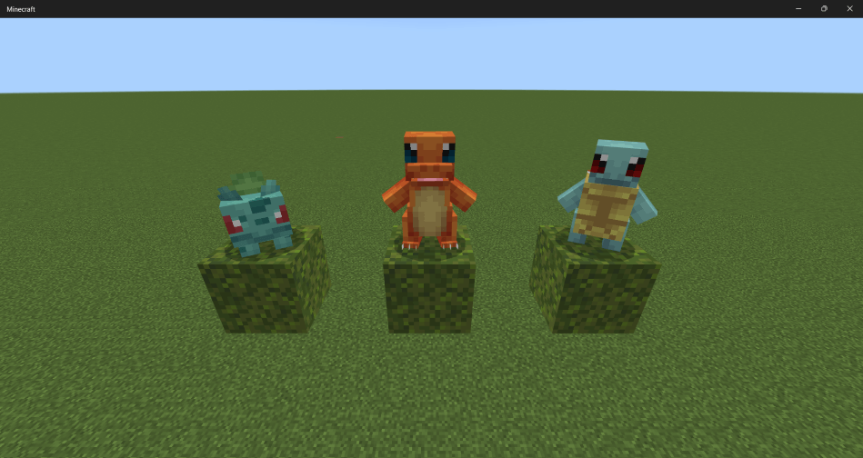

# cobblemon-bedrock
An open-source Pokémon mod ported to Minecraft Bedrock Edition.

## Installation
1. Download [cobblemon-bedrock.mcaddon](https://github.com/kirbycope/cobblemon-bedrock/releases/latest/download/cobblemon-bedrock.mcaddon) from the latest release
1. Double-click the file; Minecraft imports both packs
1. In a world's settings, turn on the Cobblemon behavior pack (it brings the resource pack with it) and load the world

Each pack's description ends with its version ("Cobblemon Behavior Pack 1.0.541"), so an older copy can be told from
the new one in the import and pack lists; delete the old ones under Settings, Storage before importing an update.

No experiments are needed: the scripts use the stable `@minecraft/server` 2.6.0 and `@minecraft/server-ui` 2.0.0,
and the packs load on a world with none turned on. The battle music is not in the add-on (it is the games' own
tracks, fetched by `tools/fetch_battle_music.py` for a local build), so battles are silent unless you build it yourself;
the release's sound definitions leave the battle music out with it, so a new world opens without content log errors.

Every screen the add-on draws (the starter screen, battles, Summary, PC, Pokedex and the rest) works with a mouse, with
touch, and with a controller: the D-pad or left stick moves between buttons, A presses and B closes. On a keyboard the
arrow keys and Enter do the same. The focused button shows its hover image; where Cobblemon draws a button's hover the
same as its plain image (48 of them, since on Java the pointer shows where it is), `port.py` brightens it or frames it
in white (`add_focus_frames`), so a controller player can see which button A will press. Every screen's
buttons name their D-pad neighbours (`focus_change_*`), since Bedrock's own guess inside a form's button panel jumps
about: `port.py`'s `add_focus_links` gives each button the nearest one in each direction, and the starter screen's are
written out by hand (it opens on "I choose you!", up reaches the starters and moves across the grid, and the page
arrows sit on its right). The battle log's expand toggle is kept out of the D-pad's way (it took the focus when a
battle screen opened) and toggles with a pointer or the controller's secondary button instead.

## Gyms and the Elite Four
Gym buildings generate in the world, and the Kanto League towers over the End islands. Each has a key trainer from
Radical Cobblemon Trainers with a full team to beat:

| Building | Where it generates | Trainer | Badge |
| --- | --- | --- | --- |
| Pewter Gym | meadows, stony peaks, windswept hills | Leader Brock | Boulder Badge |
| Cerulean Gym | beaches, warm oceans, swamps | Leader Misty | Cascade Badge |
| Vermilion Gym | badlands, savannas | Leader Lt. Surge | Thunder Badge |
| Celadon Gym | birch and flower forests | Leader Erika | Rainbow Badge |
| Saffron Gym | dark forests, cherry groves | Leader Sabrina | Marsh Badge |
| Fuchsia Gym | jungles | Leader Koga | Soul Badge |
| Cinnabar Gym | the Nether (wastes, crimson and warped forests), 32 to 70 blocks up | Leader Blaine | Volcano Badge |
| Blackthorn Gym | the End islands | Leader Clair | Rising Badge |
| Kanto League | the End islands | Elite Four Lorelei, Bruno, Agatha and Lance, then Champion Terry | |

- **On rough ground.** A gym clears the ground it is built in, cutting its room out of a hillside, and stands on
  a plinth of its own floor where the ground falls away, since Bedrock cannot reshape the terrain around it as
  Java does. Before this a gym only fitted on dead flat open ground, so the Pewter Gym practically never generated.
- **Calling the trainer.** Step on the pressure plate in a gym's doorway and its trainer appears at the far end. In the
  League, the plate on each floor calls that floor's Elite Four member (or Terry at the top), and the plate in each
  stairwell lifts you to the next floor. A League first appears as its foundations; the tower rises the moment you come
  near.
- **Battling.** Talk to the trainer to battle. A trainer sends out one Pokemon after another, picks its moves and uses
  its potions the way RCT's battle AI does, switches out when its bench rates better, and sends out the best matchup
  for your Pokemon after each faint. You can forfeit but not run.
- **Order.** Trainers must be beaten in RCT's order: Brock, Misty, Lt. Surge, Erika, Sabrina, Koga, Blaine and Clair,
  then the four Elite Four members in any order, then Terry, with RCT's other key trainers between them (Rival Terry,
  Rocket Admin Archer, Giovanni, Brendan, May and more), who wander the world rather than keep a gym. A trainer you have
  not unlocked tells you who to beat first in RCT's words, and one you have beaten says so and will not battle you
  again until it is called back.
- **Wandering trainers.** RCT's 1559 trainers spawn around you as you explore: one attempt every nine seconds, slower as
  they gather (twelve at most around a player), 25 to 70 blocks off in biomes that suit them, matched to your strongest
  Pokemon's level and to your series. They stroll, follow you while you hold a Trainer Card, and one you stare at for
  three seconds within eight blocks challenges you itself if your levels are close. They leave when nobody has seen
  them for five minutes, or nobody has been within 128 blocks for half a minute. A Trainer Spawner (stone bricks, slabs, diamonds and redstone) clicked with a trainer's
  signature item spawns that trainer for anyone who comes by, surely when powered by redstone; a Trainer Repel Rod
  (redstone torch, iron, copper) keeps them from spawning within three chunks.
- **Trainer Association.** Gym trainers only battle players in their series, as in RCT, and a series is chosen at a
  Trainer Association. Carry a Trainer Card with no series started and one comes to find you: it appears 25 to 70
  blocks away within about 20 seconds and walks to you, and the card's arrow points at it. Use it to see what it
  offers: Radical Red (the Kanto gyms and League), Brilliant Diamond/Shining Pearl, and Unbound once one of those is
  complete, each for one Trainer Card, which you get back named for the series, and a Trainer Card for a few emeralds
  and apricorns. Associations also stand about in villages, in any dimension, and one goes away once no player has been
  near it for half a minute. Once you have finished a series, an Association also offers Freeroam: a
  break from the series with no level cap, until you choose the series again and carry on where you left off.
  Starting a series again from the beginning resets its progress.
- **Level cap.** Starting a series puts you on the challenge, and from then on you have a level cap. It is the
  level of the strongest key trainer you can face next, and never below 15: 15 for Brock, then RCT's steps through the
  rival and Team Rocket fights up to Misty's 27 and on through the leaders to the League's 85, and no cap once the
  series is complete. Your Pokemon gain no experience past the cap. A trainer refuses to battle while any Pokemon in
  your party is over it.
- **Badges.** Each gym leader gives their badge the first time you win. A badge is kept on death, like the Party
  item: it is handed out once and nothing crafts another.
- **Trainer Card.** RCT's Trainer Card, crafted from a name tag, a glass pane and redstone in a ring of paper. Use it,
  into the air or at a block, to see your series, your level cap (none until you start a series, then 15), how many gym trainers
  you have beaten, and your series' trainers in order of their level, sixty to a page: a beaten one by name, the next
  one to beat as "??? (next Leader)", the rest as ??? with their type's mark; the top button cycles RCT's type filter
  (all, Leader, E4, Champ, Rival, Team Rocket and the rest). Pick one to see its type, the level cap it needs and
  gives, who comes first, the biomes it spawns in and its signature item (RCT's Spawning page), and its team once
  beaten. Held, it shows an arrow above the hotbar pointing at the next trainer you can battle (it spins when they are
  in another dimension), or, with no series started or your series finished, at the nearest Trainer Association, and
  the card glints while it has something to point at.
  Each gym remembers where its trainer stands once a player has been within about 64 blocks of it (Bedrock only
  sees that far), so the arrow points at the nearest such gym before anyone has called its trainer out; a gym nobody
  has been near cannot be found. A gym is noticed on a random tick of its marker, which can take minutes, so while the
  card is held in a series with no gym known it also searches the blocks within 32 of you every five seconds: walk up
  to a gym with the card in hand and the arrow comes within a few seconds.
- **Calling a trainer back.** The button under a gym's sign calls its trainer back for one type gem from your
  inventory, the gem the sign names (a Rock Gem for Brock). The trainer called back is a fresh one, as in RCT: it
  battles you again even though you beat the last one, drops its loot again (the badge only comes the first time), and
  refuses after it has beaten you three times until called back once more. A gym's trainer leaves as a wandering one
  does, when nobody has seen it for five minutes or come within 128 blocks for half a minute, and the button calls it
  back. Trainers rest 12 seconds after a battle,
  twice as long after each one in a row. The display cases in each gym hold an item from Radical Gyms (a Metal Coat in
  Pewter, a stone in most, medicine in the League), and no monsters spawn inside the buildings.

The buildings are furnished with CobbleFurnies furniture: sofas, stools, chairs, tables, lamps (lit ones give light),
cabinetry, curtains you can open (both halves together), plants, the ancient statues, a TV and Poke Wool. These blocks
also turn up in the creative inventory under Construction. A click sits you on a sofa, stool or chair (a comparator
reads 15 while it is taken), switches a lamp (redstone lights it too) or turns the TV's channel. A Furni Crafter
(shears and an iron axe over two planks) lists what furniture you can make from your inventory, as CobbleFurnies'
does, and the Poke Wool carpets come from the crafting table.

## Building the add-on
`cobblemon-bedrock.mcaddon` is built from the repository, never assembled by hand, and published as a release asset
(it is over GitHub's 100 MB limit for a file in the repository, so it is git-ignored). Pushing a
version tag runs `.github/workflows/release.yml`, which builds it with `tools/build_addon.py` and attaches it to the
release; the workflow can also be run by hand from the Actions tab with a tag. Locally:

```powershell
git tag v1.0.339; git push origin v1.0.339   # publishes the release through the workflow
python tools/build_addon.py                   # writes cobblemon-bedrock.mcaddon here, for testing an import
python tools/build_addon.py --check           # non-zero when the archive on disk is stale
```

The archive holds `cobblemon_behavior_pack/` and `cobblemon_resource_pack/` at its root, each with its `manifest.json`
directly inside, and only the files git tracks under `development_behavior_packs/cobblemon` and
`development_resource_packs/cobblemon`, so the battle music and the hub's generated functions stay out as they stay
out of git, and `sounds/sound_definitions.json` goes in without the sounds whose files stay out. Entry names use forward slashes, images and sounds are stored and the rest deflated, with no zip64 and a
fixed timestamp so a rebuild of the same files is byte for byte the same. Run `python port.py --fix` first when the
packs need regenerating; the release tag is the manifests' version, which `port.py` bumps.

The download is kept small without changing what the game sees. The build writes every JSON file without its
indentation (the packs unpack about 150 MB smaller), re-encodes every PNG with Pillow's optimizer where that comes out
smaller and decodes to exactly the same pixels (the workflow installs Pillow; without it the PNGs go in as they are),
and leaves out any texture nothing names (a layer only ever composited into an icon, Spinda's spot pieces), keeping
every texture under `textures/ui/` and `textures/font/` whatever, since the scripts finish UI texture names at run
time and the game finds a glyph sheet by its file name. `port.py` copies each Cobblemon sound file once, however many
species name it (one ambient sound serves 1,170 of them), and re-encodes the cries in mono Vorbis at quality 0 and
32 kHz (`CRY_ENCODE`) where that is smaller, about half of Cobblemon's 48 to 128 kbit/s; it needs `ffmpeg` on the
path and copies them as they are without it.

### Block permutations

Every block state multiplies its block's permutations (a 14-value state, a 16-value state and a facing make 896),
and Bedrock builds every one for each world the pack is in. Past 65,536 the server warns that performance degrades.
Releases 1.0.556 to 1.0.558 reached 194,885 with a few new states (the Monitor's disc and signal, the Poke Cake's
tint, the campfire pots' redstone and cooking): opening a world took the server five times as long and nearly twice
the memory, and players on phones could no longer load their worlds. 1.0.559 is back to 42,053.
`tools/check_block_permutations.py` counts them; `port.py` runs it before bumping the version and stops over the
budget, and the release workflow runs it before building, so a release over it fails. A value only the script needs
(a pot's last redstone power, a pot's cooking progress) belongs in the script, not in a block state.

```powershell
python tools/check_block_permutations.py            # the total and the heaviest blocks; exit 1 over 65,536
```

## Important Links
- https://gitlab.com/cable-mc/cobblemon
    - Entity animations, models, and textures. The port is built from Cobblemon 1.8.4 (the `1.8.4` tag), checked out
      in the git-ignored `java/`; the published jar (Modrinth's `1.8.4F`) supplies what the source tree lacks.
- https://www.curseforge.com/minecraft/data-packs/cobblemon-legendary-encounters
    - Legendary Encounters by Yağız (kurbagayagiz), MIT: the legendary and mythical spawns, in `legendary_encounters/`. Its MIT notice ships in the add-on as the behavior pack's `LEGENDARY_ENCOUNTERS_LICENSE.txt`, written by `port.py`.
- https://modrinth.com/datapack/radical-gyms-cobblemon
    - Radical Gyms & Structures by JayOnline, MIT: the nine gym and League buildings and where they generate, in `radical_gyms/`. Its MIT notice ships in the add-on as the behavior pack's `RADICAL_GYMS_LICENSE.txt`.
- https://gitlab.com/srcmc/rct/mod
    - Radical Cobblemon Trainers by HDainester, Mod Community License (MCOML): the 14 gym and League trainers' teams, bags, order and skins, the Trainer Card's icon, and the Trainer Association's texture, series and text, in `rct_trainers/`, and the battle AI, level cap, progression rules and Trainer Association the script re-implements. That data stays under the MCOML in the add-on (`scripts/rct_trainers.js`, with the licence as `RCT_LICENSE.txt`); the changes are listed in `rct_trainers/README.md`.
- https://modrinth.com/mod/cobblefurnies
    - CobbleFurnies by LunazStudios, MIT: the furniture in the gyms, converted from its models and textures (All Rights Reserved), which `port.py` reads from a git-ignored clone at `java_cobblefurnies/`. It is credited, as its README asks, in the behavior pack's `COBBLEFURNIES_CREDITS.txt`.
- https://modrinth.com/mod/cobblemon-pokemon-badges
    - Cobblemon Pokemon Badges by Jamesssssssssssssss, designs by SireSolo: the eight badge icons and names (All Rights Reserved), read from the mod's jar in the git-ignored `java_badges/`. Credited in the behavior pack's `BADGES_CREDITS.txt`. Which leader gives which badge follows RCT's badge datapack by hd42.
- https://pokemondb.net/sprites/
    - [Spawn Egg] Item textures
- https://learn.microsoft.com/en-us/minecraft/creator/documents/gettingstarted?view=minecraft-bedrock-stable&tabs=Windows10#installing-extensions
    - VS Code extensions

## Porting From Cobblemon
The script [port.py](/port.py) handles copying the assets and creating the Bedrock-exclusive files.

[PARITY.csv](/PARITY.csv) lists everything Cobblemon has, one row each, with where it comes from, where the port has
it, and whether it is done, partial, missing or n/a, and why. `python tools/parity.py` writes it from Cobblemon's own
source: every item, block and entity in its lang file, every sound event, species, Showdown move, ability and held
item, every GUI class, command, keybind, data folder and config option, and each "Not carried" note in the table
below. Run it after a change to see what is left. Where a status is a heuristic (a move whose effect lives in code
counts as done when the battle script names it), its comment says so.

Cobblemon itself never spawns a legendary or mythical Pokemon. The Legendary Encounters datapack's spawn pools
(`legendary_encounters/spawn_pool_world/`, MIT) are read alongside Cobblemon's own: ultra-rare natural spawns in
fitting biomes, some only by day or at night, at levels 50 to 90. Of its 53 species, the 18 Cobblemon has models for
spawn here: Articuno, Zapdos, Moltres, Mewtwo, Mew, Lugia, Ho-Oh, Latias, Latios, Rayquaza, Regirock, Regice,
Registeel, Regigigas, Regieleki, Regidrago, Xerneas and Eternatus; the rest (Groudon, Kyogre, Dialga and the others)
have no model in Cobblemon to draw. Its biomes are vanilla ones, mapped through the server's own biome tags
(`tools/bedrock_biome_tags.py` writes `tools/bedrock_biome_tags.json` from the Bedrock Dedicated Server's
`behavior_packs/vanilla*/biomes`). Bedrock's spawn rules have no weather filter, so a spawn that needs a weather (Zapdos
and Rayquaza in a thunderstorm, Ho-Oh in clear skies) fires an event as it spawns that tests `weather_at_position` and
despawns it in the wrong weather; `Dimension.getWeather()` answered Clear well into a thunderstorm, so the script does not decide.

Cobblemon's Blockbench exports carry things Bedrock's content log rejects (a `geckolib_format_version`
key, `NaN` and unary `+` in Molang, animation names with spaces or parentheses, catmullrom keyframes on
Molang values, models named `geometry.unknown`, Cobblemon-only queries such as `q.r.velocity_y`), so the
port fixes them after copying and names each model after its file. `python port.py --fix` runs only those fixes and regenerates the animation
controllers and client entities, without downloading anything. It keeps what a full run makes once for each copy of the models, the spread layers, the held item quads and the portraits, so a change to any of those needs a full run, and it spreads again the folders it copies afresh every time (the Poke Balls, NPCs, fossils and gilded chest); run on packs it has just made, it changes nothing but the version.

Cobblemon names a species' animation file after the model rather than the dex slug, so the plain name is
often absent: Ho-Oh's is `ho_oh.animation.json` and Kommo-o's `kommo-o.animation.json`, and a species whose
forms each have their own model (Kadabra, Sawsbuck, Lycanroc, Gimmighoul) has one file per form and no plain
file at all. The port resolves it the way it resolves the geometry, the plain name then male then female then
the first, so the animations describe the model the client entity renders. A species with no client entity is
invisible in the world, a black square in the creative menu, and falls back to its spawn egg for the party and
PC portrait, so `check_pokemon_complete` runs at the end of every port and names any Pokemon missing a client
entity, render controller, spawn egg or behavior. Every run bumps the pack version in both
manifests, because the client caches the pack the server sent it by version; `python tools/deploy.py`
then writes that version into the server world's pack lists and restarts the server. It runs the server under
`tools/bds_host.py`, which gives it a console that `bds.cmd` in the server folder types into, so a restart sends `stop` and
the world is saved; killing the server instead loses everything since the last autosave, Pokemon's properties and the
player's inventory with it.

Stop the server before porting. The packs reach its world through junctions, so a running server holds their files
open, and a folder the port generates in full cannot be emptied: the run dies part way through and leaves the pack
half written, which looks like a content bug rather than a locked file (one such run left 560 of 913 render
controllers). The port refuses to start while `bedrock_server.exe` is running and says so; `PORT_IGNORE_SERVER=1`
overrides it for a server that is not serving this repository's packs.

### What the port generates from Cobblemon's data
The Wolf-based templates are gone. `port.py` keeps a sparse clone of the Cobblemon repository in
`java/` (git-ignored; only the data, bedrock asset, lang, sound and Pokemon texture folders)
and generates every Bedrock file from it. The game's own tags that Cobblemon's data names (`#minecraft:dirt`,
`#minecraft:logs`) are read from the Java client of the release Cobblemon is built for, 1.21.1, which the port fetches
from Mojang into `java/minecraft/` once, since later releases change them (26.1's `#minecraft:dirt` has no grass or
podzol), and Bedrock names are checked against Mojang's block list (`tools/check_structures.py`):

| Generated | From |
| --- | --- |
| `entities/<id>.behavior.json` hitbox, scale, health at its lowest spawn level, movement set (walker, bird, hoverer or fish, from `behaviour.moving`, moving at 0.6125 of its walkSpeed, 0.35 unless said, or for a flier of its flySpeedHorizontal, 0.3: PokemonMoveControl's movement 0.7 times the wander's 0.35 times 2.5; it wanders to a new spot about every 220 ticks, WanderTaskConfig's chance of 1 in 120 a tick after its 100 tick path cooldown, a hoverer within 10 blocks across, 5 up or down and 0 to 6 off the ground, and one swimming under water one tick in 60 within 10 across and 7 up or down; as in Cobblemon's `pokemon_no_underwater.json`, only a Pokemon that cannot breathe under water floats at the surface, while one that can swims under it: a walker with the turtle's amphibious set, and a flier such as Dragonite or the Tynamo line by swapping its flight for that set while its head is under water and nobody rides it, `scripts/main.js`'s `swimOrFly`), fire immunity (Pokemon.isFireImmune: a Fire type, a lava swimmer or `fireImmune`), no freezing in powder snow for an Ice type or a `freezeImmune` species (canFreeze), no lightning damage for a Ground type or a Pokemon with Lightning Rod, Motor Drive or Volt Absorb (thunderHit; the three gain Strength II, Speed II or a heal from the strike and no fire is lit where they stood, `scripts/world.js`), lava walking for the `canWalkOnLava` species and lava pathing for the `canSwimInLava` ones (`add_world_rules`, the strider's components), an ambient cry every 54 seconds (ambientPokemonCryTicks 1080), an animal's experience orbs when a player kills a wild one (dropExperience), a lead for any Pokemon (canBeLeashed; a stranger's lead drops from an owned one), no Name Tag renaming (NameTagItem's CANNOT_HAVE_NAME_TAG holds Pokemon), its wild behaviours (below), its types as `type_family`, and a transformation event for each of its evolutions | `data/cobblemon/species` and `spawn_pool_world` |
| wild behaviours, `port.py` (`add_wild_behaviours`): Cobblemon's `pokemon_non_party.json` brain, as component groups that come and go with `cobblemon:wild`, so a Pokemon in a party or released has none. Panics (willFlee without willDefendSelf, the default): hurt by a player or mob it runs at 0.7 and then avoids that attacker 9 blocks out for as long as the attacker lives and stays in its dimension (FleeFromAttackerTask renews avoidDurationTicks 600 every tick while HurtBySensor keeps HURT_BY_ENTITY; `scripts/main.js` calms it once the attacker is gone, with a 10 minute timer behind that), and the villager hostiles always. Retaliates (willDefendSelf, and every wild alpha whatever its species does, in a `cobblemon:alpha_retaliates` group `makeAlpha` turns on): it targets whoever hurt it and walks at 0.5 to hit them in melee every second within 0.75 blocks; a battle takes this away until it ends. Herds (herd.toleratedLeaders, a leader named alpha such as "kadabra alpha" only while it is one): a herd spawn's first member leads and the rest follow it, half of any other spawned follow, and a follower goes after the highest tier leader within 16 blocks at 0.4, stopping 6 blocks off (the far edge of the spot FollowHerdLeaderTask walks it to); a follower never leads, and roles stay as spawned, since follow_mob cannot re-elect a leader as FindHerdLeader and MaintainHerdLeader do. Picks up items (itemInteract.desiredItems, and the fox food for a fox): walks at 0.6 to a wanted item within 7 blocks, takes it and eats it 3 seconds later; a fox also raids sweet berry bushes and glow berries. Looks around (moving.canLook): looks at the nearest player or mob within 15 blocks for 4 to 8 seconds (look_at_entities has no type filter). Breaking out of a ball does not make it wary: PokemonBrain.onCaptureFailed sets avoid_target, but no behaviour in 1.8.4 moves a Pokemon into the avoid activity, so the `cobblemon:wary` group (avoiding players for 5 to 20 seconds, 15 blocks off at 0.55) is kept but never sent. Hunts (TargetEntityTaskConfig): Pidgeotto goes for a Magikarp with air above it within 24 blocks, as Seviper and Zangoose go for each other (`PREDATORS`). Not ported: eating grass, the bee pollination, Peaceful-mode rules and pasture behaviours | `behaviours/*.json`, `pokemon_non_party.json`, `pokemon_core.json`, `CombatBehaviour.kt`, `HerdBehaviour.kt`, `ItemBehavior.kt`, `MoveToItemTaskConfig.kt` |
| drops, `scripts/data.js` (`drops`): a wild Pokemon that dies, or is beaten in battle, drops its held item and its species' drops by Cobblemon's DropTable.getDrops: an amount from the table's range, each attempt taking the first entry in order whose percentage passes (an attempt where none does still counts), each entry at most its maxSelectableTimes, dropped where the Pokemon was in its quantityRange (defaultDropItemMethod ON_ENTITY); a fishing bait's drops reroll rolls the table twice. A wild Pokemon a player kills also drops an animal's experience orbs, 1 to 3 (PokemonEntity.dropExperience, `minecraft:experience_reward`). The Bedrock loot tables (`loot_tables/entities/<id>.json`) are left empty, since a loot table cannot pick the first passing entry attempt by attempt; entries whose item the packs lack are left out, and a vanilla item goes by Bedrock's id (a Lotad's lily pad is `waterlily`, a Dwebble's terracotta `hardened_clay`, a Phantump's jack o'lantern `lit_pumpkin`, a Bramblin's dead bush `deadbush`), every one checked against the server's item catalogs and the packs' items and blocks | the species `drops`, `DropTable.kt`, `ItemDropEntry.kt`, `PokemonServerDelegate.doDeathDrops` |
| `spawn_rules/<id>.json`: where and how often a Pokemon appears in the wild. Each Cobblemon spawn entry becomes one condition: its biome tags translated to Bedrock biome tags (`BIOME_FILTERS` in `port.py`), surface, underground or underwater from the position type and `canSeeSky`, and the sky light and time of day by Bedrock's brightness, which is not the same thing: Cobblemon's sky light is the open sky over the spot (the SKY layer's raw value), which night does not dim, while Bedrock's brightness is the light there now, which it does (vanilla's cow, 7 to 15, never spawns on the surface at night, its zombie, 0 to 7, does). So a night, midnight or dusk spawn asks for 0 to 7 (the 7 to 7 it was given before let no night spawn through, Abra and Hoothoot among them), a day spawn 8 up, an untimed spawn under the open sky (minSkyLight 8, most of them) no brightness at all, so it comes by night as by day as in Cobblemon, and an untimed land spawn never under it (maxSkyLight 7) spawns underground only. An entry whose preset asks more than biomes (SpawnDetailPreset.apply merges it in: urban's concrete nearby, a pyramid's or redstone's blocks, a nether fossil; 257 entries) is no spawn rule but the script's spawner's, which tests what it needs, so Lillipup, Trubbish and Sigilyph (urban, or a village) no longer spawn in open plains; a preset's biomes join the entry's, so salt's and webs' (other mods' biomes only) leave an entry naming none of its own nowhere. Its anticondition's biomes are left out (Clefairy's spooky ones), isRaining and isThundering go through the weather event described below (the Legendary Encounters datapack's `"weather"` key is no SpawningCondition field, which Cobblemon's loader passes over, so its Zapdos and Rayquaza spawn in any weather, there and here), a slime chunk entry (Ditto's, the Goomy line's) through `cobblemon:spawn_slime_chunk`, on which the script takes the Pokemon away outside one of Bedrock's slime chunks, `minY`/`maxY` as a height filter, and herd size from the species. A Nether biome spawns underground whatever its position type says, because the Nether has no sky and a surface-only rule can never fire there (every vanilla Nether mob spawns underground, Hoglin and Strider included), and a water spawn takes vanilla's density limit so it cannot fill every shore. Weights are normalised rather than carried over: Cobblemon rolls a rarity bucket first (common 94, uncommon 5, rare 0.5, ultra-rare 0.2, boss 0.3 for the alpha herds) and then picks within it by weight, so a raw weight only means anything among the spawns eligible at one spot, while Bedrock makes one weighted pick across the rules that hold there. So a condition's weight is its bucket's share of a spot's pool of 50,000 (`SPAWN_POOL`) times its raw weight over the raw weights of its bucket's conditions in its biomes (each biome's sum, averaged over its biomes), capped at 10,000: in the plains at noon Rattata is 6.3 percent of the pool against Cobblemon's 5.9 (88 of the common bucket's 1,396 there), and the herds' first members 55 percent against Cobblemon's 53 (just under 40 percent over the whole land pool). A species' conditions that come under 1 in one bucket (the rare and ultra-rare ones, the legendaries) are one condition where only their biomes differ, and one still under 1 carries the least weight a rule can, 1, and fires a weight multiplier's event with a top of 1 over its share, so the script keeps that share of its spawns and a legendary comes about as often as in Cobblemon, a few in a million spawns (0.7 to 4 times, against 4 to 72 at a bare 1). A fixed total per species and bucket (common 240), as it was until November 2026, made a Rattata no likelier than a Hawlucha (0.3 percent of the plains each); one total split across buckets by raw weight, before that, handed Tsareena's alpha herd (boss, raw 100) a weight of 60 against 19 for its common spawn (raw 0.1): alpha herds came six times as often as Cobblemon's boss bucket has them and the species was rarely met on its own, which is what issue 61's "too many herds" was. Carried over unchanged, Dratini's two ocean-ruins entries (weight 4500, where the median entry in the game is 16) made it 62 percent of the `water_animal` pool on their own, and the heaviest five species 85 percent of it, which is why the same few Pokemon kept turning up; `check_spawn_balance` now fails the port if any species takes more than a fifth of its pool, or a weight leaves the 1 to 10,000 band (times a multiplier condition's top). A regional form's own entries ("rattata alolan", 47 species) spawn that form: their herd event, `cobblemon:spawn_form_<form>`, sets the form and rolls its gender and shininess again. A wild Pokemon's level is rolled evenly in its natural spawn entries' range (the chosen entry's own levelRange, and a species' natural entries all share one; a herd's, a fishing or a snack-only entry's levels do not widen it), whatever the nearby party: PlayerLevelRangeInfluence narrows it to the player's levels, but PokemonSpawnAction.createEntity rolls levelRange.random() over it, so in Cobblemon 1.8.4 the party changes nothing. A script that spawns a Pokemon (fishing, a Poke Snack, fossils, the starter) sets its own level. Herds (`spawn_pool_world/herds`, PokemonHerdSpawnDetail) spawn as in Cobblemon: a herd's first member, a leader where the herd has one (Charmeleon or Charizard over Charmanders) and otherwise a follower, spawns naturally with the herd's conditions and its share of the herd's weight, and fires `cobblemon:herd_seed`; `scripts/main.js` then rolls one herd level in the herd's range and fills the herd about it to its size (at most 8, maximumSpawnsPerPass), each member by weight up to its maxTimes, at the herd's level clamped to its own range and moved by its offset (`scripts/herds.js`), each on a block of its own within 6 blocks that passes the herd's conditions and its position type (seafloor, surface or submerged as Cobblemon's calculators tell them); a member with its own dropTable drops that instead of its species' table. A seed none of whose herds is allowed where it stands (their biome, height, light or sky) goes. A herd's moon phase (SpawningCondition.moonPhase: Basculin's stripes each under their own moon, Clefable's alpha herd under a full one) a seed's spawn rule cannot test, so a seed with no herd under this moon goes, as Cobblemon would not have spawned it. An entry only a Poke Snack draws (`isPokeSnack`, 577 of them) never spawns singly in the wild, as in Cobblemon, where the species they cover (Pidgey, Starly, Bidoof, Magikarp and 195 more) come in herds. Alpha herds (959 of Cobblemon's 1,107 boss-bucket herds, the rest needing biomes Bedrock has no match for) spawn too, at the boss bucket's 0.3 against common's 94: the first member seeds with an event of its own, so its herd is filled from the alpha herds only, and the leader is made an alpha holding its gem ("venusaur held_item=cobblemon:grass_gem alpha=true"), matching its level to the nearest player as every wild alpha does. An entry naming a species feature's choice spawns that look ("flabebe flower=blue", "vivillon vivillon_wings=polar", "magikarp magikarp_jump=calico-orange-gold"), the property read through the feature's aspect format to the form event that look rolls gender and shininess in: 958 such entries. Cobblemon's weight multipliers (SpawnDetail.weightMultipliers) apply where the script draws a spawn, a Poke Snack's, a rod's and the spawner's for blocks and villages: a snack doubles or adds a quarter to the spawns that favour it, the time of day, thunder and the full moon weigh others, and a rod's lure level takes a fish from 0.6 to 5 times. The natural spawns follow their multipliers too, though a Bedrock spawn rule's weight cannot change with them: a condition with multipliers on the time, the weather, the moon, the biome, blocks nearby, the light or a village or Cobblemon structure spawns as often as they can make it, every multiplier over 1 at once, and its spawn fires `cobblemon:spawn_mult_<n>`, on which the script keeps it in the share the multipliers that hold now give (`scripts/spawn_multipliers.js`), so a Vulpix comes two and a half times as often at twilight as otherwise and a spawn a thunderstorm makes a quarter as likely is thinned to a quarter in one. A condition whose spawn fired an event of its own (a form's, a weather check's, a herd's first member) fires the multiplier's instead, which does what its own did, and the script then answers the original (filling the herd). The same event carries what else a rule cannot test (`scripts/spawn_checks.js`, main.js's `entryHolds`): the condition's anticonditions (SpawnDetail.anticonditions, the spawn's own and one from each of its presets, any one of them holding whole, every field at once, taking the spawn away: the wild preset's village with concrete about it, a cove's floors between its heights, Stonjourner's henge at dusk), its block light (minLight and maxLight: Venonat and Mothim by a light at night, Misdreavus and Morelull in the dark), its x bounds (minX and maxX: Shellos' and Gastrodon's East Sea from x 0, the West Sea west of it) and its own drop table (PokemonSpawnDetail.drops, 39 entries: the Nether's Gastly drops ghast tears and spell tags, the End's Elgyem ender pearls and chorus fruit), which the Pokemon keeps and drops instead of its species'. The natural preset's block beneath (neededBaseBlocks, `#cobblemon:natural`: grass to deepslate, the ores, snow, ice, terracotta, moss and nylium, never farmland) is the rule's `spawns_on_block_filter`, so nothing spawns on a built floor. Not carried: entries for properties the port has no look of its own for (Arbok's patterns), which spawn as the species; the foliage preset's leaves nearby (Burmy, Scatterbug, Caterpie spawn on grass without them); a dusk spawn's hour, which takes the night's dark instead; the time of a spawn underground; a `region_bias` entry marks the Pokemon with its bias (see evolution) | `spawn_pool_world`, `spawning/best-spawner-config.json` |
| name label, `scripts/main.js`: PokemonRenderer.renderNameTag's label over the Pokemon a player looks at, the name (the nickname, or "???" while that player has not registered the species) and "Lv. N", with "Press Use to battle." under a wild Pokemon until the player's first win. It is the entity's own name tag, which a Pokemon can carry now that it is no longer an NPC; a Name Tag item does not rename it, as NameTagItem's CANNOT_HAVE_NAME_TAG refuses a Pokemon (`allow_name_tag_renaming` off) | `PokemonRenderer.kt`, lang `ui.lv`, `challenge_label` |
| interact wheel, `ui/server_form.json`, `textures/ui/cobblemon/interact/`: sneak and right-click on one of your own Pokemon, whatever is in hand, opens InteractWheelGUI's wheel on Cobblemon's base, buttons and icons at their positions, with the hovered option's name in Java's tooltip beside it (InteractWheelButton; an option not offered shows none). Held item (north) gives the item in hand or takes back what it holds, offered only when there is something to give or take; Ride (west) mounts a rideable Pokemon; Shoulder (north-west), offered for species whose form is shoulderMountable, has the Pokemon hop at the player and sit on the free shoulder, the left first, in its shoulder pose (PokemonEntity.tryMountingShoulder), on Bedrock's own two parrot shoulder seats; it comes off as a parrot does in Java, when the player falls more than half a block (so a jump drops it), is hurt, goes into water, sleeps or flies. The port puts Summary east and Stay or Follow south. Each button's icon is drawn onto its texture by `port.py`, one per place, icon and state, since a form button carries a single texture. A plain right-click on a wild Pokemon with an empty hand starts a battle. Change cosmetic item (north-east) puts on a cosmetic item for the 36 species Cobblemon's `cosmetic_items` data dresses (Pikachu's caps and Detective hat, Conkeldurr's concrete, Timburr's and Komala's logs, Smeargle's dyes, Gholdengo's chests and the rest, a tag's items each), offered when the item in hand is one it can wear or it wears one and the hand is empty: the item is used up and the Pokemon takes the look its aspect gives, the variant with that form and its own gender and shininess (the looks the resolvers already have); another wearable item swaps for it, an empty hand takes it back and the plain look returns, with Cobblemon's messages. The item stays with it through the PC, trades and evolution (`scripts/cosmetics.js`, written by `port.py`). `/execute as <pokemon> run scriptevent cobblemon:wheel` opens a Pokemon's wheel for its owner, for testing. The Summary and the PC carry Cobblemon's held and cosmetic item toggle (the SummaryButton beside the item slot), which shows the cosmetic item's icon, its name as the tooltip and "Cosmetic Item" in the slot instead, each item's icon written by `port.py` (the gilded chests' cut from their chest texture) | `InteractWheelGUI.kt`, `PokemonEntity.showInteractionWheel`, `PokemonEntity.tryMountingShoulder`, species `shoulderMountable`, `textures/gui/interact` |
| battles between players, `ui/server_form.json` (`cobblemon_challenge`), `textures/ui/cobblemon/request/`: the player wheel's Battle (north) opens BattleConfigureGUI on the other player, on Cobblemon's `interact/request` textures: "Battle Request", the Single Battle tile with its overlay blinking, the level rule between its arrows (Anything Goes, Level 50, Level 100, Level 5, BattleConfigureGUI's levelRulesetOption), the target's name and Challenge. The challenge goes to the other player (ChallengeManager: "You challenged ... to a Single Battle.", "... challenged you to a Single Battle!"), refused past 32 blocks (battlePvPMaxDistance) or when either has no Pokemon, and times out after 20 seconds (closing the receiver's Battle Request if it is still open); the Battle Request with Accept and Decline opens for the other player as the challenge arrives (Cobblemon's toast and respond keybind, which a pack cannot add; a client may not draw the chat line at all, and a player holding a block cannot open the wheel on another player, since Bedrock takes that use as placing the block), and while it is pending their wheel shows Battle with the exclamation and opens it again. Their Battle Request has Accept and Decline, two buttons side by side that a controller moves between (Accept once shared the Challenge button, which lay over Decline, so a controller could only reach Decline). `/execute as <player> run scriptevent cobblemon:challenge_test` opens a Battle Request from a stand-in challenger, to try them with one player. The battle is the same engine and screen as against a trainer, run for both sides: each player sees their own Pokemon on the left with its health in numbers and the other's on the right as a share, the trainers' names over the tiles, and Fight, Switch and Forfeit; the turn resolves once both have chosen (medicine used from the minimised screen is a choice too), "Waiting for ..." showing on the side that has chosen; switches go first, then the moves by priority and speed. A fainted Pokemon gives the other side's party experience once the battle ends and its side is out of Pokemon (Cobblemon's allowExperienceFromPvP is on and awardExperienceOnBattleLoss off), its trainer picks the next while the other waits, and the side out of usable Pokemon loses ("... is out of usable Pokémon!", "... won!"), as forfeiting does; a player leaving the game ends the battle as Showdown's forcetie (BattleRegistry.onPlayerDisconnect), no one winning and nothing said of a win, the other player's screen closing, and the same for a wild or trainer battle, whose wild Pokemon heals and is freed and whose trainer rests, none left frozen. A level rule battles clones (BattleBuilder.pvp1v1's clone and heal): every Pokemon fights at that level from full health and keeps nothing from the battle, and no experience is given. `/execute as <player> run scriptevent cobblemon:accept_challenge` accepts the challenge waiting for that player, for testing. The format arrows page through Single Battle, Double Battle and Triple Battle (BattleConfigureGUI's pages), and the challenge names the format; a Double Battle between players runs as the next row describes against a trainer, both players picking for their two Pokemon at once, "Waiting for ..." on the side that has chosen, each side's fainted Pokemon giving the other side's Pokemon in battle experience, both trainers picking replacements at the same time, and the side with nothing left losing; each player's screen shows their own two Pokemon on the left. A Triple Battle between players runs the same way with three a side (see the triple battles row). A pending challenge shows ClientPlayerIcon's exclamation over the challenger's head for the challenged player alone, fading out and back in over its last five seconds (`scripts/request_icons.js`). Not carried: Multi and Royal Battles, which need four players (the arrows skip them) | `BattleConfigureGUI.kt`, `ChallengeManager.kt`, `BattleBuilder.pvp1v1`, `textures/gui/interact/request`, lang `cobblemon.challenge.*` |
| double battles, `scripts/main.js` (`startDoubleBattle`, `doubleTurn`, `resolveDouble`), `ui/server_form.json` (`compact_*`, `target`): BattleTypes.DOUBLES, two Pokemon a side. `/scriptevent cobblemon:battle_format doubles`, run by a player looking at an NPC trainer (or standing within 8 blocks of one), makes it fight Double Battles, as a Cobblemon NPC does when its battle script calls `start_battle` with the `doubles` format (BattleFormat.GEN_9_DOUBLES); `singles` puts it back. The trainer sends out its first two, the player their selected Pokemon and the next able one, side by side. Each of the player's Pokemon picks Fight or Switch in turn, its condensed tile's role strip lit (BattleOverlay draws a Double Battle's four tiles condensed, the player's down the left and the trainer's down the right), and a move with one target opens BattleTargetSelection: the trainer's two over the player's partner, the ones the move can be used on lit, an arrow at the one hovered; a move at any adjacent Pokemon can go at the partner. The trainer's AI picks a move for each of its own. Every move then goes in priority and speed order across all four; Rock Slide, Earthquake, Surf and the other moves at all adjacent foes, or everything adjacent, hit each target for three quarters of their damage (Showdown's spread modifier), Earthquake hitting the partner too; a move at a foe that fainted earlier in the turn goes at the other one. Screens, hazards and the other side conditions cover both Pokemon of a side, and weather, status damage and held items run for all four at the end of the turn. A fainted foe is replaced from the trainer's bench, a fainted Pokemon of the player's from the party, and the side with nothing left loses. Intimidate, Supersweet Syrup and Frisk reach both foes, and Download weighs both foes' defences. Helping Hand (+5 priority, the partner's move at one and a half times), Aromatic Mist, Coaching and Dragon Cheer work on the partner and fail in a Single Battle, as in Showdown; Howl, Life Dew and Jungle Healing work on the user and its partner. A trainer switches when its AI chooses to, before the moves. Follow Me and Rage Powder (+2 priority) make the user the center of attention for the turn, drawing the foes' one-target moves to it (Rage Powder not from a Grass type, an Overcoat Pokemon or one holding Safety Goggles), and Spotlight does the same to its target; a Stalwart or Propeller Tail attacker keeps its move on the Pokemon it picked. Ally Switch (+2 priority) trades the user's place with its partner's, so a move aimed at a place hits whoever stands there now, and used again the next turn it works one time in three, then one in nine, as Protect does. All four fail in a Single Battle. Elite Four Lorelei fights her gym battle as a Double Battle, as RCT's GEN_9_DOUBLES format has her do. Every screen works on a controller: the D-pad moves between Fight, Switch and Forfeit, the moves (the PP padded to five characters, since a one-digit "5/5" was a JSON UI parse failure on every move button; the focused one framed in white, since Cobblemon's slight brightening cannot be told apart among four coloured tiles), the four target tiles (each showing its arrow when focused) and the party, A picks, B steps back from the target picker or the party (and minimises the battle from its first screen), and sneaking (the right stick) brings it back; a whole turn, a switch and a forfeit were played on an emulated Xbox controller, and so were a turn, a replacement and a forfeit of Lorelei's battle, Follow Me drawing a foe's Tackle and Ally Switch trading two Pokemon's places. A Double Battle between two players (the PC and a second Windows laptop, each on an emulated Xbox controller) was played to its end: the challenge with the format arrows set to Double Battle, the receiver's Battle Request opening by itself, Follow Me drawing both foes' moves, simultaneous replacements after both of one side's Pokemon fainted, a target that fainted earlier in the turn passing to the other foe, each player seeing their own Pokemon on the left, and the win. Not carried: Multi and Royal Battles, which need four players | `BattleTypes.kt`, `BattleOverlay.drawTile` (isCompact), `BattleTargetSelection.kt`, `MoveTarget.kt`, `NPCServerDelegate` (`start_battle` with a format) |
| triple battles, `scripts/main.js` (`adjacent`, `shiftToCenter`, `autoCenter`), `ui/server_form.json` (`compact3_*`, `target3`, `shift_panel`): BattleTypes.TRIPLES, three Pokemon a side, run as a double battle with a third slot. `/scriptevent cobblemon:battle_format triples` makes an NPC trainer fight them, and the challenge screen's format arrows reach Triple Battle between players. A move reaches only the Pokemon in reach, as Showdown's isAdjacent and validTargetLoc have it: the partner beside it, and the foe across from it or one place to either side, so an edge Pokemon cannot reach the far edge unless its move targets any Pokemon (Dragon Pulse, Fly); spread moves hit only those in reach, a one-target move with nothing in reach has no target, and the target picker lights only the tiles in reach. BattleOverlay's six condensed tiles stand down each side, each a step further in than the one below it, and BattleTargetSelection shows three over three, an edge tile's arrow pointing in from the side and a middle one's from above or below. An edge Pokemon's move screen has Cobblemon's Shift button (BattleShiftButton) beside Back: it trades places with the middle Pokemon in turn order as a move of priority 0. Ally Switch trades the two edges and fails from the middle. When each side has one Pokemon left and the two are out of reach of each other, both are moved to the center at the start of the turn (Showdown's automatic center). Intimidate and the other entry abilities reach the foes in reach. Played against an NPC trainer on an emulated Xbox controller: the six tiles, the target picker lighting only the Pokemon in reach of the left edge, the D-pad reaching Shift from Back, and Shift trading Greninja into the middle. Between players it is unit-tested and waits on a second player. Not carried: Multi and Royal Battles, which need four players | `BattleTypes.kt`, `BattleShiftButton.kt`, `BattleMoveSelection.kt`, `BattleOverlay.drawTile`, Showdown `sim/pokemon.js` (isAdjacent), `sim/battle.js` (validTargetLoc, getRandomTarget) |
| trading, `ui/server_form.json`, `textures/ui/cobblemon/trade/`, `scripts/trade_layout.js`: sneak and right-click on another player opens Cobblemon's player wheel (createPlayerInteractGui): Battle at the north, greyed with the challenge to a battle (see battles between players), and Trade at the north-east, with the exclamation mark over its icon while that player has sent you a request. Trade sends a request (TradeManager: "Requested to trade with ...", the other side told "... requested to trade Pokémon with you!"), refused when either side has no Pokemon, when one is already sent, or past 12 blocks (tradeMaxDistance), and timing out after 20 seconds with Cobblemon's messages. The other player accepts by choosing Trade on the sender's wheel, and TradeGUI opens for both: both names over the base, each party of six (PartySlot: portrait, level and gender, the pointer over the one on offer), and for each offer its level, ball, name and gender, portrait, shiny star, types on the type spacer, held item with its tooltip, nature, ability, moves, IVs and EVs, on Cobblemon's textures at TradeGUI's positions. Choosing one of your Pokemon offers it (again takes it back); a new offer takes back both acceptances (ActiveTrade.updateOffer). Trade accepts the other's offer, showing the dots while the other side has not; when both have, the ready bars and the trade animation play and the two change hands. Each keeps its original trainer, shown as OT in the Summary, and its friendship is kept for the trainer it leaves: it gets back what it had with a trainer it returns to, otherwise its species' base friendship. A trade evolution happens on arrival when its conditions hold (TradeEvolution, the 30 in the species files, 26 once Pumpkaboo's four sizes count as one): the held item, used up when the evolution says so, and the species it was traded for (Karrablast and Shelmet), and an Everstone stops it. The screen stays open for further trades until either side leaves it with the exit button or Escape, which closes it for both; leaving the game cancels a trade and its requests. `/execute as <player> run scriptevent cobblemon:trade_test [species ...]` puts a scripted trader in front of the player with three Pokemon of its own (Shelmet, Graveler and Kadabra unless named), which accepts a request, offers its first Pokemon and accepts what it is offered, for testing with one player. On a player already in a battle the wheel offers Spectate in Battle's place (its spectate icon, InteractWheelGuiFactory's SPECTATE_BATTLE), unless that player has challenged you, and it shows their battle's screen read-only (BattleGUI as ClientBattle.spectating: the tiles, health bars and message pane as that player sees them, Leave in place of the actions, drawn again as the battle moves and closed when it ends), as `spectatebattle` does. While a trade offer awaits your answer, ClientPlayerIcon's exclamation shows over the sender's head for you alone, 1.5 blocks up, fading out and back in over its last five seconds (the cobblemon:request_icon particle, `scripts/request_icons.js`). Not carried: the trade's 3D models (the portraits are the rendered icons) | `TradeGUI.kt`, `TradeManager.kt`, `ActiveTrade.kt`, `TradeEvolution.kt`, `InteractWheelGuiFactory.createPlayerInteractGui`, `textures/gui/trade`, lang `cobblemon.trade.*` |
| `animation_controllers/<id>.animation_controllers.json`, `animations/<id>/poses.animation.json`: Cobblemon's own poses, read by `poses.py` from the species' JSON poser or Kotlin model. Each pose becomes a controller state; the client works out the pose type every frame as the server's updatePoseType does (a passenger stands, then sleep, swim or float under water, fly or hover in the air for Pokemon that fly, walk, stand) and plays the first pose, in Cobblemon's order, whose types include it and whose conditions hold: in battle, touching or under water, wild, ridden, in the air, at dusk, holding an item. Every pose plays its Bedrock clips, clips Cobblemon picks at random rolled once per Pokemon, and a generated clip for what Cobblemon does in code: head tracking on each bone the pose names, the quadruped and biped walks, the arm swing, wing flaps, pitch tilt, bone waves, the segment wave of Ekans and Qwilfish, and the parts a pose moves or hides. The server sets `cobblemon:battle`, `cobblemon:submerged`, `cobblemon:holding` and `cobblemon:on_sand` (1 on sand, 2 on red sand, within two blocks below) for the client, since Molang cannot read them, so the sand poses of Hippowdon, Garchomp, Lunatone, Solrock and the rest play as Cobblemon's `isStandingOn` and `is_standing_on_blocks` ask. Where Cobblemon leaves a walking pose on its idle clip (Druddigon, Audino, Kingambit and 20 more with legs), the port adds Cobblemon's biped walk and arm swing or quadruped walk at their defaults, so they do not slide. `python tools/pose_audit.py` checks every species against its poser and writes `captures/pose_audit.md`; it reports 0 problems, and lists as Cobblemon's own the clips and bones its posers name that its files lack. Eyes and lids built as stacked faces are spread apart so they do not flicker, and so is a pattern drawn as a thin box inflated a hundredth over the body box it lies on (Arbok's hood, in 400 or so models), which a distant view showed flickering in and out, and a face detail drawn as a plane turned within the face it lies on (Mimikyu's painted eyes, and about 130 models' tilted eyes and mouths) or hidden at rest by a part every idle clip turns away (Toxicroak's teeth and lips behind its throat sac) is spread too; a box a hair wider than what it wraps on both sides (Pikachu's muzzle, Toxicroak's lips, Blastoise's cannon roofs, in about 500 models) grows out past both sides, its texture held to its own size by per-face UVs, where it used to slide sideways, burying one side in the head and leaving the other proud, or stay a hundredth out and flicker (Toxicroak's closed mouth still does, a strip under its lips, since the lips cover just over half its side and the pass tucks it there as it does Squirtle's mouth under its lips); and the small offsets the clips give them are stretched to match; a blink that adds to the standing pose's own offset (the Greninja line, Geodude, Rayquaza and 13 more) is stretched as that sum and replaces the pose's values while it plays, since two stretched offsets added pushed Greninja's closed eye out past its head; and a blink's pieces stack only on what shows while it plays over the standing pose, not on every spare lid of every other pose, so the closed eye sits on the eye rather than a pixel out from it. A part a poser shows by an aspect is shown by the property the script keeps for it: Slowpoke's tail segments (`regrown-tail-1` to `3`) as `cobblemon:tail` counts them back, so a sheared Slowpoke loses its tail and regrows it a segment at a time over slowpoke_tails.json's 1200 seconds of world time (under 700, 200 and 1 second left), and can be sheared again once it is whole. Mareep, Wooloo and Dubwool hide their wool by the sheared aspect their Kotlin models test (`isNotSheared` on the wool's transformation, `ground_walk_sheared` for Mareep's walk by `withCondition`), read here from the `cobblemon:sheared` property the script keeps with the shearing and the regrowth, so shorn wool goes from the model until it grows back; these and Slowpoke's tail are every aspect a poser or Kotlin model tests | `bedrock/pokemon/posers`, the Kotlin models, `ClientMoLangFunctions.kt`, `PosableModel.kt`, `PokemonServerDelegate.updatePoseType` |
| `sounds/pokemon/<id>/cry.ogg`, `sound_definitions.json`, `sounds.json` (ambient, hurt and death play the cry) | `assets/cobblemon/sounds/pokemon` and Cobblemon's `sounds.json` |
| sounds, `sounds/sound_definitions.json`, `sounds.json`, `blocks.json`: every Cobblemon sound event but the battle music is copied at Cobblemon's own paths (2,232 definitions, every species' cry and ambient sound among them for every ported species: the cries, Poke Balls, the PC, GUIs, medicine, blocks and machines, fishing, moves, impacts, statuses, riding, animations, NPCs). The script plays them where Cobblemon does: the healing machine, the fossil machine's revival, the apricorn and berry harvests, the campfire pot's and TM Machine's lids, gilded chests, the shiny send-out, a thrown ball, level-ups, evolutions, the PC turning on and off and releasing, every fishing step (cast, bobber landing, bite, reel, splashes), and each medicine by its kind (spray, liquid, herb, pills, candy, feather). Cobblemon's block sound types (30 SoundTypes in 13 families: tumblestone, gems, evolution stone blocks, tatami, berry bushes, roots, mints, grains, coin sacks, gilded chests, display cases, campfire pots, paper item blocks) are read from `CobblemonSounds.kt` and `CobblemonBlocks.kt` and given to the blocks that use them for breaking, placing, hitting, stepping and falling, the vanilla events among them as Bedrock names them. Every other block gets the vanilla sound Java gives it, as Bedrock names it in `blocks.json`: a `SoundType` set on the block or on shared properties (`PLANT_PROPERTIES`), a copy of a vanilla block (`IRON_ORE` sounds as stone, `DEEPSLATE_IRON_ORE` as deepslate) or of another Cobblemon block, the helpers' own (`leaves()` grass, `log()` wood), and Cobblefurnies' furniture by its properties in `CFBlocks.java` (wood, wool, calcite, stone); before this a block with no sound fell back to Bedrock's stone, so apricorn leaves, logs and saplings, ores and furniture all sounded like stone. Of 469 blocks, 32 keep the stone default, as Java gives them none either (terrain seeds, campfire pots, Hearty Grains) or they are the port's own markers | `sounds.json`, `blocks.json`, `CobblemonSounds.kt`, `CobblemonBlocks.kt`, Cobblefurnies' `CFBlocks.java`, the item classes |
| battle music, `tools/fetch_battle_music.py`: Cobblemon declares battle.pvw, pvn and pvp.default (wild, trainer, player) empty for a resource pack to fill. The tool downloads Pokemon Showdown's battle themes (https://play.pokemonshowdown.com/audio/) into `sounds/battle/`, which is git-ignored, the trainer themes for wild and trainer battles and the rival, gym leader and Elite Four themes for battles between players; port.py registers them and a battle plays one at random on loop over the game's music until it ends (BattleMusicPacket). Run it once after cloning | Showdown's audio folder |
| move effects, `scripts/move_fx.js`: Cobblemon's action effects (`data/cobblemon/action_effects/moves`, 136 timelines with generic_move for the rest, `<move>_<species>` first) flattened by port.py into timed events: the user's attack animation (the first of the effect's names the species has: its own clip, the move's style, or physical, special or status), the move's actor and target sounds and particles (606 move particles, aimed at the target through ParticleStorm's target_delta variables), and the sounds those particles play from their own events (Absorb's actor sound as its heal starts), which a Bedrock particle cannot play, as timed sounds beside them, and generic_move's impact sound and particle by type. The battle runs each move's effect in turn and waits for its hold to be released before the next message, the next move, fainting or the next choice, as Cobblemon does; a damaging hit makes the target play its recoil clip, and a beaten wild Pokemon plays its faint clip before it goes. An attack or faint clip Cobblemon plays as a primary animation takes over from the pose while it runs: each species has a primary controller, and the script sets `cobblemon:primary` to the clip's number, which starts the clip on the client (a clip played from the script reached the client after the pose had stopped, leaving the model in its rest pose for a moment). The script keeps `cobblemon:primary` on a second past the clip's length, so the client's own timer always ends it with its fade back to the stance; cleared on the clip's length, it reached the client before that fade had run, and the pose snapped back (a twitch at the end of every move). The clip and the pose cross-fade by weight, the two summing to one as Cobblemon's PrimaryAnimation intensities do: the clip comes in over its first tenth and, where Cobblemon cuts straight back to the pose, goes out over its last tenth, so a move neither jumps from the battle stance to its first frame nor snaps from its last back to the stance (issue 48). The client times the clip itself (`v.primary`, the clip's length against the time since the property changed) and goes back to the pose the moment it has run, so a server running slow, such as a tablet hosting its own world, no longer leaves the model standing in its rest pose until the script clears the property; a faint clip holds its last frame, as Cobblemon's do. For testing, `/execute as <pokemon> run scriptevent cobblemon:move_fx <move>` plays a move's effect at the nearest other Pokemon, and `/execute as <player> run scriptevent cobblemon:lag <ms>` spends that long in every server tick, a slow host (0 stops it). A generic clip an effect plays on a Pokemon (Quick Attack's dash, Seismic Toss's throw and landing) brings its sound and particle keyframes, and Minecraft's own sounds an effect names (Self-Destruct's explosion) play by their Bedrock names. A pause an effect keeps only for a target that did not faint (`q.target_fainted == false`, Water Shuriken's last beat, 1.8.4) is left out when the move knocks the target out, the effect's end coming that much sooner. move_to_target, the walk to the target that only Old Scratch's effect has, is off in Cobblemon unless its walkingInBattleAnimations config is set (false by default), so it is left out as Cobblemon leaves it out. A particle an effect ties to a part that moves with the body (a hand, the mouth, the eyes, the top of the head, the special-attack point: Fire Punch's flames, Dragon Claw's, Leer's gleam) is emitted by the Pokemon's own animation at that locator (`port.py`'s `add_bone_particles`, `animation.cobblemon_fx.<particle>.<locator>`), so it follows the bone as ParticleStorm's locator emitters do, on every Pokemon whose model has the locator; one aimed at the target keeps the script's placement, which carries the aim | `MoveInstruction.kt`, `ActionEffects.kt`, `ParticleStorm.kt`, `bedrock/particles/moves` |
| `entity/<id>.entity.json`, `render_controllers/<id>.render_controllers.json` | models, textures, texture layers |
| `particles/**/*.particle.json`, `textures/particles/`, `animation_controllers/ambient.animation_controllers.json` (behavior pack) | Cobblemon's particle files are already Bedrock particle JSON; only its own `cobblemon:emitter_space` component is dropped, its size and target queries become constants, and the three tail-flame particles go because Cobblemon ships no texture for them. Particles bound through the resource pack (animation keyframes or controller states) never appear on this dedicated server, while `/particle` does, so an ambient effect (a Slugma's lava bubbles, a Gastly's gas) is fired server side, only while the animation it comes from would play: a battle clip's in battle (Lucario's aura), an air clip's off the ground (Ho-Oh's trail), a sleep clip's asleep, and a ride clip's never, since Cobblemon fires those as thrust while ridden (fired all the time, Blastoise's jets came out of its feet): a one-second twin of the particle, `cobblemon:<name>_ambient`, and a behavior-pack animation controller on the Pokemon whose state entry runs `/particle` at the locator's offset once a second. That is the only copy: the resource pack's controller states and the looping animation's time-0 keyframe for the same effect are taken out (`strip_server_ambient_keyframes`), because on a local world, where the phone hosts, they drew too, and a looping keyframe started two endless emitters on every loop, so a Gastly kept adding gas for as long as it was loaded (`tools/battle_test/tests/ambient_particles.mjs`) |
| head tracking, `animations/look.animation.json`: a Pokemon turns its head toward what it looks at the way its Cobblemon poser says, spreading the turn over the bones each `q.look(bone, pitch share, yaw share, max pitch, min pitch, max yaw, min yaw)` names (Charizard's four neck bones and head each take a share, capped to a few degrees apiece) and clamped to those limits, with Cobblemon's defaults (70 up, 45 down, 45 either side) where a call gives none. The standing pose's calls serve every pose. A model with a head bone and no poser gets the default single-bone look | `bedrock/pokemon/posers` |
| variants: every look a Pokemon can have becomes an entity variant (`minecraft:variant`, read client side as `query.variant`). Cobblemon's resolver files list variations keyed by aspects, and a look is the merge of every variation whose aspects apply, in file order, each overriding only the model, texture or layers it names; the port runs that merge for every combination of form, gender and shiny, where a form is a regional form (alolan, galarian, hisuian, paldean) or a species feature value from `species_features` (an Unown letter, a Vivillon wing pattern, a Burmy cloak, Valencian Vileplume). One render controller per pass picks texture and geometry from arrays indexed by the variant, and a layer a variant lacks draws with a blank texture. A wild spawn rolls gender from `maleRatio` and shiny at 1 in 8192, and a feature whose default is `random` rolls one of its values by its weight, evenly for a plain choice (Unown, Gyarados' eyes 50/50, Pumpkaboo's four sizes a quarter each) and by the weights of a `weighted_choice` (Dudunsparce two segments 99 in 100), a value the resolvers draw no differently being the base look (Toxtricity's Amped half); a feature with a named default starts on that value, which wins over a random one (Minior always in its meteor shell, its core colour not splitting the roll), two random features share the roll equally (Spinda, Alcremie), and flags and regional forms start off. Any form can be set with `/event entity <target> cobblemon:set_variant_<n>`, n being the form's index in the list. A form battles with its own types, stats and name, and with its own abilities, hidden ability, learnset, egg moves, EV yield, base experience and base friendship where its species file gives it them (FormData's getters: Alolan Ninetales' Snow Cloak and 2 Speed EVs, the Rotom appliances' 182 base experience, Galarian Stunfisk's friendship 50); a form keyed by gender (Indeedee's, Meowstic's, Oinkologne's and Basculegion's F) is the female look's, and a look keyed by one aspect of a form that has two is that form (Tauros' aqua-breed look is Paldea-Aqua). Variant models drop locators the base model already defines, because Bedrock merges locators across an entity's geometries. Bedrock also builds an `armor_offset.default_neck` locator in each geometry from the pivot of its bone named `body`, so in the 25 species whose forms place that bone differently (Alolan Ninetales, Midnight Lycanroc, Alolan Muk, Rotom's appliances and the rest) the port renames it `body_` in every model and animation (`rename_clashing_body_bones()`); they look and move as before, and the Content Log no longer opens on launch. Layer textures are laid out a fixed number of slots per variant, so the index is `query.variant` arithmetic; a chain of ternaries fails past a few dozen variants (Spinda has 86). A layer that is neither emissive, translucent nor animated (Pikachu's caps, Conkeldurr's concrete) is drawn into its variant's texture at build time, since a second pass over the same geometry z-fights in Bedrock and the layer flickers. The look follows the gender, as Cobblemon's resolvers pick the female model by it, and an evolution keeps the gender, shininess, the regional form where the new species has it, and the cosmetic look where it can still wear it (`VARIANT_LOOKS` in `scripts/variants.js`). A wild shiny within 24 blocks of a player (shinyNoticeParticlesDistance) sparkles every 3.5 seconds with its ambient chime, out of battle, and the first time a player comes near it its ring and chime play for them (PokemonClientDelegate.playWildShinySounds; Bedrock particles cannot play sounds, so the script plays them). Alpha eyes are not variants but a render pass of their own (see alphas). Smeargle's tail paint is a form too (PokemonAspects.CHARACTERISTIC_RAINBOW_ASPECT, `characteristicRainbow`): the colour its nature's raised stat and its characteristic give (the highest IV, Characteristic.calculate, ties told apart by the uuid's hash), which `scripts/world.js` sets when a Smeargle appears in its plain look; light blue never matches the resolver's spelling, as in Cobblemon. Not carried over: features no resolver draws | `bedrock/pokemon/resolvers`, species `forms` |
| texture layers: one render controller per layer on the variant's geometry, a static emissive texture or animated frames picked by Molang at the resolver's fps (a Charmander's tail flame). An emissive layer (Charizard's flame, Magcargo's lava) is drawn with `entity_emissive_alpha_one_sided` from frames baked per variant: texels under Java's 0.1 alpha cut are cleared to all zero, which that material discards (a transparent texel with colour in it showed solid white on Magcargo's shell), and the rest are the layer over the base by its alpha, glowing by it. `entity_alphablend`, which the other layers still use, writes depth even for clear texels, so a layer drawn with it over the whole model hid the water behind wherever the base is cut out (Charizard's wings and tail fire) | `bedrock/pokemon/resolvers` |
| sleeping: Cobblemon's DrowsySensor, run by `scripts/main.js` once a second: a Pokemon that can sleep, in one of its `behaviour.resting.times` (read as IntRangesAdapter does, a comma list of names and tick ranges, so Bulbasaur's "night, noon" is night and noon and Vulpix's "167-11833,13702-22299" those two ranges), not in battle, not hurt in the last two seconds (HURT_BY, kept as long as the last damage source, 40 ticks) and not still fleeing or angry at a living attacker (ANGRY_AT, HURT_BY_ENTITY), grows drowsy at its `drowsyChance` (1/30 unless the species says) and then naps (the fox's nap goal, in a group the script adds); it rouses at its `rouseChance` (1/240), when its hours end, or when hurt. A player or mob nearby neither keeps it awake nor wakes it, as in Cobblemon 1.8.4, where SleepDepth's player checks are never called, and the weather does not either (canSleepAt has no weather test); it naps on the ground, out of water. A party Pokemon never naps on its own (`pokemon_sleeps.json`, go_to_sleep's onlyFromStatus), a pastured one does; a napping wild Pokemon carries the Sleep status (GoToSleepTask) into a battle, so it starts asleep and is the easier to catch, and loses it when it wakes, is hurt or breaks out of a ball outside battle (EmptyPokeBallEntity.breakFree, which leaves its nap going). A species with `resting.willSleepOnBed` (305 of them) sleeps on its trainer's bed (`pokemon_sleeps_on_trainer_bed.json`, `scripts/world.js`): while its trainer lies in a bed within 12 blocks it comes to them and, once within reach, settles on the bed's foot and sleeps until they rise or it is hurt. The pose controller enters `sleeping` on `q.is_sleeping` from every state. Not carried: canSleepAt's `light` test, which reads the light the block under the Pokemon gives off (getLightEmission: the usual 0-4 keeps one off glowstone or a sea lantern, 11-15 or 12-15 lets eight species sleep only on such a block), since the Script API reads only the light falling on a block (getLightLevel), nor the one species' `resting.fluids` that lets it sleep in a fluid | `behaviour.resting`, `DrowsySensor.kt`, `RestBehaviour.kt` |
| battle spacing: a Pokemon is sent out where Cobblemon puts it (ActiveBattlePokemon.getSendOutPosition): its trainer and the other side kept at least 4 blocks plus half of both Pokemon's hitbox widths apart (at their base scale), the Pokemon 40 percent of the way across in a wild battle and 30 otherwise, stepped aside by 0.3 plus its width; a gym trainer's Pokemon is placed the same way from the trainer | species `hitbox`, `baseScale` |
| battle facing: the two Pokemon in battle turn to face each other at send-out and every turn (LookAtTargetedBattlePokemonTask), and in battle they look at no player, follow nobody and keep that facing (`cobblemon:in_battle`: `body_rotation_blocked`); the following and looking come back when it ends. Idle quirks do not play over a battle pose, and a battle pose's own clips are used where the poser names them (Charizard's `battle_cry`, and `air_physical` and the rest while hovering) | `pokemon_battles.json`, the posers' `namedAnimations` |
| hidden parts: a part Cobblemon keeps at scale 0 in every pose outside battle (Greninja's shuriken, kunai, katana and water planes) is hidden by the render controller's `part_visibility` outside battle too, since an animation's scale 0 does not hold at spawn or on a blend; 49 species | the posers' pose animations |
| quirks: a Pokemon's `*_quirk` animations (stretch, sniff, ear twitch, wing flap) play at random while it stands still | the animation file |
| `items/<ball>.json`, `entities/<ball>.behavior.json`: all 49 of Cobblemon's balls (Poke, Great, Ultra, Master, the special balls and the ancient Hisuian ones) are throwable items, each with its own icon, projectile, model and texture; the item is `cobblemon:<name>` and its projectile `cobblemon:ball_<name>` (the Poke Ball keeps `cobblemon:poke_ball` for both). Every ball is held as its 3D model (an attachable on the ball's Cobblemon model and texture, one for each filled ball too); the hotbar keeps the icon. A ball that misses drops back as an item. One that hits a wild Pokemon plays EmptyPokeBallEntity's capture in `main.js`: it bounces up and back off the Pokemon, opens 0.2 s later, and a red beam (PokemonRenderer's recall beam, a `cobblemon:beam` entity pointed and stretched by properties) runs from the ball to the Pokemon, which reddens and shrinks into it (`cobblemon:size` and `cobblemon:red`, read by its render scale and overlay); the ball shuts, falls, bounces on landing and then shakes once per check passed of CobblemonCaptureCalculator (health, half the rate outside battle, the ball, the low-level bonus, four checks of 65536 / (255 / rate)^0.1875), every 1.25 s after the first second, with PokeBallPosableState's bounce, random bob, capture and break animations, sounds and particles on a `cobblemon:capture_ball` entity. Four checks passed and it clicks shut and the Pokemon is yours, as Cobblemon's party.add does: it goes into your party in its ball, or to the first free PC slot when six are already with you, and a catch in battle does the same. The ball's capture effects apply: the Friend Ball starts it at 150 friendship, the Luxury Ball doubles the friendship it earns, the Heal Ball restores it fully, status and PP with the health (Pokemon.heal), where any other ball keeps the status and PP it fought with (filled ball items, `cobblemon:poke_ball_<id>`, from before still place their Pokemon back); otherwise the ball bursts and the Pokemon grows back out. Sending a Pokemon out (the PC, a pasture, a battle) throws its ball to where it stands, which bursts with the ball's own send-out flash and sparkles as the Pokemon grows; recalling one (the PC, a pasture, a battle switch) runs the red beam from the Pokemon to the player's hand as it shrinks away. The flat multipliers come from the lang tooltips, the rules from CatchRateModifiers: the Timer Ball 1 + turn * 1229 / 4096 up to 4x, the Level Ball 2x, 3x and 4x with the thrower's Pokemon strictly above, twice and four times the target's level, the Love Ball 2.5x with a Pokemon of the opposite gender out and 8x when it is the same species, the Heavy Ball 1.5x, 2.5x and 4x from 100, 200 and 300 kg, the Nest Ball (41 - level) / 10 below level 30, the Moon Ball from 12000 ticks 4x under a full moon, 2.5x gibbous and 1.5x at a quarter, the Dusk Ball 3x in light 7 or under and 3.5x in none, the light the greater of the block's and the sky's less the night's darkening (Level.getMaxLocalRawBrightness; the Script API gives no block light of its own, so a light source counts only where it outshines the sky), the Dive Ball 3.5x with the Pokemon's head in water, the Park Ball 2.5x in #cobblemon:is_temperate (the forests, the cherry grove, the plains and the meadow), the Dream Ball 4x on a sleeping Pokemon, a napping one too, the Lure Ball 4x on one fished up, and the Beast Ball 5x on an Ultra Beast and 0.1x on anything else, the one penalty any ball carries. Thrown in the world, Quick, Timer, Level and Love read a battle (BattleModifier) and are 1x; every other rule and Safari's 1.5x hold. A critical capture (CriticalCaptureProvider: likelier the more the player has caught, none up to 30 and two and a half times as likely past 600) is one check and one shake, after the critical animation's own 1.25 s step. An ancient Hisuian ball hops once in place of its shakes, the hop picked by the checks passed as EmptyPokeBallEntity.shakeBall picks it (one check the weird hop, two the big hop, three the middle hop, a catch the small hop, a critical capture counting one), and the catch follows 1.8 s after rather than 1 s. Ancient Feather, Wing and Jet Balls fly at twice the speed and Ancient Heavy, Leaden and Gigaton Balls at six tenths of it (PokeBalls.kt's throwPower 2.5 and 0.75 against 1.25) | species `catchRate`, `weight`, `labels`; `bedrock/poke_balls` models, animations, variations; `textures/poke_balls`, `textures/item/poke_balls`; lang tooltips |
| hitboxes: each species' collision box is Cobblemon's hitbox, which Bedrock scales by the entity's baseScale as PokemonEntity.getDimensions does (it was scaled twice, so a Pikachu's box was a quarter of its model and hard to click). `/execute as <entity> run scriptevent cobblemon:hitbox` measures the box an entity really has, with rays, for testing | species `hitbox`, `baseScale` |
| ownership: a successful capture tames the Pokemon (`minecraft:tameable`, set by the script); a released one can be claimed again by interacting with it while holding a Poke Ball. An owned Pokemon follows its owner (at a wolf's pace at least, so a big one with a small walkSpeed, Charizard or Blastoise, keeps up instead of falling behind until it teleports; as move_to_owner for a party Pokemon it sets off once more than 5 blocks away, stops 3 off and teleports past 32, each past half its width), defends its owner if its species does (willDefendOwner, pokemon_owned.json), going for the mob that last hurt them while it lives and is within 32 blocks (DefendOwnerSensor, FOLLOW_RANGE 32), attacks hostile mobs only when pastured with the defend toggle on, and never despawns; its wheel offers Stay and Follow. A Pokemon with Levitate drifts down (PokemonServerDelegate.updateAttributes halves its gravity; slow falling here, `scripts/world.js`). A Pokemon under level 9 is drawn smaller, 0.9 at level 1 growing evenly to full size by level 9 (Pokemon.effectiveScale, babyPokemonSizeMultiplier and babyPokemonLevelDuration; an alpha keeps its own scale). Owned Pokemon take no damage from suffocation or from players, and one that dies anyway (in lava, the void, a mob's attack while fainted) comes back fainted beside its owner, with everything it had, or by its owner when they next join | the wolf's owner behaviours |
| riding: the 95 species Cobblemon lets you ride (`riding` in the species file with seats and behaviours, as PokemonEntity refuses a ride with no seats) take riders once owned, at the model's `seat_<n>` locators, placed where the rest pose's bone rotations put them (read as written, Corviknight's seat, on a chest tilted back on a tilted torso, sat 1.6 blocks forward, inside its head). Cobblemon carries its rider with the seat locator as the ride clips move it, while a Bedrock seat stays put, so the port draws a flier's model in the air where its seat locator meets the seat, and on land and in water moves the seat instead: the 54 mounts whose walking or swimming ride pose moves the locator by a pixel or more (its clips at their start and its transformed parts) get a rideable for each riding style, in the `cobblemon:seat_land`, `cobblemon:seat_liquid` and `cobblemon:seat_air` groups, which `scripts/main.js` swaps as the style changes, in one event that takes the others away, since a group taken away takes its rideable and the rider with it (`add_ride_seats` in `port.py`). Gyarados' seat, on its head, sits half a block further forward walking, and a block further forward and over half a block lower swimming. Right-click mounts, which PokemonEntity.isRideableFor allows the owner alone (a friend may climb on behind once the owner is aboard, and never drives, as getControllingPassenger and SelectDriverEvent give the owner the reins: a first seat that is not the owner's throws every rider off) and refuses while the owner is in battle, the Pokemon is pastured, on its battle raft, on its way into its ball or under 0.75 of its scale (minimumRidingScale), as `scripts/riding.js` refuses the interaction; sneak dismounts, as Bedrock's engine has it, where Cobblemon's sneak descends and only the send-out key dismounts, so the Party item used while riding gets a passenger off at once and the driver off the selected Pokemon, every rider with them, leaving the Pokemon out where it is (DismountPokemonPacketHandler), and does nothing mid-air on a flier that also walks (enableInFlightDismounting is off by default); a driver who gets off any other way takes the passengers with them. Sneak plus right-click opens the interact wheel, which carries Ride too. Walkers and swimmers steer with the ground controls, and back up at a third of their speed (HorseBehaviour), a boat and a dolphin at a quarter (reverseDriveFactor), a submarine at its strafe speed (jumpExpr). A Pokemon that lives in water (Lapras, the fish) breathes air too, as PokemonEntity does, so one that follows its trainer onto land no longer dries out. Swimmers swim at Cobblemon's speed: PokemonMoveControl moves one at 0.7 times 0.33 (a wander) times its swimSpeed times 2.5 blocks a tick, and a Bedrock swimmer wanders at about 4.3 times the square of its underwater movement value, so that value is the square root of the one over the other (a wild Lapras now swims about 0.1 to 0.25 blocks a tick where it raced at 0.4 to 0.5). `/execute as <entity> run scriptevent cobblemon:speed_probe [value]` logs an entity's speed over ten seconds, for testing. The 43 species Cobblemon flies (an `AIR` riding style, Charizard, Dragonite, Corviknight and the rest) fly the way the vanilla happy ghast does: free camera controls move the mount where the rider looks, holding jump climbs, looking down while moving forward dives and lands, and nothing moves it with no input. On the ground a flier with a land behaviour rides by it instead (RidingController.canTransitionToLand): its `cobblemon:ridden_land` group carries the ground controls, so it walks, sprints and jumps as a horse does, and a second jump within 12 ticks of the first (LocalPlayerMixin's double jump, canTransitionToAir) takes it off, lifted 0.1 blocks a tick, into its `cobblemon:ridden_air` flight group, which it leaves again as soon as it is on the ground, no sooner than ten ticks after the last change; a flier switches to its water behaviour only once its eyes are under (canTransitionToLiquid). While ridden, a flier drops its gravity and its own flight AI (`movement.fly`, `navigation.fly`, kept in a `cobblemon:gravity` group that riding removes), and it takes no fall damage, so a rider who sneaks off in the air (Bedrock's own dismount) leaves it flying. These species are written at entity format 1.26.30, which the flight controls need and which is stricter than the older format (a word for `deals_damage`, `hover_height` as an object, `pushable_by_entity` and `pushable_by_block` for `pushable`). Ridden, a Pokemon plays Cobblemon's ride animations (`ride_ground_run` or `ride_ground_walk` moving, `ride_air_fly` or `ride_air_glide` in the air, `ride_water_swim` in water), falling back to its own walk, fly and swim. The ride stats act on the ride as Cobblemon's ride behaviours use them (`ride_settings`, each expression get_ride_stats between its values at 0 and 100): on land (HorseBehaviour) a mount walks at its walk speed and sprints, on a double tap of forward (the second press within 12 ticks of the first, where Cobblemon allows 7, since Bedrock passes no sprint key from a rider), at its Speed, reaching it in its Acceleration's time, while stamina lasts (its Stamina's seconds, coming back eight times as fast at a walk, the sprint locked until a third is back), and holding jump jumps as high as its Jump allows; in water a boat cruises at its Speed, sprints at its Jump's multiple and leaps out of the water on jump at its Jump's strength (BoatBehaviour's jumpStrengthExpr, 0.8 to 1.6 blocks a tick, scaled to Bedrock's gravity), a dolphin boosts on a double tap while it has a quarter of its stamina, and a submarine holds its breath while its rider's head is under and gives the rider its air while it has any (LivingEntityMixin's conditional water breathing, as the water breathing effect); in the air a bird (BirdBehaviour) speeds up to its Speed in its Acceleration's time, spends stamina flying (half again as fast straight up, half hovering, a quarter gliding, less the steeper the dive), a dive adds speed up to its Jump multiple of its Speed (glideSpeedExpr), and with none left it falls until it lands; a hover (HoverBehaviour: Bronzong, Metagross and the other six) flies for nothing under the height its Jump stat allows (2 to 32 blocks, a ray straight down), spends stamina above it, gets it back in two seconds below, and with none left is pushed down until it has some; a jet (JetBehaviour: Dragonite, Gyarados, Garchomp and the rest) never slows under half its Speed while it flies, boosts to its Jump multiple on a double tap held, spending stamina half again as fast, spends stamina the whole flight, and with none left is slowed to the half and pushed down, up to six blocks a second after seven seconds; a rocket (RocketBehaviour: Blastoise, Golurk) falls unless jump is held, which lifts it, pushes forward at its Acceleration's rate a tick up to its Speed, boosts to five times that on a double tap held with a burst of half a block a tick that costs five percent stamina, and spends stamina only while it lifts or boosts. Unridden, a mount gets back a tenth of its stamina a second. The stamina fills the vanilla jump bar over the hotbar (setRideBar), on the Java client's jump bar art. RideControlsOverlay's hint shows the ride's controls over the hotbar for eight seconds after mounting and again whenever the riding style changes (a flier landing, a swimmer leaving the water), with Cobblemon's key and mouse art (`textures/gui/riding`) as glyphs U+E800 on (`font/glyph_E8.png`, port.py create_ride_glyphs) and the controls the port gives each behaviour: steer, walk, the double-tap sprint, the held jump and a flier's double-jump take-off on land; fly, climb and dive in the air, the hover's height, the jet's and the rocket's boost and the rocket's held lift; go, sprint, turn and jump on a boat; swim, boost and rise in the water; sneak to get off. Cobblemon's own overlay is off by default (displayControlSeconds 0). Bedrock's ridden speeds are set through the movement value (2.2 blocks a tick a point) on land, the underwater movement value (about 4.4) in water, and one of sixteen flying-speed groups in the air; a ridden land mount carries an empty `dash_action`, since without one a press of jump leaves the rider off. `/execute as <player> run scriptevent cobblemon:ride_probe [movement]` logs the ride's speed and `cobblemon:ride_stamina <0-1>` sets its stamina, for testing. Not carried: the fliers' and swimmers' turning and pitch models (Bedrock steers them), and with them the jet's halved handling at no stamina and its forward motion with no input (the free camera moves nothing on its own), the rocket's lift speed by its Jump stat and its slow sink while boosting (the engine climbs at one rate), the flight speeds past 1.2 blocks a tick a jet's or rocket's boost reaches, and a take-off from the water. Each style's ride sounds (RideSoundSettings: wind, water, plumage and the rest) loop while it is ridden, louder with speed, the stereo one for the rider and the mono one for those about | species `riding.behaviours`, `riding.seats`; model `seat_*` locators; `ride_*` animations; vanilla `happy_ghast.json` |
| `items/evolution/<item>.json`, evolution by item: Cobblemon's 52 evolution items (the stones, trade items and Link Cable) are items, and a right-click with one on an owned Pokemon evolves it when Cobblemon's `item_interact` evolution names that item. Trade evolutions happen in a trade (see trading), and also by right-click: with the item the trade needs held (a Metal Coat for Onix) or else the Link Cable. Day or night and gender requirements are checked. A stone whose result depends on the biome (a Thunder Stone makes an Alolan Raichu on a beach and a Raichu elsewhere; Exeggcute and Petilil the same way) is the script's to pick: the one whose requirements hold where the Pokemon stands, or its region bias's (see evolution). Moon phase, party member, friendship and held-item-on-level-up are not checked. The evolved Pokemon stays the player's: `main.js` notes the owner as the old entity is removed and tames the transformed one back | species `evolutions` (`item_interact`, `trade`, `requiredContext`, `requirements`); `textures/item/evolution` |
| Pokemon interactions: Cobblemon's `pokemon_interactions` files, where an owner uses an item on their Pokemon for a drop, become entries in the owned Pokemon's `minecraft:interact`: a brush on a Charmander for a Shed Shell, bone meal on an Abomasnow for a spruce sapling, a bucket on a Miltank for Moomoo Milk. Item tags stand as one Bedrock item (`#c:tools/brush` a brush, `#c:fertilizers` bone meal, `#c:tools/shear` shears); a tool takes the file's wear (ShrinkItemEffect's amount: a brush 8, 16 or 32 durability by species, Furfrou's shears 8), anything else is used up, a drop comes from a generated loot table in `loot_tables/interactions` with the file's count or range (set_count: two feathers from a Pidgeot, one or two sugar from an Alcremie), a bucket or bottle turns into what it filled, and the file's cooldown applies. Shed Shell, Moomoo Milk and Revival Herb are items for it. Each plays its sound by Bedrock's name (the brush, bone meal, bucket and bottle). Furfrou wears a dye from the cosmetic option as Cobblemon's dyes.json gives it one, with no look of its own (Cobblemon draws none), and shears on your own Furfrou trim it as furfrou_trim does: eight of the shears' durability, the poodle hair particles in its dye's colour twice, and the dye gone half a second later. An interaction for one form is kept to that form's variants (a Frost Rotom fills a bucket with powder snow, no other Rotom). Shears take Mareep's, Wooloo's and Dubwool's wool (two to four of its colour, grown back when it eats a grass block, about one second in 20: EatGrassTask's 1 in 400 a tick) and a Slowpoke's tail (a Tasty Tail every 1,200 seconds); a dye colours Wooloo, Dubwool and Conkeldurr and a water bucket washes it off. A Mooshtank Miltank (PokemonEntity.mobInteract, `scripts/world.js`) fills a bowl with Mushroom Stew; a brown one fed a flower remembers it (Pokemon.lastFlowerFed) and the next bowl fills with Suspicious Stew carrying that flower's effect (Java 1.21's flowers, the Pep-Up Flower's 10 seconds of Levitation), given when the stew is eaten since a script cannot write a stew's own effect; a lightning strike turns it red to brown or back with the mooshroom's sound (`lightningHit.rotateFeatures`). A female Bouffalant, Gogoat or Skiddo gives milk to a bucket and a male one does not: the script holds the interaction back by the Pokemon's gender, which an entity's interaction cannot test. | `data/cobblemon/pokemon_interactions` |
| `structures/cobblemon/*.mcstructure`, `features/`, `feature_rules/`: Cobblemon's worldgen structures (ruins, habitats, fishing boats, shipwreck coves; 65 of 67) generate in new chunks. Java places them as jigsaw structures that grow piece by piece, and Bedrock's own jigsaw structures still need the Data-Driven Jigsaw Structures experiment, so the 52 whose start pieces lead on (every habitat, most ruins, the shipwreck coves, the warm ocean fishing boat) are grown by the script: a feature rule over the structure's biomes, at about the rate its structure set spaces it (one per spacing squared chunks, shared by weight), places a `cobblemon:jigsaw_start` block, and `main.js` (`growJigsaw`, `layoutJigsaw`) grows the whole structure from it as JigsawPlacement does. The start piece comes from the start pool by weight, turned at random, its middle on the block and its lowest layer on the ground's top block (the ocean floor's for an OCEAN_FLOOR_WG structure, leaves, logs and plants left out as the worldgen heightmaps leave them) plus the start height; then, breadth first, each piece's jigsaws in selection priority try their pool's pieces in a weighted shuffle (none past the structure's size) and then the fallback pool's, each turned four ways, against each jigsaw that fits (facing back, named the source's target, the same top for an aligned joint), the piece placed so its jigsaw sits in front of the source's, kept in the structure's reach and clear of the others (or, starting inside its parent, inside it and clear of its other children); an empty element ends that jigsaw. `port.py`'s `jigsaw_layout` writes every pool and piece (`scripts/jigsaw.js`: 202 pools, 855 pieces, each piece's size and jigsaws) and converts the pieces. A start block placed by world generation gets no scheduled tick, so the script looks through each chunk within 4 of a player once for one; a structure grows once its start piece's columns are loaded, and a piece reaching past the loaded area waits in a world property until a player comes near. A grown structure notes its box for the spawns that need it and its suspicious blocks' finds. The rest (the beach and deep ocean fishing boats) are one piece, placed by a feature as before. `tools/nbt_to_mcstructure.py` converts the Java templates: Java block names and the states that matter (log axis, stair facing, slab half, leaves that must not decay, candles, lanterns, trapdoors, torches) become Bedrock's, jigsaw blocks leave their final state, and the pieces' processor lists run at conversion (marker gold blocks to air, habitat blocks to the biome's ground, a share of bricks to mossy or cracked) with a fixed seed. Every resulting name was checked on the server (`tools/validate_blocks.py`, `tools/bedrock_blocks.json`), and every port now checks each block in every structure, name and states, against Mojang's own block list (`tools/check_structures.py`, from bedrock-samples' mojang-blocks.json): a name Bedrock 1.26 does not know loads as the "?" block, as the gyms' `light_block` (now `light_block_<level>`), `oak_trapdoor`, `chain`, `skull` and `rooted_dirt` did. `python tools/block_zoo.py closeups` stands every block of the pack on a white concrete field in the sky and photographs each, labelled, onto contact sheets in `captures/zoo/`. `python tools/pokemon_zoo.py` does the same for every Pokemon, standing, in its battle pose and asleep, onto sheets in `captures/pokezoo/`. Cobblemon's own blocks in them are the pack's blocks (berries as ripe bushes); the few it lacks become air. Their loot is Cobblemon's: a chest or barrel saved with a loot table, or given one by a processor's append_loot, fills from it when first opened (`loot_table/ruins`, `shipwreck_coves`, `villages`, converted to Bedrock loot tables at the same paths, with the ruins' book enchanted at level 30 from the treasure pool as EnchantWithLevelsFunction does with no options, the coves' water breathing potions as Bedrock's potion data 19 and 20, and the coves' bow's set_damage, whose 10 to 38 Java clamps to whole), and a gilded or Gimmighoul chest, a custom block that holds no block entity, keeps its table's number in two block states (`scripts/chest_loot.js`) and is filled by the script when it first becomes the chest. A ruin's suspicious sand and gravel give from its own archaeology tables: Bedrock rolls nothing for a suspicious block a structure placed, so each piece whose blocks name a table is marked (130 pieces), and a block brushed inside one rolls that piece's tables, each as likely as its share of the piece's suspicious blocks, an empty entry finding nothing; the markers within 24 blocks are noted at the first brush rather than waiting for a random tick. A terrain-matching piece (a path, a flower bed: TERRAIN_MATCHING's GravityProcessor) is placed at its jigsaw's height and then each of its columns moved up or down to the ground there, the spot it left filled with the ground's block below the surface and cleared above it (`followGround`, from the template's own blocks, so a structure void leaves the world's block). The 50 structures Java adapts the terrain to (beard_thin, beard_box, bury) have the ground raised under each rigid piece: every column of its footprint filled from its floor down to the ground with the ground's block, at most 12 deep, so a ruin on a slope stands on the hill instead of floating (`beardUnder`). Round a raised piece the ground also rises toward its floor for 4 blocks, a block lower for each block out, so the plinth slopes into the hill (`beardSkirt`), and in a beard_box structure the ground left inside a piece where its template keeps the world's block (a structure void) is cut away above its floor, so a ruin set into a hillside is not filled with the hill (`carveBox`). Cobblemon's other 20 structures are features rather than jigsaws (CobblemonFeature, `worldgen/placed_feature/habitats` and `ruins`): the 17 feature habitats (Treasure Hoard, Ancient Wellsprings, Deep Roots, Earthen Hives, Exposed Geodes, Lost Ruins, Rocky Outcrops, the rocky and sandy tidepools, Root Nurseries, the Nether's Abandoned Fortress, Volcanic Plumes, Quartz Spikes, Skeletal Fall and the two Strange Fungal Dwellings, and the End's Chorus Briars) and the Crumbling Arch, Rooted Arch and Deep Crypt ruins, whose jigsaw files start from an empty pool. Java rolls a chunk at the placed feature's rarity (one in 80 for a Treasure Hoard, one in 3 in the deep dark for a Deep Crypt), a y in its height range, scans up to seven blocks for the floor and sinks one of the configured feature's templates, turned at random, its random offset; `tools/port_worldgen.py` writes each as a feature rule at that rarity over the same y range, a snap to the floor within the scan's reach (the Nether's lava sea at y 31 and the sandy tidepool's y 58 under a beach of 64 or more placed outright), a scatter down the offset and a weighted pick of the templates, converted with their processor lists, and a template with suspicious blocks takes structure markers like a jigsaw piece, so a brush in an arch or crypt rolls its own tables. A structure set's odds are Java's (ChunkGenerator.createStructures): a set places one structure in each spacing-by-spacing chunk cell, drawn by weight, and when the drawn one's biomes do not hold there it is dropped and another drawn, so a member shares a cell only with the members that can stand in its biomes; each rule's chance is the member's share among those, averaged over its biomes (a desert ruin about one in 5400 chunks rather than one in 13500). A piece whose processor list carries a `cobblemon:height_range` (HeightRangeStructureProcessor, 85 lists, most two blocks over sea level and up) discards the whole start when its box's bottom falls outside the range, as StructureMixin does, so none stands on a lake or the sea (`scripts/worldgen.js`, heightRangeOk, from the piece's `hr` in `jigsaw.js`). A rigid piece whose list carries a gravity processor on the surface heightmap (a sandpit clearing's -6, a berry patch's -2) is draped onto the ground at that offset the way a terrain-matching piece is at -1 (the pool entry's third field, groundOffset). The deserted house, tower and fallen statue rot as their `minecraft:block_rot` has it, a tenth of their sandstone left out. The templates' block entities and mobs come through the converter: the coves' twelve trial spawners as Bedrock trial spawners with their spawn potentials, mob counts, delay and reward tables, normal and ominous (`loot_table/shipwreck_coves/spawners`); a mob spawner's mob (the crypt's cave spiders, the tombstones' zombies); a bee nest's bees (the honey tower's, spawned when the nest loads); a dispenser's items (the Mossy Oubliette's poison and TNT traps, potions by Bedrock's id); a decorated pot's sherds and the item saved in it, or, for a pot a processor fills from `ruins/pots/ruins`, one stack rolled from that table at conversion (a Bedrock pot holds one); and the mobs saved in a template (the Gimmighoul towers' breeze, witches and husks), kept from despawning. Not carried: the beard's exact density falloff, which reaches 12 blocks and rounds the edges, a gravity processor on the ocean floor heightmap (the Submerged Forge's), whose pieces stay rigid, and the environment scan's taller air it asks for over some floors | `data/cobblemon/structure`, `worldgen/structure`, `worldgen/structure_set`, `worldgen/template_pool`, `worldgen/processor_list` |
| `loot_tables/chests/*.json`, `loot_tables/chests/village/village_*_house.json`, `loot_tables/gameplay/fishing/treasure.json` | Cobblemon's loot in vanilla chests, as LootInjector adds it: apricorn seeds, Vivichoke seeds, Link Cables, Poke Rod smithing templates and the rest in mineshafts, dungeons, ancient cities, bastions, end cities, igloos, jungle temples, nether fortresses, pillager outposts, shipwreck supply chests, the spawn bonus chest, stronghold corridors, woodland mansions and the five village houses, and in fishing treasure. A behavior pack's table at a vanilla path replaces the vanilla one, so `port.py` writes each as the newest vanilla table from the Bedrock Dedicated Server's versioned packs (`C:/GitHub/bedrock-server/behavior_packs/vanilla*`) with Cobblemon's pool added; a Minecraft update that changes one of these tables needs the port run again | `data/cobblemon/loot_table/injection` |
| `trading/economy_trades/fisherman_trades.json`, `wandering_trader_trades.json` | CobblemonTradeOffers on Bedrock's villagers: a master Fisherman may sell the Poke Rod smithing template for 12 emeralds (it joins the master trades, and the tier picks as many as it had, as Java picks from a level's list), and the Wandering Trader's common wares take in Vivichoke seeds, the saccharine sapling, Hearty Grains, the Chipped Pot and the Masterpiece Teacup. Farmer villagers gather Cobblemon's crops as EntityVillagerMixin lets them (VillagerGatherableItems): the vanilla `villager_v2` is written into the pack (`entities/villager_v2.json`, from the newest vanilla behavior pack) with the six Mint Seeds, Revival Herb, Vivichoke Seeds and Hearty Grains on the farmer's `minecraft:shareables` lists, wanted and kept as its own seeds are. Each is the newest vanilla table with these added, as the loot is. Not carried: the villages' long path, a street piece Cobblemon adds to each village type's streets pool at weight 10, which only fits into a village's own street layout (Bedrock's villages take no new pieces; the berry farms and Pokemon Centers are placed beside them instead, see below) | `CobblemonTradeOffers.kt`, `CobblemonVillagerProfessions.kt`, `CobblemonStructures.kt` |
| `structures/cobblemon/village_*_pokecenter.mcstructure`, `entities/nurse.behavior.json`, `scripts/main.js` (`placePokecenter`, `openNurse`) | Village Pokemon Centers. Cobblemon adds a plains, desert, savanna, snowy or taiga Pokemon Center to each village's houses; Bedrock's villages take no new pieces, so the first time a village's villagers load near its bell the script holds a small ticking area around the bell and puts the center of the villagers' type on the flattest open ground 14 to 38 blocks out, its door turned toward the bell, the ground filled up to its floor beneath it and raised to it around it where it stands lower, and the tree it cut through cleared. Each village gets one (the bells are kept in the world's `cobblemon:pokecenters`), old villages included the next time they load, and then more as Java draws them: Cobblemon adds the center to the village's houses pool at weight 35 (CobblemonStructures.pokecenterWeight, against a vanilla pool of about 86 in plains and savannas, 71 in deserts, 66 in snowy villages and 69 in taigas, plus the two berry farms), so for each of the village's other houses, counted by its beds, another center comes with the center's share of the pool, up to four more, each on its own open ground with its chest and its own Nurse (`scripts/worldgen.js`, pokecenterRolls). The Nurse (CobblemonVillagerProfessions.NURSE) stands by its healing machine, a villager in Cobblemon's nurse profession clothes; a Name Tag renames her, and a name ending in Joy, Joelle, Joëlle, Джой or another of CobblemonVillagerProfessions.getNameTagOverride's names gives her the Nurse Joy look (`nurse_joy.png`, the variant whose texture slot holds it, switched by `scripts/storage_npc.js` as VillagerProfessionLayerMixin swaps the texture); Bedrock's trade screen does not open for a pack's own entity, so her trades are a screen like the Poke Mart's: CobblemonTradeOffers by villager level, as a villager trades: she starts a Novice with two offers drawn from that level's list (Oran and Persim Berries, Energy Root, emeralds for Medicinal Leeks), and each trade spends one of its uses and earns her its villager XP, taking her to Apprentice (Medicinal Brew, Mint Leaves), Journeyman (emeralds for Mulch Base, glass bottles), Expert (Revival Herb, Vivichoke seeds) and Master (the status medicines, Vivichoke Dip) at 10, 70, 150 and 250, two new offers each time; a glass bottle or bowl goes with the emeralds where Java wants one. She restocks at her healing machine in working hours, twice a day at most, and the player gains 3 to 6 experience a trade, 5 more when she levels. Her level, offers and stock are kept on her. `/scriptevent cobblemon:pokecenter [type]` places one for the bell nearest the player and `cobblemon:pokecenter nurse` adds a Nurse to the center beside them. Through the working day the Nurse is heard at her healing machine now and then (work_nurse, as a villager at its job block). The center's chest holds Cobblemon's `villages/village_pokecenters` loot (an apricorn seed, 6 to 12 bread or Exp. Candy XS, 1 to 3 remedies and status cures, up to 6 Oran Berries), filled by `loot insert` as the piece is placed, since the converted piece's chest carries no loot table (`scripts/rules.js`, `fillPokecenterChest`). Not carried: a center inside the village's own street layout | `structure/village_*/village_*_pokecenter.nbt`, `CobblemonStructures.kt`, `CobblemonVillagerProfessions.kt`, `CobblemonTradeOffers.kt`, `textures/entity/villager/profession/nurse.png` |
| `structures/cobblemon/village_*_berry_*.mcstructure`, `scripts/main.js` (`placeBerryFarms`) | Village berry farms. Cobblemon adds a small and a large berry farm of each village type to its houses at weight 1 each, at most two to a village, and its crop_to_berry processor turns their wheat into berries. They are placed with the village's Pokemon Center, on open ground 14 to 38 blocks from the bell the same way, clear of it and of each other, the ground about them raised to theirs so their water stays in. How many follows the village's own farms, since a village's houses are all drawn from one pool: for each vanilla farm within 40 blocks of the bell, a berry farm with a chance of 2 to the weight of the small and large farms in Java's `village/<type>/houses` (plains 2 in 8, desert 2 in 19, savanna 2 in 14, snowy 2 in 6, taiga 2 in 13). Each farm's wheat becomes one of crop_to_berry's fifteen pairs (Oran or Persim with Cheri, Chesto, Pecha, Rawst, Aspear and, for Oran, Razz, Bluk, Nanab, Wepear or Pinap), each bush either berry of it, planted, sprouting or grown but not yet in flower. `/scriptevent cobblemon:berry_farm [type] [count]` places them for the bell nearest the player whatever the roll | `structure/village_*/*_berry_*.nbt`, `CobblemonStructures.kt`, `StructurePoolGeneratorMixin.java`, `worldgen/processor_list/crop_to_berry.json` |
| `blocks/<berry>_bush.json`, `blocks/healing_machine.json`: Wild berries grow in groves, as Cobblemon's berry_groves places them: a grove of one berry of the biome's, picked by weight, one chunk in 25 (its file's rates for sparse and dense biomes name tags Cobblemon does not define, so 25 holds everywhere), written as one rule for each group of biomes that share the same berries (27 groups, by the server's own biome tags) picking among those berries' groves, the grove's size from the berry's spawn conditions (3 to 5 bushes, mature, flowering or ripe about 50:34:16, ClampedNormalInt's Java ages 3, 4 and 5) round its centre a block up, level or down; BerryGroveFeature tries those 24 places until the grove is grown, and a Bedrock scatter cannot stop on a count, so it takes three tries a bush. the 70 berries are bushes with four stages (sprout, young, flowering, ripe) drawn from Cobblemon's Java block models, which `java_model_cubes()` converts into Bedrock block geometry (a flat panel a Java model floats a hair off a box, like the Healing Machine's screens 0.01 pixel out, is moved out to 0.15, or it flickers through the box from a few blocks away); the ripe stage carries the berry's own fruit model at each of its data file's growth points. A berry item plants its bush on grass, dirt, farmland and the like; the bush grows on BerryBlockEntity's timer: from planted to flowering in its growthTime and from flowering to fruit in its refreshRate (minutes, times 1.4: an Oran Berry's 50 to 61 and 25 to 30), each stage 80 to 100% of its share of what is left, Growth Mulch halving it, with the time due kept with the bush and the next random tick after it moving it on; and a ripe one used by a player drops Cobblemon's base yield of the berry and goes back to flowering; broken ripe outside Creative it drops the same harvest (BerryBlock.playerWillDestroy). Bone meal moves a bush a stage at three fifths of the berry's boneMealChance, its five ages being three stages here. Structures that carry berries place ripe bushes. The healing machine is Cobblemon's model and textures and faces the player who places it. Its charge is HealingMachineBlockEntity's: up to 6, a newly placed machine empty and filling over 900 seconds of world time, its five lights showing it in fifths (a structure's machine on Cobblemon's limited model), one placed in creative infinite, and one from before this or from a structure counted full. A heal needs the party's missing health (each Pokemon's missing share of its HP, a fainted one a whole charge) and spends it, though a full machine heals without spending, as Cobblemon's does; short of it the machine says how much more it needs ("This machine needs 40% more charge to heal your party!"). Used, it does what HealingMachineBlock.useWithoutItem and HealingMachineBlockEntity do: the party's Pokemon out in the world are recalled into their balls (tryRecallWithAnimation), the balls go onto the tray in HealingMachineRenderer's two rows of three, the machine lights up with its animated active screen and healing_machine.active plays, happy villager particles rise off it half the ticks while it heals (animateTick), and 24 ticks later the party is healed (HealingMachineBlockEntity.completeHealing; the PC too only under the HEALERS_HEAL_PC game rule), the balls come off and Cobblemon's "Your Pokémon party has been healed!" shows over the hotbar; a machine in use, or a party already healing, is refused with Cobblemon's messages. The active screen is Cobblemon's animated texture, as a Bedrock flipbook at its two ticks a frame. Bedrock rejects a block geometry spanning more than 29 pixels up, tilted cubes counted by their turned corners, and then draws nothing at all, so the tallest bushes (Tamato, Lum, Rindo, Nanab and seven more) lose the top of their canopy to fit; before this they were invisible once grown. `python tools/block_spans.py` checks every block geometry against the limit. A mulch used on a berry tree short of flowering stays on it (canHaveMulchApplied; one in flower or fruit takes none): Growth Mulch grows it twice as fast for five harvests, Rich Mulch adds one or two berries to five, Surprise Mulch makes three mutations four times as likely, and the others count as the preferred biome for the berries that favour them. A shovel used on a mulched tree takes the mulch off (BerryBlock.useWithoutItem, the MULCH_REMOVE sound), and shears harvest a ripe tree as a hand does, with a sheep's shear sound, wearing by one (BerryBlock.attemptShear). Surprise Mulch on a Revival Herb at age 6 or under with no mutation yet gives it one, Mental, Power, White or Mirror (RevivalHerbBlock.applyMulch; `scripts/decor_blocks.js`, `cobblemon:herb_mutation`), and the herb drops that herb besides whenever it is broken, as loot_table/blocks/revival_herb.json gives (a loot table an age and mutation). A harvest gives the base yield, the preferred biome's bonus where it grows in one (or has a favoured mulch), and Rich Mulch's, up to its growth points; when the tree comes into flower beside a mutation partner (growHelper's age 3 to 4 step), by its own clock or by bone meal, one chance in eight (one in two with Surprise Mulch) turns one berry into the mutation (`scripts/berry_care.js`; the bone meal path once skipped the roll, so bone-mealed trees never mutated). The mulch shows on the soil under the tree, Cobblemon's own `<kind>_mulch` plane just over the farmland, as a bone of the bush's geometry that its cobblemon:mulch state shows. A comparator beside it reads its charge (HealingMachineBlockEntity.updateRedstoneSignal: whole tenths, up to 10; it sets an infinite machine's to 10 and then overwrites that with the charge's, so an infinite one reads its charge too, and one with no record, from a structure, counts as full), through Bedrock's redstone_producer on a `cobblemon:signal` state, which unlike Java's comparator-only signal also powers redstone dust beside the machine directly.  | `data/cobblemon/berries`, `models/block`, `textures/block`, `textures/berries`, `bedrock/berries` |
| alphas and honey logs: an alpha leads each alpha herd (see spawning), and is rolled one time in 100 for the Pokemon a honey-slathered Saccharine log draws, one in 20 from the fossil machine, and at a bait's alpha chance. It is larger (Cobblemon's alpha scale, the more so the smaller the Pokemon), its eyes glow (each species' emissive alpha layer, a second render pass shown by the `cobblemon:alpha` property while the Alpha Mark is its active mark, since the glow is that mark's alpha_eyes aspect in Cobblemon; choose another mark in the Summary and they go dark), it wears the Alpha Mark, and its moves are moveset_builders/alpha.json's (DefaultMovesetBuilder, `scripts/progression.js`): the last attack it learnt by level that suits its higher attacking stat (physical or special), the last attack, and two TM moves it learns by no level, each picked by move_weights.json and falling back to the last level-up move; every other Pokemon (a wild spawn, a herd member, a starter, one given by command, an NPC's) starts with wild.json's, the last attack it learnt by level and then the last level-up moves, a level holding several drawn by move_weights.json, its form's learnset where the form has one, and Tackle when it has learnt none. A wild alpha retaliates when hurt whatever its species does, and an alpha never sits on a shoulder (canSitOnShoulder). A wild alpha matches its level to the nearest player's strongest Pokemon (plus 4 to 20 by band, never under the level it evolves at, Venusaur 32), with a cry and a burst of light as it first matches them, and takes that level again whenever its own differs, comes into battle with the Wild Alpha boost (level / 10 + 1 random stat steps, each half the stat again, kept apart as Showdown's alphaBoosts: getStat reads them for speed order, Gyro Ball, Electro Ball, Download, Beast Boost and Protosynthesis, while the damage formula's Attack and Defense never see them), and drops Cobblemon's alpha rewards by its level when it faints (`loot_tables/alpha`). Catching one unlocks the Alpha PC wallpaper. A honey bottle used on a Saccharine log slathers it and gives the bottle back; the next wild Pokemon to spawn within 32 blocks comes to the log, with a one in 20 chance of its hidden ability, a shiny roll of one in 4000 and the alpha roll, and the log, its honey eaten, is a plain log again. After a battle, a Burmy that fought takes the cloak of its trainer's biome (sandy in deserts, beaches and caves; trash in the deep dark, the End, snow, taiga and mushroom biomes; plant in lush caves, forests, jungles, bamboo, flowers, plains and swamps; anywhere else it keeps its cloak, as burmy_cloak_change leaves it). Honey goes only on a standing Saccharine log (its axis up), on the side clicked, and not on a side water touches (SaccharineLogBlock.useItemOn); a water bottle used on the honeyed side washes the log back to a plain log, the bottle handed back empty, with a swim sound and a splash on that side, and water touching that side does the same, checked every second or two (SaccharineLogSlatheredBlock.useItemOn and neighborChanged; `scripts/decor_blocks.js`). A Bedrock script cannot tell a water bottle from another drinkable potion, so any potion washes it. AlphaEyeRenderer's bloom and trail: every other tick an alpha emits a soft red glow (cobblemon:alpha_eye_bloom) at each eye locator its model has, left where it was and fading over 400 ms, so a moving alpha leaves the trail behind its eyes; the off-angle shrinking is left out, since a particle cannot read the camera. | `Pokemon.isAlpha`, `SaccharineLogSlatheredInfluence`, `AlphaLevelMatchingSensor`, `callbacks/` |
| Habitat Block, `scripts/habitats.js`: a game master's spawner. Used by a player in creative, it offers Cobblemon's 51 habitat pools (`data/cobblemon/habitat_pools`), then its settings in a form standing in for the HabitatEditGUI: what sets it off (a redstone signal coming on, every second, or now and then as a random tick would), the chance an activation spawns, the range, the most of its Pokemon alive at once and per activation, and a level range. A spawn takes the pool's spawns for the day's phase (the day number through the pool's phases) and the time of day, a bucket by Cobblemon's activated habitat weights (common 83.25, uncommon 11.25, rare 4.125, ultra-rare 1.375), then a spawn by weight, with its form and a level in both ranges, only with a player within 64 blocks. | `HabitatBlockEntity`, `ActivatedHabitatSpawning`, `HabitatPool` |
| fossils, `blocks/fossil_analyzer.json`, `blocks/restoration_tank.json`, `blocks/monitor.json`: Cobblemon's fossil machine on its own models. A Restoration Tank (two blocks tall; placing the lower half adds the upper), a Fossil Analyzer level with its lower half on one of its four sides and a Monitor directly on the Analyzer form the machine, as FossilMultiblockBuilder's conditions have it; short of all three the parts do nothing, and the Monitor shows the progress. Using any part: a fossil goes into the analyzer (up to two, which must match one of the 15 recipes in `data/cobblemon/fossils`; an empty hand takes the last one back), and a natural material goes into the tank until it holds 128 (worths from `natural_materials`: berries 2, wheat 2, seeds 1, bread 4 and so on). The analyzer scans, the tank fills and the Pokemon grows for twelve minutes, an embryo through three stages and then its own fetus model growing in the tank, each stage its own display entity (`cobblemon:fossil_display_<n>`), since one entity listing all eighteen models made Bedrock log a locator clash for each on every launch, and a Poke Ball used on the machine takes it out as the player's own, behind the machine, at level 1 (the fossil's result names no level, so PokemonProperties.create gives a new Pokemon's); for five minutes only the player who revived it can. Breaking any part with the Pokemon ready lets it out wild behind the tank, at level 1 too, the fossils dropping unless the machine has under a second to go (FossilMultiblockStructure.playerWillDestroy), and a redstone pulse on the tank lets it out the same way four ticks on, once the protection is over (onTriggerEvent). A comparator reads the tank's material in fifteenths of its 128 and the Monitor's progress, 1 to 15 while it grows and 15 ready (getAnalogOutputSignal; Bedrock's redstone_producer, so redstone dust beside them is powered too). The Monitor's reading comes from its screen rather than a state of its own, so it steps with the nine scanning frames (1, 2, 4, 5, 7, 9, 10, 12, 14) rather than one level at a time, and a lone Monitor showing a music disc reads 15 as a finished machine does; a 16-level state would have made the Monitor alone 57,344 block permutations. Hoppers pointing into the analyzer put fossils in and ones into the tank natural material, one item each eight ticks while the machine is idle, a material's bowl or bucket going back into the hopper (FossilAnalyzerBlock and RestorationTankBlock as WorldlyContainerHolders; Bedrock's hoppers cannot see a scripted block, so `scripts/block_logic.js` moves the items, as the pot's do). A Monitor in no machine is Cobblemon's standalone one (FossilMultiblockEntity): a TM disc used on it goes in and its screen shows the move's type (TM_<type>, over the `cobblemon:disc` and `disc_b` states, since a state holds at most 16 values), a music disc the music screen, an empty hand ejects the disc in front, breaking drops it, and the TM is unlocked for the player on insert and eject (unlockTmForPlayer, as the TM Machine learns them). An Upgrade used on it runs the loading grid for 90 ticks (PORYGON_TIME), then the Monitor breaks into a Damaged Monitor with monitor.break and a Porygon comes out in front at level 20, one in five a Porygon2 at 25; a Dubious Disc runs the glitching screen, then the Monitor blows up (an explosion's particles and sound, 1 to 3 iron ingots, sculk veins spreading three blocks over the blocks around, 1 or 2 hearts off every mob within three blocks) and a Porygon-Z at level 35 comes out half the time; either is alpha one time in 40 (monitorAlphaRate) and shiny one in 200 (monitorShinyRate). Breaking a Monitor mid-process gives the Upgrade or Dubious Disc back, and one joined into a machine ejects its disc. The 15 fossils are items; the machine blocks craft from Cobblemon's recipes. Fossils are found by brushing suspicious sand and gravel in the 23 buried fossil formations (a birch tree turned to stone, a frozen pond, hydrothermal vents), placed about one chunk in 300 in the biomes Cobblemon gives each, on solid ground (the feature's `grounded` constraint), in new terrain, with their processors converted: most suspicious blocks give from the formation's common table (a Big Root at weight 6 in the 18 that name one, a block of the pack's), up to five from its uncommon one, and one is the rare fossil spot. Bedrock gives nothing when a suspicious block placed from a structure is brushed, whatever loot it names, so `main.js` watches brushing: when a suspicious block turns plain with nothing dropped, it rolls the loot of the formation that biome holds, each table as likely as its share of the formation's blocks. A vanilla suspicious block whose find the player picks up at once can give a second item. `/execute as <player> run scriptevent cobblemon:fossil_time <seconds>` sets what running machines have left, for testing. The machine's screens animate as Cobblemon's do: every animated block texture (a strip of frames with a `.mcmeta`: the analyzer's scan, the Monitor's grid, scan and glitch, the tank's bubbling fluid, the TM Machine's disc, the crystal core, the decorative orbs) is a Bedrock flipbook at its frametime and frame order, blended only where Java interpolates. Every natural material Cobblemon names counts, its own foods and medicines too (Roasted Leek, Leek and Potato Stew giving its bowl back, the remedies and revives, the Hearty Grains and their bale, the apples, the regional sweets and dishes), and its tags (mints, mint leaves and seeds, apricorns and their seeds, herbs, mochi, flowers, leaves, saplings, raw and cooked meat and fish, as the Java jar and Fabric's convention tags list them), an item's own entry counting over a tag's and the first tag over a later one, as NaturalMaterials.getContent looks them up. Each goes by Bedrock's item id, since the tank matches what is held by its id (a lily pad is `waterlily`, a dead bush `deadbush`, a jack o'lantern `lit_pumpkin`, a melon `melon_block`, frogspawn `frog_spawn`). Not carried: the six ids 1.21.1 has no item for (grass, tall_fern, tall_seagrass, dripleaf, glistening_melon_slice, rabbits_foot), which never match in Cobblemon either. | `data/cobblemon/fossils`, `natural_materials`, `recipe`, `loot_table/fossils`, `structure/fossils`, `worldgen/configured_feature/fossils`, `worldgen/processor_list/fossils`; `bedrock/fossils`; `textures/fossils`; `CobblemonPlacedFeatures.kt` biomes; `FossilMultiblockStructure.kt` timings |
| PC, `blocks/pc.json`: Cobblemon's PC, two blocks tall on its own model (placing the lower half adds the upper), its screen lit while in use and crafted from Cobblemon's recipe. It holds 40 boxes of 30, as Cobblemon's does, kept on the player as one dynamic property per box. Moving a party Pokemon into a box deposits it, one out in the world coming back to its ball first, and moving a boxed one into the party withdraws it into its ball; Release lets one go for good, after asking, the last in the party included (preventCompletePartyDeposit is false). A stored Pokemon keeps its form (shiny, regional, feature), level, experience, moves, health and whether it has fainted, and its name if it was given one. It cannot be used in battle. The box grid screen, wallpapers and moving Pokemon between boxes are in the PC screen row below | `blockstates/pc.json`, `models/block/pc_*`, `recipe/pc.json`; `PCStore.kt`, `PCBox.kt` sizes |
| pasture, `blocks/pasture.json`: Cobblemon's pasture, two blocks tall on its own model, its lamp lit while a player within 5 blocks has its screen open (PokemonPastureBlockEntity's getInRangeViewerCount, the PC's rule; `scripts/storage_npc.js` follows the viewer's distance every second), crafted from its recipe. As in Cobblemon, a pastured Pokemon stays in its PC box and is out in the world at the same time: it roams within 32 blocks of the pasture (`pastureMaxWanderDistance`) instead of following, up to 16 per pasture (`defaultPasturedPokemonLimit`), and does not count toward the party or battle. One that gets more than 32 blocks from the pasture in any direction is put back behind it, ceil(width) + 1 blocks out along its facing on the ground up to 4 blocks above it, and recalled into its PC when no spot is found or the pasture is gone (PokemonEntity.checkPastureTether); the wheel offers no Ride on a pastured Pokemon (isRideableFor). Using the pasture sends one out from the PC or brings one back, carrying back what changed while it was out; its PC slot shows it as pastured and cannot be withdrawn or released meanwhile. Breaking the pasture brings them all back. The pasture's own screen is in the pasture screen row below. As canAddPokemon does, no more go out while the 32 block square round the pasture holds 64 Pokemon (`pastureMaxPerChunk`, 4 for each of its 16 chunks), and a fainted one cannot go out at all | `blockstates/pasture.json`, `recipe/pasture.json`; `PokemonPastureBlockEntity.kt`, `CobblemonConfig.kt` |
| nearby-block, village and amphibious spawns, `scripts/fishing.js` (`WORLD_SPAWNS`, `SPECIAL_SPAWNS`), `scripts/main.js` (`specialSpawn`): the 657 spawn entries (217 species) that need blocks nearby, a block beneath or a village, which a spawn rule cannot test: Geodude and Aron by iron ore, Bidoof and Bibarel by water, Applin by oak leaves, Alcremie by cake or sugar cane, Ariados by cobwebs, Magnemite and Voltorb by a lightning rod, the Saccharine tree Pokemon, Audino, Lillipup, Snubbull and the other village Pokemon, in water Poliwag and Lotad by lily pads, Corsola and Cursola by coral, Skrelp by kelp and Grimer by concrete, and the presets that add such conditions (redstone, urban, saccharine_tree, stronghold, the pyramids); and the 270 water spawns of the 97 species that also spawn on land (Psyduck, Krabby, Staryu, Wooper, Totodile, Mudkip, Marill), which the spawn rules leave out (see the spawn rules above). Once a second for each player in any dimension (the Nether's fortress and bastion spawns, the End's End city ones) the script takes a spot 16 to 64 blocks away, on the ground or, where the column is water within 32 blocks of the player's height, one of its positions at random, a seafloor (a solid block under water), submerged (water above and below) or the surface (air above), so each comes as often as the column holds positions of it, as Cobblemon's selector weighs them. It draws there as Cobblemon's spawner does, a rarity bucket and then a spawn by weight, from every spawn of that position type that may come there: the 1990 the spawn rules carry and these, whose blocks are looked for within 4 blocks across and 2 up or down of the position. A draw of one the spawn rules carry is left to them; a draw of one of these spawns it, its herd filled about it where it is a herd's first member, unless the 3 by 3 chunks round the spot hold nine Pokemon; an entry's minX and maxX (Shellos' seas) and block light hold for the draw, and its own drop table goes onto what it spawns. A village is the ground within 48 blocks of a village bell the Pokemon Centers have recorded. Blocks are Java's ids and block tags (Cobblemon's and the game's) as Bedrock names them, other mods' left out. A Woodland Mansion's spawns (Cobblemon's mansion preset: 100 spawns of 63 species, Ditto's uncommon one among them, indoors) come where a mansion would be, a dark forest spot with no sky, on the preset's floor blocks and by its wall blocks, since the structure itself cannot be told. The 155 spawns (and 61 fishing spawns) in Cobblemon's own ruins and shipwreck coves (Gimmighoul and Yamask in the Gimmighoul towers, Dhelmise and Clamperl in the submerged cove, Lunatone and Solrock at their henges) come in those structures: each of the 126 pieces their 28 structures start from carries up to four `cobblemon:structure_marker` blocks on its lowest layer, near the middle, in place of that layer's commonest plain block (water, in the lush and magma coves, whose start pieces are only the water Java grows the cove from by jigsaw), and the first random tick of one notes where the structure stands (`main.js`, `noteStructureSite`, kept in a world property per 512-block region) and puts the block back, so a structure is known a few minutes after its chunks first load near a player, as a gym is. A spot is in it within the piece's half diagonal of the marker across and from its lowest layer up its height (getStructureWithPieceAt). A spawn's structures are read as Cobblemon 1.8.3's `#cobblemon:spawns/...` tags resolve (`structure_leaves`): civilization to villages, the witch structures to the swamp hut, the ruins to Cobblemon's ruins, an entry marked `required: false` by its id, other mods' structures left out (a spawn naming only those, the graveyards and dungeons, never comes). The spawns at vanilla structures (a swamp hut, a jungle or desert temple, an ocean monument or ocean ruin, a Nether fortress or bastion, a pillager outpost, an End city, an igloo, the desert well: Honedge and Charcadet at fortresses, Hatenna at swamp huts, Qwilfish at monuments) come where that structure would be, a spot in one of its biomes with one of its own blocks within 6 across and 3 up or down (`VANILLA_STRUCTURE_SIGNS`: the hut's spruce, a fortress's nether bricks, a monument's prismarine bricks), as a mansion's are, since the script API tells what structure a block is in only with the Beta APIs experiment; a player's own build of those blocks in that biome counts too. Not carried: the spawns naming only other mods' structures, those naming `#cobblemon:ruins/arch`, a tag Cobblemon does not define, Lava's surface spawns (the lava preset: Slugma and Magcargo, and their herds) come from the script, on lava under air within 16 blocks up or down of the player, in the Overworld and the Nether, since Bedrock's spawn rules have no lava surface | `spawn_pool_world`, `spawn_detail_presets`, `AreaSpawningCondition.kt`, `CobblemonConfig.kt` |
| fishing, `items/rods/`, `scripts/fishing.js`: Cobblemon's 48 Poke Rods, one per ball, made at a smithing table from a fishing rod, the ball and a Poke Rod Smithing Template (which fishing turns up one time in six among vanilla treasure, a pool of that loot table as Cobblemon injects it, and which copies itself with gold and a prismarine shard). A rod casts its own ball as a bobber and a second use reels in. As in PokeRodFishingBobberEntity: once the bobber floats, a wait of 100 to 600 ticks runs down, faster by the rod's Lure level, by two on a quarter of the ticks it rains on the bobber (raining, under the open sky and in a biome whose precipitation is rain, as isRainingAt reads it: not where it snows, Bedrock's frozen and cold biomes but for the cold and deep frozen oceans, nor in a desert, savanna or badlands) and not at all on half of those it cannot see the sky (tickFishingLogic, `scripts/spawn_checks.js`); something swims up for 20 to 80 ticks, at the same pace, and bites, splashing, and 85 times in 100 it is a Pokemon, otherwise an item. The Pokemon is picked by rarity bucket from the rod's own weights (fishingBuckets: common 83.25, uncommon 11.25, rare 4.125, ultra-rare 1.375, flatter than the world's, and levelled further by a rarity bait and Luck of the Sea from 1.29 as BucketNormalizingInfluence does), every bucket rolled as Spawner.chooseBucket rolls them, and then by weight from the 593 fishing spawns this biome, depth, sky, weather, time of day, moon phase, rod and Lure allow (a rolled bucket with nothing able to come here is the selector's empty answer: a 17 to 30 tick window and, reeled, Cobblemon's "Not even a nibble." with no wear on the rod), and it comes out of the water at its spawn level, pulled toward the player unless it weighs 90 kg or more, and a second later it turns on the angler and the battle begins (spawnPokemonFromFishing's forceBattle); an entry with its own drop table gives it that table. Reeling in during the bite (15 to 40 ticks for a Pokemon by rarity, 20 to 40 for an item) lands it; an item comes from the Poke Rod table (junk 66, Cobblemon treasure 17, vanilla treasure 17; the two treasure tables only with the bobber in open water, `in_open_water`: the 5 by 5 columns about it still water under open air, as FishingHook.isOpenOrWaterAround reads them; Luck of the Sea changes none of it, since the bobber's loot context carries no luck for the tables' quality to read). Each catch wears the rod and drops an experience orb by the angler, for a Pokemon as for an item. `/execute as <player> run scriptevent cobblemon:fish_now` makes a floating bobber bite, for testing. Bait (spawn_bait_effects, 79 items): sneaking and using a rod opens the bait screen (Cobblemon's bundle click on the rod), where a bait stack goes on whole, tops up the same bait or swaps for another, and Take Off gives it back; bait in the off hand goes on as PokerodItem.use puts it (the pack's bait items carry allow_off_hand; vanilla ones cannot go in the off hand). The rod keeps its bait in its lore, one is used per Pokemon reeled in, and a Poke Bait cooked with seasonings carries their effects (BaitSeasoningProcessor). The effects are Cobblemon's, alike ones merged as SpawnBaitUtils does: bite time, the Pokemon chance, rarity (BucketNormalizingInfluence, with Luck of the Sea), EV yield, type and egg group weighting, and on the Pokemon caught nature, IVs, shiny reroll, mark chance, a second drop roll, gender, level, hidden ability, friendship and size; spawn entries that need a bait now come with it. The fishing spawns that need a slime chunk (Feebas, the Goomy line), a village (Grimer and Muk) or nearby blocks (Skrelp and Dragalge by kelp) bite where the bobber lands in one. The fishing spawns in the shipwreck coves come where the bobber lands inside one, found by its markers as the world spawns' structures are (see nearby-block spawns). The line is drawn as PokeBobberEntityRenderer draws it: 16 segments from the bobber to the rod hand (0.35 to the side and 0.8 ahead of the body, 0.45 under the eyes), sagging as (t * t + t) / 2 of the drop, in the rod's lineColor (`pokerods/*.json`), each segment an entity pointed and stretched by the script every tick as the beam is. The bobber turns as the renderer turns it: a random yaw and pitch (-40 to 40) each cast, spinning while it is off the ground at 20 degrees a tick slowed by its age (age / 100, or / 15 in water) until 220 ticks, its pitch easing upright while it bobs | `data/cobblemon/pokerods`, `spawn_pool_world` (fishing spawns), `loot_table/fishing`, `recipe`; `PokeRodFishingBobberEntity.kt`; vanilla biome tags |
| Poke Snack, `blocks/poke_snack.json`, `scripts/fishing.js` (`SNACK_SPAWNS`): a placed Poke Snack is a lure (PokeSnackBlockEntity). Every second of Cobblemon's random ticks, with a player within 64 blocks, it draws one wild Pokemon to a spot within 8 blocks of it (the ground or, where a column there is under water at the snack's height, one of its water positions, a seafloor, submerged or the surface, since its spawner's zone resolves every position type: a snack on a dock draws water Pokemon) and loses a bite; after its ninth bite it is gone. The Pokemon comes from Cobblemon's world spawns of that position that a snack may draw (those marked `isPokeSnack: false` left out, those only a snack draws included), checked against the spot's biome, sky light, sky, time, moon and weather, and, for those that need a place, the blocks near it, the block beneath, a village, a Woodland Mansion or one of Cobblemon's ruins and coves, tested as the spawner tests them (so a snack in a mansion can draw Ditto), rolled through the snack's own rarity buckets (pokeSnackBuckets: common 83.25, uncommon 11.25, rare 4.125, ultra-rare 1.375; every bucket is rolled, as Spawner.chooseBucket rolls them, so a bucket with nothing able to come here spends the cycle with no Pokemon, and a rarity seasoning levels them from 1.2 where the rod's levelling starts at 1.29, PokeSnackSpawnerFactory's BucketNormalizingInfluence), at a level in the entry's range. The seasonings a snack was cooked with are its bait, as a Poke Rod's bait is: their rarity, typing, egg group and EV effects weigh the pick, a bite time effect shortens the wait, and the rest (nature, IVs, shiny reroll, hidden ability, level, gender, size, friendship, marks, drops) go onto the Pokemon. With 18 Pokemon in the 3 by 3 chunks about it (pokeSnackPokemonPerChunk, 2 a chunk, as Spawner.calculateSpawnActionsForArea counts them) it waits. An entry's minX and maxX, block light and own drop table hold for a snack's draw as for the spawner's. Bedrock's random ticks come a third as often as Java's, so the block ticks on its own clock, as often as a Java random tick (every 68 seconds on average): a Pokemon about every two and a quarter minutes, as in Cobblemon. A Pokemon a snack drew sheds crumbs now and then until it is caught (the poke_snack_crumbed aspect's particles, bits in the snack's colour), as one a honey-slathered log drew drips honey. Broken, a snack or cake drops nothing, as PokeSnackBlock has no loot table. A Poke Cake takes a candle on top (Minecraft's candle or any of the 16 dyed ones, its template_candle model at PokeSnackBlock's cake height), which flint and steel or a fire charge lights to light level 3 with a candle's flame, an empty hand puts out, sneaking with an empty hand takes back unlit, and which drops when the cake is broken. A placed snack takes its seasonings' colour, PokeSnackBlockEntity's tint: their dye colours (FoodColourComponent.COLORS) mixed by getColourMixFromColors, the first 70% and the rest sharing 30%. Bedrock tints a block from no data, so the colour is the nearest of a 64-colour palette (`snack_palette` in `port.py`: the 16 dyes, then the mixes of up to three seasonings farthest from those already chosen), each a set of pre-tinted textures its `cobblemon:tint_hi` and `tint_lo` states pick, the overlays and candles left as they are. A cake stays its plain colour: its bites, facing, 18 candles and light are already 2,304 block permutations, and the 16-colour tint it had in 1.0.556 to 1.0.558 made it 36,864, part of what left those releases too heavy for phones to load (see Block permutations below). Not carried: the cake's tint, and the colour of the item in hand and in the inventory (an item's icon is fixed) | `PokeSnackBlock.kt`, `PokeSnackBlockEntity.kt`, `PokeSnackSpawnerFactory.kt`, `SpawningCondition.isPokeSnack` |
| Poke Cake and the Gimmighoul chest: a Poke Cake (PokeSnackBlock, not a lure) is eaten a bite at a time like a cake by a hungry player, two hunger a bite, gone after its ninth. The Gimmighoul chest a structure hides (GildedChestBlock Type.FAKE) is a Gimmighoul: opening or breaking it brings one out in its chest form, level 5 to 30, facing as the chest did, and it battles the player at once (in Creative it only reveals itself) | `PokeSnackBlock.kt`, `GildedChestBlock.kt` |
| Pokedex, `items/pokedex/`, `scripts/dex.js`: Cobblemon's seven Pokedexes, crafted from an apricorn, copper, iron and a screen material (glow ink, redstone, glowstone, blaze powder, prismarine or amethyst, the `pokedex_screen` tag without Bright Powder). In a hand it is drawn as Cobblemon's pokedex_<colour>_model, the 3D Pokedex with its screen open (an attachable), and as ItemRendererMixin picks the model its screen is lit and animated (three frames at 5 ticks) while it can open the Pokedex, dark in the off hand with another Pokedex in the main hand, and scanning (six frames at 3 ticks) while it is used. Each player's register records every Pokemon as unknown, seen or caught: seen when they battle it, fish it up or scan it, caught when it becomes theirs (a claim, a capture, a revival, an evolution) or they hold it in a filled ball; opening the Pokedex also registers as caught every Pokemon the player keeps, in the PC or out in the world, so a register from before a way of getting one counted catches up. A tap of the Pokedex opens the register; holding it opens PokedexScannerRenderer's scanner as a HUD layer on Cobblemon's `pokedex/scan` textures (scanlines, borders and notch, the outer and inner rings turning at Cobblemon's rates, the middle ring's 40 segments). Aimed at a Pokemon within ten blocks it shows the info frames at their places on random sides (level and species, and size and types once caught; the size is PokemonSizeCategory's XS to XL, the fifth of the 0.95 to 1.05 range the Pokemon's intrinsic scale fell in when it first appeared, which it keeps through the PC and evolution and is drawn at); a species not yet registered is scanned while it stays in the sights, the segments running down behind the unknown mark and pointers, then the "Pokémon Registered" frame shows and Cobblemon's scanner sounds play. The register: the 11 dexes from `data/cobblemon/dexes` (National first), seen and caught counts, pages of entries by number, and each entry's type, Pokedex text, height, weight and base stats once caught. The Repeat Ball reads it: 3.5x in battle on a Pokemon registered as caught. The chosen entry has PokedexGUI's six tabs in its order, once caught: Info (the Pokedex text), Abilities, Size (SizeWidget's height and weight), Stats, Drops (DropsScrollingWidget's amount, item and chance for each of the species' drops) and Moves (MovesLearnsetWidget's learnset: the level-up moves by level, then the TMs the species can learn and its egg moves by name, each move once, a TM the player has not unlocked shown as ???; seven rows of two a page, and pressing the Moves tab again turns the page where Cobblemon's list scrolls; its filter and sort buttons are not carried). The entry shows the variants the player has met (Cobblemon's encountered forms and seen shiny states, which the port's variants carry together), each with its own name, types and portrait, and PokemonInfoWidget's form arrows step through them when there are more than one; the 18 species with cosmetic variations (Wooloo's colour, Vivillon's pattern, Spinda's spots) also carry PokemonInfoWidget's variation buttons, 12 apart from the viewport's top right with their icons and PokedexTooltip names ("Color"), each stepping the variants the same way, since the port's variants carry those looks; scanning a species already registered in a variant not yet met registers it as "Variation Registered" or "Form Registered". SearchWidget's bar sits over the entries: clicking it asks for the text (a form cannot be typed into), and the search-by button beside it cycles Species Name, Ability and Move Name as SearchFilter does, its PokedexTooltip ("Search by Ability") showing on hover, abilities and moves only matching caught species. The scanner zooms as PokedexUsageContext does, nine steps each reaching two blocks past its ten (BLOCK_LENGTH_PER_ZOOM_STAGE) and narrowing the view on Cobblemon's log curve with the zoom click; Cobblemon zooms with the scroll wheel, which a Bedrock script cannot read, so jump zooms in and sneak zooms out while the scanner is up, and since Bedrock's camera goes no narrower than 30 degrees the curve runs from 70 to 30 rather than 80 to 10 | `data/cobblemon/dexes`, `recipe/pokedex_*`, species `height`, `weight`, lang Pokedex text |
| lectern, `blocks/lectern.json`, `models/blocks/cobblemon_lectern.geo.json`, `scripts/main.js` (`pokedexOnLectern`): a Pokedex used on a lectern lays it there (LecternBlockMixin), the lectern becoming Cobblemon's: the vanilla lectern's model, read from the Java 1.21.1 client and drawn with Bedrock's lectern textures, with the Pokedex's flat model on its top where LecternBlockEntityRenderer draws it, in that Pokedex's colour. Using it opens that Pokedex; sneaking with an empty hand takes the Pokedex back into the hand. Bedrock's lectern keeps no state for a book, so the lectern as it stood is saved as a structure first and put back when the Pokedex comes off, book and all. Breaking it drops the Pokedex and leaves that lectern standing, where Java drops the lectern too: a lectern a script breaks (`setblock destroy`) drops no book, so breaking the one put back would lose the book it held. The lectern gives light 13 while anyone reads the Pokedex on it (LecternBlockEntity's EMIT_LIGHT, kept by the readers it has until the last closes the Pokedex) and a constant redstone signal of 15 (LecternBlock.getSignal) | `LecternBlock.kt`, `LecternBlockMixin.java`, `LecternBlockEntityRenderer.kt` |
| apricorns, `blocks/*_apricorn*.json`, `structures/cobblemon/apricorn_tree_*`: seven colours of apricorn on apricorn trees. port.py runs Cobblemon's ApricornTreeFeature algorithm (a five-block trunk, four layers of leaves with random extenders, up to eight fruits hanging off the second layer) to write six trees per colour with fruit at random ripeness for worldgen and six with unripe fruit for saplings; feature rules scatter them over Cobblemon's sparse, normal and dense apricorn biomes at one chunk in 8 times 0.1 times 0.1, 1 or 10. Worldgen places a wild tree's seed (`*_apricorn_tree_wild`) only on the dirt a sapling grows on, as Cobblemon's sapling check and ApricornTreeFeature's dirt check do, and `scripts/main.js` grows it on its first tick, unrotated: a structure feature turned at random left the fruit facing the wrong way, and with no ground check trees stood on sand, terracotta, leaves and water. A fruit ripens a stage on three random ticks in five (ApricornBlock's one in five, Bedrock's random ticks coming a third as often), drops its apricorn (and an Apricorn Sprout one time in ten) when picked or broken ripe, and starts again; bone meal ripens it a stage. A sprout plants a sapling, which grows into a tree in two steps (SaplingBlock's STAGE), each three random ticks in seven (one in seven) with light 9 or more above it, or 45 times in 100 from bone meal; used on the side of apricorn leaves it hangs an unripe apricorn of its colour there instead (ApricornSeedItem.getPlacementState, `scripts/item_behaviours.js`). The wood is ported as logs, wood, stripped logs and wood (an axe strips them), planks and leaves (shears keep them). The three tumblestones are items, for the ancient balls. The rest of the apricorn and saccharine wood sets and the tumblestone blocks are in the building blocks row. The saccharine logs, like the apricorn logs, turn to the face they are placed on (RotatedPillarBlock's axis), which the saccharine trees' structures rely on. Apricorn and saccharine leaves decay as LeavesBlock's do: on a random tick a leaf with no log within six blocks (counted through leaves) falls with what its loot table drops, unless a player placed it (`cobblemon:persistent`), and an apricorn falls when the leaf it hangs from goes, broken or decayed (ApricornBlock.canSurvive; `create_leaf_decay`, the `cobblemon:leaves` component). Shears pick a ripe apricorn too, with a sheep's shear sound and wearing by one (ApricornBlock.attemptShear), and so does a left-click on it (ApricornBlock.attack; the entityHitBlock event, `scripts/decor_blocks.js`) | `ApricornTreeFeature.kt`, `ApricornBlock.kt`, `worldgen` apricorn features and biome tags, `models/block` |
| recipes: every Cobblemon recipe whose result and ingredients the pack has becomes a Bedrock recipe (shaped, shapeless, furnace, blast furnace, smoker, campfire and stonecutter), with Cobblemon's item tags resolved to their first item the pack has, the common `c:` tags (dyes, concretes, nuggets, ingots, seeds, chests, buttons and the rest) to the vanilla items, and Java names of vanilla items to Bedrock's. 586 of 591 come across, among them all 46 craftable Poke Balls (the Cherish, Origin and Strange Balls have no recipe in Cobblemon either) and apricorn planks and dyes; the other five are the four apricorn and saccharine signs, which Bedrock custom blocks cannot be, and the Automaton armour trim's smithing recipe. Cobblemon's 27 brewing stand recipes (`recipe/brewing_stand`: Medicinal Brew from a water bottle and a Medicinal Leek, then the potions, Full Restore, Ethers and Elixirs, the vitamins, PP Up and PP Max, the status heals, the Ability Capsule and Throat Spray) are shapeless crafting recipes of their bottle and their ingredient, since Bedrock's brewing stand takes only potions in its bottle slots | `data/cobblemon/recipe`, `tags/item` |
| TMs, `items/tms/`, `scripts/tms.js`: Cobblemon's 334 TMs (`data/cobblemon/tms`), one item a move on its type's disc and named Technical Machine with the move as its tooltip, as TechnicalMachineItem is. Used on one of your own Pokemon it teaches the move when the species can learn it from a TM (its species file's `tm:` moves) and does not already know it or have it to relearn, and is used up; with four moves known the move goes to the ones the Pokemon can relearn, which the Summary's Switch Move list offers, and a move switched out goes there too, as BenchedMoves keeps it. A player learns a TM for the TM Machine once one of their Pokemon, in the world or the PC, knows or could relearn its move, or a pre-evolution of it learns the move by that level (TMMoveManager.getLearnableTMsFromPokemon: a Dewott at 17 unlocks Razor Shell's TM, Oshawott's level-17 move), told in chat ("You unlocked the Thunderbolt TM!"), and the default TMs from the start without a word, as Cobblemon's are passively obtained. Every TM's move is in the battles: the moves a species learns by TM or tutor are carried with its learnset, Draco Meteor, the starters' ultimate moves and the Pledges among them, and Telekinesis, Corrosive Gas, Psychic Noise, Burning Jealousy, Alluring Voice, Grassy Glide and Sky Drop's weight limit work as Showdown's do (Coaching and Dragon Cheer, for an ally, fail in a single battle). Learning a TM shows TMMoveManager's toast at the top right (the TM's disc, "New TMs Learned!" and the move's name, or "Check the TM Machine" for several, 4 seconds) on the HUD toast the starter uses | `data/cobblemon/tms`, `TechnicalMachineItem`, `TMMoveManager`, species `moves` |
| TM Machine screen, `ui/server_form.json` (`cobblemon_tm`), `scripts/tm_layout.js`: right-clicking a TM Machine opens Cobblemon's TMMachineScreen: the type slots (All and each type, on the machine's type slots), then that type's TMs as move tiles with their category icon under a search bar, the learned ones first and the rest greyed and not chosen, then the chosen TM's disc in its type's primary and secondary colours with Start, its power, accuracy, effect chance and description, its recipe and, along the bar, the blank disc slot and what the player carries of each ingredient (green enough, red short). Start takes a Blank TM and the recipe from the inventory, as the machine's slots would hold them, burns for the machine's 114 ticks with its start, burn and craft sounds and the block's active state, and hands the TM over. Down the left is the party (TMPartySlotWidget): each Pokemon's portrait, ball, level, name and gender, and for the chosen TM, or a TM in hand, whether it Can Learn, Cannot Learn or has Learned the move; clicking one lists the TMs it can learn, and with a TM in hand teaches it. Hovering a recipe item shows its name in Java's tooltip, as TMMachineScreen does. The machine remembers the TM last made on it and keeps its own slots (the result, a Blank TM and the recipe's three ingredients), as TMMachineBlockEntity does: while it has redstone power, hoppers pointing into it fill those slots, it makes that TM again whenever they hold the recipe and the result slot has room, and a hopper under it takes the TMs out; breaking it drops what its slots hold. Choosing another TM hands back what the slots were loaded with, with the machine's item_retrieve sound. The disc spins while it burns (Cobblemon's animated tm_machine_disc texture, a flipbook). A comparator reads it as TMMachineBlock.getAnalogOutputSignal gives: its progress in fifteenths while it burns, otherwise 15 when its slots hold a TM's recipe and 0 when not, and while it makes TMs on its own (powered) 8 with its result slot blocked or 4; Bedrock's redstone_producer carries it, so, unlike Java, redstone dust beside the machine is powered by it directly | `TMMachineScreen`, `TMMachineBlockEntity`, `StartButton`, `TMPartySlotWidget`, `ElementalTypes` colours |
| items, `items/general/`, `scripts/items.js`: every other Cobblemon item with a flat icon and a name, 275 of them: held items, medicine, candies, mints, type gems, sweets, food and the rest, their icons composited from the model's layers. The 12 wearables (WearableHatItem: Black Glasses, Choice Band and Specs, Exp. Share, Focus Band, Muscle Band, Rocky Helmet, Safety Goggles, Wise Glasses, Sharp Beak, Covert Cloak, Shell Helmet) go on the player's head from the inventory's helmet slot or by using one, drawn on the head from Cobblemon's own wearable models where CustomHeadLayer puts them (each model's head display, at 0.625 of it, 4 pixels above the neck), and in a hand as a small copy of the model (`attachables/wearable_*.json`, `models/entity/wearable/`); the block wearables (King's Rock, Never-Melt Ice, the Galarica Wreath, the Cleanse and Spell Tags: WearableBlockItem, an Equipable in the head slot) place as blocks and go on the head as well, from the helmet slot, drawn from their own wearable models like the hats. Foods eat with the nutrition and saturation `CobblemonItems.kt` gives them. Every item with Cobblemon tooltip lines (CobblemonTooltipGenerator's `.tooltip`, `.tooltip_1` and on, 397 items) carries them as gray lore, set by `main.js` when the item turns up in a player's inventory, wrapped to Bedrock's 50 characters a line. Right-clicking one of your own Pokemon with medicine heals, revives or cures it with Cobblemon's amounts (`mechanics/potions.json`, `remedies.json`); with a candy it gains experience (Rare Candy a level); with a held item it holds it, handing back what it held, and the interact wheel's held item button or the Summary's held item slot returns it. In battle, with the battle screen minimised, medicine used on the Pokemon fighting takes the turn, and held items act as Showdown's do: the 18 type-boosting items, Choice Band, Specs and Scarf with the move lock, Life Orb, Expert Belt, Muscle Band, Wise Glasses, Leftovers, Focus Sash, Rocky Helmet, Assault Vest, Eviolite, the Oran, Sitrus, Leppa and status-curing berries, the weather rocks, the type gems (1.3 times once), Light Ball, Thick Club, Deep Sea Tooth and Scale, Metal Powder, Quick Powder, Scope Lens, Razor Claw, Leek and Lucky Punch (critical stages), Wide Lens, Zoom Lens, Bright Powder, Lax Incense, Blunder Policy, Weakness Policy, Absorb Bulb, Cell Battery, Luminous Moss, Snowball, Throat Spray, Focus Band, Shell Bell, Big Root, Black Sludge, Sticky Barb, Flame Orb, Toxic Orb, Air Balloon, Safety Goggles (powder moves too), Utility Umbrella, Covert Cloak, Protective Pads, Punching Glove, Clear Amulet, White Herb, Quick Claw, Lagging Tail, Full Incense, Iron Ball, Lucky Egg (Cobblemon's 1.5), Exp. Share (half the experience to a holder elsewhere in the party), Macho Brace and the power items (EVs, half speed). Flinching comes across with them: moves that flinch in Showdown do, King's Rock and Razor Fang add one in ten, Inner Focus stops it and Steadfast answers it. Eject Button sends its holder back when hit, and Red Card sends back the Pokemon that hit its holder (a wild one flees). A Custap Berry eaten at a quarter of HP puts a normal-priority move first in its bracket, as Quick Claw does; a Micle Berry eaten at the end of a turn there makes the next move 1.2 times as accurate; Berry Juice heals 20 at half HP; Float Stone halves its holder's weight (as Light Metal does, and Heavy Metal doubles it) for the weight moves; Ring Target lets its holder's type immunities fall; Room Service lowers its holder's Speed when Trick Room goes up; an Eject Pack sends its holder back when a stat of its is lowered. Ability Shield keeps its holder's ability from being changed or suppressed (Skill Swap, Gastro Acid, Mummy, Neutralizing Gas and the rest). An item a Pokemon takes (PokemonSelectingItem: medicine, candies, vitamins, feathers, mints, EV berries, the ability changers, mochis and the hyper training candies) is used by right-clicking one of your Pokemon, or out of battle in the air, which asks which party member it is for, those in their balls included, so a Revive reaches a fainted Pokemon (PartySelectGUI). An item that would change nothing is not used up (an Antidote on a healthy Pokemon, a Potion at full health). Amounts are Cobblemon's: Sitrus and the portion berries (Figy, Wiki, Mago, Aguav, Iapapa) heal a third of max HP and the portion berries feed five, the Revival Herb revives to a quarter, and the bitter medicines lower friendship (remedies.json: 5 for the Remedies and Heal Powder, 10 for Energy Root, 15 for the Revival Herb). A mochi gives 4 EVs and feeds one, the Fresh Start Mochi sets every EV back to 0, and each hyper training candy moves one IV up or down by one. A Pokemon loses one friendship each time it faints, and a Soothe Bell adds half again to its gains. What a medicine comes in comes back (BagItem.returnItem), in battle and out: the potions, status cures, Ethers, Elixirs and the Ability Capsule hand back a glass bottle and Berry Juice its bowl (`scripts/item_behaviours.js`, handBack), as the vitamins and PP Up already did. The Ability Patch used on a Pokemon that has its hidden ability turns it back to one of its standard abilities (AbilityTypeChanger: a hidden ability's target is the common type). The ten regional dishes (RegionalFoodItem: Pewter Crunchies, Rage Candy Bar, Lava Cookie, Old Gateau, Casteliacone, Lumiose Galette, Big Malasada, Smoked-Tail Curry, Jubilife Muffin, Open-Faced Sandwich) used on your own Pokemon with a status cure it and are eaten up; a hungry player eats the dish instead unless sneaking, and used in the air with no hunger to fill it asks which party member it is for. The Hopo Berry restores 10 PP to a chosen move as the Leppa Berry does (PPRestoringBerryItem), in battle too. The Sweet, Tart and Syrupy Apples are food (4 hunger at 0.3), and eating an apple, one of the three or a Candied Apple leaves a Leftovers one time in forty (PlayerMixin.onEatFood, appleLeftoversChance). Vivichoke Dip gives Absorption for 45 seconds, can be eaten when full, hands back its bowl and clears every other effect first, as milk does; a Candied Apple or Candied Berry leaves its stick and the Leek and Potato Stew its bowl (FoodProperties.usingConvertsTo), and the leeks are eaten in 16 ticks (fast). Everything Cobblemon registers as compostable (registerCompostable: the berries 65%, mints 95%, apricorns 65%, sprouts and seeds 30%, mint leaves 50%, the herbs 85%, the remedies 65, 85 and 100%, Vivichoke 80%, the apples, saplings, leaves, flowers and Leftovers, 151 items) composts at its chance when used on a composter, which Bedrock's own list cannot be told of, so `item_behaviours.js` raises the composter's level. Poke Balls stack to 64 and a Poke Rod lasts 256 casts, as their Item.Properties say. The Poke Rod Smithing Template carries SmithingTemplateItem's lines ("Poké Rod Upgrade", "Applies to: Fishing Rod", "Ingredients: Poké Balls") as its lore. Not carried: items with 3D or animated models (the ones not made here), and Poke Puffs, which Cobblemon itself has switched off (its item registration is commented out) | `models/item`, `textures/item`, `CobblemonItems.kt`, `mechanics/`, Showdown `items.js` behaviour |
| items and blocks that act, `port.py` (`create_boats`, `add_cobblemon_food`, `create_model_blocks`), `scripts/main.js`: the apricorn and saccharine boats and chest boats are entities on Bedrock's own boat and chest boat (they paddle, float, carry two, or one and a chest of 27), drawn with Cobblemon's textures, which its build generates (read from the published 1.8.4 jar, fetched from Modrinth, since the source tree lacks them), on Java's BoatModel and ChestBoatModel converted to Bedrock geometry, since Bedrock's own boat model cannot be named by an add-on; the item places one on the water or block looked at within five blocks, facing the player's way, and a broken boat drops its item. The Link Cable used on one of your own Pokemon out in the world runs a trade evolution whose conditions hold (its held item, no Everstone) and is used up; one that needs a partner (Shelmet and Karrablast) waits for a trade, as LinkCableItem leaves it. A Tumblestone, Sky or Black Tumblestone placed on a block's face starts a small bud there facing out (TumblestoneItem), and a bud grows to medium, large and a cluster on one random tick in five with lava or a magma block touching it or its corners (GrowableStoneBlock, #tumblestone_heat_source), three in five of Bedrock's random ticks, which come a third as often; the buds and the type gem clusters face the face they are on. The seven sweets are food as well (6 hunger), as CobblemonItems' foodItem makes them. A type gem used on a solid block's face with air beyond starts that type's gem cluster there at its first stage, facing out, with the cluster's place sound (GemItem.useOn). An Aprijuice with no ride boosts is drunk, over 32 ticks for 4 hunger at 1.2 saturation (AprijuiceItem.finishUsingItem), stacks to 16, and one with boosts used in the air asks which rideable party member it is for (PartySelectGUI) instead of being drunk. Mint seeds are items (`<colour>_mint_seeds`, CobblemonItems.mintSeed) that plant their mint crop on farmland, and a mint crop drops a seed at any age, more when grown, and its leaves when grown, as Cobblemon's loot tables do. The crops plant where Cobblemon's blocks let them: mints and Vivichoke seeds on farmland (CropBlock), berries on farmland (BerryBlock.canSurvive's berry_soil; wild groves keep to the ground they generate on), Galarica Nuts on sand and dirt of every kind and farmland (galarica_nut_may_place_on), and the Medicinal Leek only into a water source the player aims at, over a water block or a waterlogged mangrove root or leaf block (MedicinalLeekItem.use, medicinal_leek_plantable: the item is liquid clipped, as a lily pad is), being eaten anywhere else. A sapling, berry, mint or the Pep-Up Flower used on an empty flower pot plants it (FlowerPotBlock; 85 potted plants, each its own block, since a vanilla pot cannot hold a custom plant), an empty hand takes it out again, and a broken one drops the pot and the plant. The boats row their paddles as BoatModel.animatePaddle swings them (450 degrees of rowing time a second, Java's xRot and yRot ranges, the right paddle turned round) while they move with a rider; Bedrock's own boats paddle in code a custom boat does not get, so both paddles row together and rest when it stops. Not carried: a pot already holding a vanilla flower is not told apart from an empty one, since a script cannot see a vanilla pot's plant. Block models whose tilted cubes Java lets reach 32 pixels up (the grown berry bushes' leaves) are moved back inside Bedrock's 30, by a pixel or so | `CobblemonBoatItem`, `CobblemonBoatEntity`, `LinkCableItem`, `TumblestoneItem`, `GrowableStoneBlock`, `FlowerPotBlock`, `CobblemonItems.foodItem` |
| model blocks: the 138 other Cobblemon blocks with element models, their blockstate variants as permutations with each variant's geometry and rotation (an element tilted about x turns the other way on Bedrock, and a face's texture rotation is carried as `uv_rotation`, so a bottle's neck, a mint's leaves and the pasture's screen lean as in Java): placed medicine, vitamins and held items (the item places `cobblemon:<name>_block`, as Cobblemon's ItemNameBlockItem does, and stacks to its blockstate's amount when used on it again, dropping that many), plaques on floors, walls and ceilings, teacups, pots, the display case, disc shelf, campfire pots, and mints and Hearty Grains that grow a stage on random ticks (the grains grow their upper half too). Blocks Cobblemon draws from vanilla templates (orientable, crop, cross) are built from those templates. Gilded chests, all seven colours, are entities: a Bedrock custom block holds no items, so the placed block becomes an entity on Cobblemon's own chest model, texture and lid animations with GildedChestBlockEntity's 27 slots, titled with the chest's name; the lid opens on use and shuts when nobody is near, and breaking it drops the chest and what it holds. A hopper pointing into the chest from above or a side puts one item in each eight ticks and one under it takes one out (GildedChestBlockEntity's canPlaceItemThroughFace and canTakeItemThroughFace; the script moves them, as for the pot), and a solid block over the chest keeps it shut (GildedChestBlock.useWithoutItem). The Disc Shelf holds fourteen items (DiscShelfBlockEntity): a click on one of the two columns of seven slots on its front puts the held TM, Blank TM, Upgrade, Dubious Disc or music disc in (the one there comes back to the hand), an empty-hand click takes it out, a comparator reads the filled slots (to 14), hoppers from above or a side fill the first free slot and one below empties the first filled one, one item each eight ticks, and breaking it drops them; the slots are kept by the world, by place, as the TM Machine's are (`scripts/block_logic.js`). The campfire pot cooks (its own row). Multipart blockstates are whole states here, the parts that apply merged into one model: Pomohana grows a flower each time one is used on it, up to four, and the Galarica Wreath hangs from a chain under a ceiling, stands on a floor or hangs on a wall. A Relic Coin Sack or Pouch a ruin placed breaks into Relic Coins (20 to 64, 2 to 9) and a village Pokemon Center's PC or healing machine into iron ingots, while ones a player placed drop themselves (Cobblemon's natural property, `cobblemon:natural`, which the structures carry; `create_natural_blocks`). The display case holds one item (DisplayCaseBlockEntity.updateItem): a click puts one of the held stack in, another item swaps with it, an empty hand takes it out (in Creative the hand keeps its item), each with Cobblemon's add or remove sound, and a click on a side turns the item to face it. A Bedrock block holds no item and draws none, so the item is kept in a small entity at the case's middle (`cobblemon:display_case_item`, one slot), drawn as its flat icon half a block across where DisplayCaseRenderer's GROUND item stands, from 1,145 icons (every pack item with one and every vanilla item with a flat icon of its own); a case that is broken, blown up or replaced drops its item. Its comparator signal is DisplayCaseBlock's: 0 empty, 3 a Poke Ball, 2 a block, 1 anything else. A block item with no flat icon of its own (stone, logs, ores, wool, glass, the pack's apricorn and tumblestone blocks: 561 of them) is drawn as the small cube Java's GROUND transform makes it, a quarter block across, its sides, top and bottom each with its own texture (the vanilla ones from Mojang's blocks.json, its carried textures first so grass and leaves keep their colour), by three render passes the `cobblemon:display_block` property picks the textures of. Not carried: signs (see building blocks), the true shape of a block item that is not a cube (stairs, slabs, fences, chests: kept but not drawn), the discs on a Disc Shelf (kept but not drawn) and a note block on top of one playing them as notes (NoteBlockMixin; Bedrock's script API has no note block event), and a comparator reading a gilded chest's contents (the chest is an entity, with no block for a comparator to read). A crystal core grows the type gems joined to it on its random ticks (TypeGemCoreBlock): a gem block's open faces sprout buds of its type, full growers, stunted ones or decorations; a bud facing away from its gem grows through four stages, and a full grower at the last becomes a gem block of its own unless a gem already touches it. The Galarica nut bush has its four ages, each with its own texture and drops: it grows three random ticks in eight (NutBushBlock's one in eight, Bedrock's random ticks coming a third as often) where the light above it, sky or block, is 9 or more, bone meal adds a stage, using it fully grown gives one or two Galarica Nuts and takes it back to age 1, and Galarica Nuts plant it. The redstone decorations act (`add_decor_components`, `scripts/decor_blocks.js`): the Metronome (ActivatableDecorationBlock) swings when clicked and stops when clicked again, a comparator reading 4 while it swings; the Eject Button (EjectButtonBlock, an iron button, placed on a floor, wall or ceiling) stays pressed 40 ticks, powering 15 and strongly powering the block it is on; the Ring Target (RingTargetBlock, a TargetBlock on a wall) powers 1 to 15 by how near its centre a projectile strikes, for 8 ticks (an arrow's 20), taking no new hit meanwhile; and the Damaged Monitor's screen glitches at light 10 under redstone power and is off without it (DamagedMonitorBlock.neighborChanged, checked every half second, since a Bedrock block gets no word of its neighbours). Every block Cobblemon makes waterloggable (SimpleWaterloggedBlock: the PC, Pasture and TM Machine, plaques, orbs, the magnet and wreath, every placed medicine and held item, the Eject Button, Ring Target and Metronome, the decorative items, coin pouches, tumblestone buds and clusters, the campfire pots, Lobaila and the saccharine leaves, with the slabs, stairs, walls, fences and trapdoors Minecraft's own classes make so: 149 blocks read from CobblemonBlocks.kt) stands in a water source through Bedrock's liquid_detection (`add_waterlogging`); the gilded chests, entities here, need none. Not carried: the Metronome's and Ring Target's signals power redstone beside them, where Java's Metronome is comparator-only | `blockstates`, `models/block` |
| building blocks: every Cobblemon block whose model is a standard shape, 159 of them: the tumblestone blocks, bricks, polished, smooth and chiseled stone with their slabs, stairs and walls, the 18 type gem blocks and clusters, the evolution stone ores and blocks, and the apricorn and saccharine wood, each dropping what Cobblemon's block loot table gives. Structures now keep these blocks rather than vanilla stand-ins. Walls and fences join their own kind, fence gates and solid blocks on each side, as a state per side the script sets when a block is placed or broken nearby (`/scriptevent cobblemon:join_fences` joins everything within 8 blocks, for fences placed by commands). Apricorn and saccharine doors (a two-block multi-block), trapdoors (lower or upper half), fence gates, buttons (pressed for 30 ticks) and pressure plates (pressed while anything stands on them, checked every half second as Java does), from Cobblemon's textures, with their crafting recipes; a door takes its hinge as Java's `DoorBlock.getHinge` picks it (the other hinge beside a door of its kind, so two side by side make a double door swinging apart, else the side with more solid blocks, else the half of the block clicked), a right-hinged door drawn mirrored; buttons and plates give a redstone signal of 15 while pressed and strongly power the block they are on. Checked in the client by clicking and standing on each. The slabs, stairs, walls, fences and trapdoors stand in a water source, as Minecraft's own classes make them waterloggable (`add_waterlogging`, Bedrock's liquid_detection). Not carried: signs and hanging signs (Bedrock custom blocks cannot hold editable text), and apricorn and saccharine leaves drop themselves to shears or Silk Touch, sticks one time in fifty otherwise, and draw one side of each face so neighbours do not z-fight | `blockstates`, `models/block`, `loot_table/blocks` |
| ores and wild plants, `features/`, `feature_rules/`, `scripts/silk.js`: Cobblemon's evolution stone ores generate as its CobblemonOrePlacedFeatures place them (42 placements: each stone's normal pair in its biomes and the rarer pair in its rare ones, eight veins of three a chunk, trapezoid from -64 to 192 or 64 to 320, the deepslate ore under y 0, the terracotta Sun Stone ore, the Nether Fire Stone ore in netherrack and the dripstone Moon Stone ore), Medicinal Leek on mangrove roots at the water's surface (two patches of twenty tries, one chunk in four, outside freezing, coast and ocean biomes; Java tries each at the OCEAN_FLOOR heightmap, which water does not count in, with air there and water below, so a wild leek only grows on a waterlogged block reaching the surface, where Bedrock's heightmap counting the water had put leeks on every lake and river), wild mints on dirt from y 70, rarer the lower (one chunk in 88 from 70 up to one in 12 from 120, by the height of the chunk's middle), big roots hanging under the ground, which spread as Cobblemon's RootBlock does (in light under 11 and with fewer than 9 roots within 4 blocks, to a free side with dirt or stone overhead, an Energy Root one time in four; Java spreads on half its random ticks and Bedrock's come a third as often, so each of Bedrock's spreads), spread at once under bone meal, shear to hanging roots and String (an Energy Root to a big root and an Energy Root), fall when the block above goes and have no collision, Galarica bushes on beaches at galarica_bushes' ages (grown, or ages 2, 1 and 0, at 8:3:3:2), wild Revival Herbs tried at every cave floor of two columns a chunk as Java's beneath_heightmap from the ocean floor with no reach does (a search down each column, a herb on each floor it finds), type gem clusters in deep caves (two tries a chunk from -64 to 0, one in three, on stone, deepslate or tuff, the cluster of a random type, grown, as the core that grows them is not carried), and saccharine trees: SaccharineTreeFeature's trunk of one or two logs, the leaf start and its big and small leaf layers round a log column, written as six structures and scattered over the saccharine biomes that are also apricorn biomes at one chunk in 51 times 0.1 times the apricorn density's 0.1, 1 or 10. A saccharine sapling grows into one in two steps, as a SaplingBlock does: each three random ticks in seven (Java's one in seven) with light 9 or more above it, or 45 times in 100 from bone meal. Block loot is Cobblemon's own table decided per block state, so a crop or cluster drops its harvest only grown (Medicinal Leek, Vivichoke, mints, Hearty Grains, gem and tumblestone clusters) and a berry bush its berry only just planted (one in fruit drops its harvest instead); an ore drops its stone. Silk Touch keeps the 79 blocks Cobblemon's tables keep whole (ores, gem and tumblestone clusters and blocks), taken over by the script as Bedrock loot cannot tell the tool. Fortune adds to the 49 blocks whose tables apply it, by Cobblemon's formulas (an ore's stone multiplied by 1 to level plus 1, a crop's or cluster's uniform or binomial bonus, only on the grown state the bonus needs): the loot table drops the base count and the script adds Fortune's share on the player's break, so Fortune III averages 2.2 stones an ore. The tall plants (Verdroot, Lucibell, Mistleaf, Voltaconia, Hearty Grains) stand in two halves and drop their lower half's share, as one break gives in Java, the upper half dropping nothing; breaking either half takes the other with it, the lower destroyed with its drops when the upper goes (DoublePlantBlock's updateShape), and shears or Silk Touch keep the plant whole. A Terrain Seed (Electric, Psychic, Misty or Grassy) planted on farmland is a crop of four ages, two blocks tall from age 2, that grows an age one random tick in 32 where the light is 9 or more (three in 32 of Bedrock's rarer ticks) or one age from bone meal, and at the last becomes Voltaconia, Lucibell, Mistleaf or Verdroot (TerrainSeedBlock; `create_terrain_seeds`, `scripts/decor_blocks.js`). The plants glow as TerrainPlantBlockEntity and MistleafFlowerBlockEntity light them, on their glowing textures: Voltaconia at light 8 in a thunderstorm, Verdroot at 5 in rain that is not a storm, Lucibell at 8 while anything stands in it, and Mistleaf at night by the moon, glowing 1 at the new moon rising through the odd numbers to 8 at the full moon and falling through the evens, its light glowing + 2 and a comparator reading glowing (which, as a Bedrock block has no comparator-only output, also powers redstone beside it). Wistensu (WistensuFlowerHeadBlock) roots under a ceiling or on a wall, or hangs as the next link under a Wistensu, grows a link down one random tick in ten (three in ten here), the old head becoming its vine, to Java's 25 links, bone meal growing several at once with a 0.826 falloff, and a broken link takes the hanging part below with it; Pauvillea sits on the face it was placed against and bone meal pops a copy of it (PauvilleaFlowerBlock). The Galarica nut bush slows anything but a fox or a bee standing in it (NutBushBlock.entityInside), as Slowness I while it stands there, since a Bedrock block cannot slow by itself. Every block CobblemonBlocks.kt lights at a fixed level is lit here (`add_light_levels`): the Flame Orb 15, Light Ball 13, Life Orb 7, Luminous Moss 5, Wistensu 11, the Fire Stone block 13, Thunder 8, Sun 5, Shiny 15 and Dawn 15, and the ores, Dawn 7, Fire 10, Shiny 12, Sun 2, Thunder 6, Nether Fire 10 and terracotta Sun 2. Loot tables keep their nested sets (sets/any_evo_stone and the rest, converted beside them), ranged rolls, counts, random enchanting and a TM's move. Block loot is converted again once every item exists, so a drop of a general item (a type gem from its cluster) is not lost to the order the port writes things in. Saccharine trees carry their bee nests and honey as SaccharineTreeFeature and SaccharineLeafBlock have them: half the generated trees have a south-facing bee nest at one of the nest spots (beside the top trunk or a gap in the leaf start, nothing to its south) that fills itself with bees, one nest in two of them Combee's (level 5 to 15), and a sapling-grown tree with a flower within two blocks gets one a time in ten. A saccharine leaf holds honey in three stages, plain, sticky and dripping, each with its own texture: a honey bottle fills it (an empty bottle back), an empty bottle takes the honey from a dripping one, bone meal adds a stage, and seven random ticks in eight (Java's one in two, over Bedrock's third as many ticks) a honeyed leaf passes a stage to the first saccharine leaf below it within ten blocks. Hearty Grains stand in water as HeartyGrainsBlock is waterloggable (Bedrock's liquid_detection, can_contain_liquid) and are planted where its canSurvive allows: in a water source on dirt, sand, gravel or farmland, on land on mud, muddy mangrove roots or farmland. Wild ones grow as hearty_grains/grains_patch places them: twenty tries 3 across at the sea's top (y 62), each a grown or nearly grown crop (age 6, 5 or 4, 6:3:3) in water on what it grows on there, one chunk in 8 in swamps and one in 7 in plains. The crops grow on random ticks at Cobblemon's odds tripled, since Bedrock's random ticks come a third as often as Java's: the Medicinal Leek three in four with no light needed (MedicinalLeekBlock's one in 4), the mints three in eight (MintBlock's one in 8) and Hearty Grains three in 16 (one in 16) with light 9 or more, and Vivichoke and the Revival Herb by the farmland formula with light 9 or more (CropBlock's one in 25 / moisture + 1: three in 13 on dry farmland, three in 7 on hydrated, less beside the same crop). Bone meal grows a mint, Vivichoke or the Leek one age and Hearty Grains one to three, from either half; breaking the upper half of Hearty Grains sets the lower back to age 3 to grow again, and breaking the lower takes the upper with it (HeartyGrainsBlock.updateShape). Not carried: Cobblemon's advancements, which Bedrock add-ons cannot add | `world/feature`, `worldgen/placed_feature`, `loot_table` |
| held items on the model: a Pokemon shows what it holds where Cobblemon's HeldItemRenderer draws it, at its model's `item` locator, or `item_face` and `item_hat` for the glasses, tags, bands and helmets Cobblemon's visibility tags put there. Each model gets a companion geometry (`<model>.held`, the same bones with a flat quad at each locator, so it moves with every animation) and a render pass whose texture is the held item's icon, picked by the synced `cobblemon:held_index` property. Right-clicking your Pokemon with a held item (Cobblemon's `held/is_held_item` tag, the face and hat items, and berries) gives it; the summary's Give button gives anything in hand but containers (`blacklisted_items_to_hold`), as Cobblemon lets a Pokemon hold any item. About 75 vanilla items (flowers, food, ingots, gems, tools, weapons) are drawn too, with their textures from Mojang's bedrock-samples texture lists. Vanilla items are drawn too: the ones Mojang files under other names (the flowers, the tools, the fish) by hand, and every other vanilla item whose own item_texture entry is one flat icon, 255 in all (spawn eggs left out). Not carried: the 3D look of block items and the vanilla items without a flat icon of their own (the display case draws block items as cubes, but on a Pokemon that would mean 1,700 more textures in each of 905 client files, or Mojang's own block textures shipped in an atlas) | `HeldItemRenderer.kt`, `tags/item/held`, `PokemonEntity.offerHeldItem`, the models' locators |
| evolution: once a second over every party member, in its ball or out (PlayerPartyStore's pass), and as a Pokemon levels up, a level-up evolution whose requirements hold is queued, as Cobblemon's pending evolutions are, its held item used up as it queues, and its trainer notified once; it leaves the queue when they stop holding unless it is permanent (Grotle's sapling, Happiny's Oval Stone, Milcery's sweets), and Evolve plays Evolution.forceEvolve's effect (the Pokemon holds still, and a second later Cobblemon's `generic/animations/evolution.animation.json` plays on it: evo_particles' twelve-second timeline of sparkles, build-up, the obscuring cloud, godrays, implosion and burst from its middle locator with evolution.full, while from five seconds in it spins ten times, shrinks to three quarters, rises and glows white, then drops back as the burst comes; at 11.2 seconds it changes). That animation names Cobblemon's `root_part`, which Bedrock has no such bone for, so `add_evolution_animation()` writes each species its own copy on its root bones, played while the script holds `cobblemon:evolving` on and transforms it into the evolution, which keeps its level, experience, moves, nickname, IVs, EVs, nature, friendship and held item and takes the ability in the same slot. As Evolution.evolutionMethod does, what the pre-evolution could still relearn (its level-up moves to its level, its benched moves) and the evolution's own moves go into a free slot, or onto the bench when four are known, so a Dewott evolved at 17 keeps Razor Shell, and the moves an evolution teaches stay relearnable for good (Learnset.evolutionMoves). The requirements are Cobblemon's: level, friendship, time of day (`TimeRange.kt`), held item or any item of a tag (Grotle's `#cobblemon:azalea_tree`), known move or move type, another party member, fainted or not, by species or by type (Pancham's Dark type), rain or thunder, moon phase, the stat comparisons (Tyrogue), gender (rolled from `maleRatio`), nature (Toxel), nickname, and Wurmple's cocoon split, rolled once. An Everstone hides a queued evolution and its notification without taking it off the queue. Friendship rises 3 a level to 99 and 2 to 199, and by 1 every two minutes out in the world to 160, as `PlayerPartyStore` does. The regional evolutions happen in their biomes (Cobblemon's evolution/regional biome tags, tested where the Pokemon stands) and their everywhere-else partners outside them, and the progress evolutions count what a player's Pokemon has done (cobblemon:progress): the times it used a move (Primeape's Rage Fist), the foes knocked out with what they held, credited as the battle ends to every Pokemon still standing that faced them (Bisharp's Leader's Crest Bisharp), its critical hits in the last battle, started again as each battle begins (Galarian Farfetch'd), the HP it is short of its most after each hit it lives through (DamageInstruction, Galarian Yamask) and the recoil it has taken without fainting (White-Striped Basculin). A form with evolutions of its own evolves by those alone (FormData.evolutions: Galarian Farfetch'd, Yamask, Meowth, Mr. Mime, Corsola, Linoone and Slowpoke, by the Galarica Cuff and Wreath and never the King's Rock; Hisuian Sneasel and Qwilfish; White-Striped Basculin; Paldean Wooper; Dusk Rockruff; Antique Sinistea; Artisan Poltchageist), and a species' evolution item its form does not use does nothing on it. Shelmet evolves by a Link Cable with a Karrablast in the party. A feature the new species rolls at random that the old one lacked is rolled by its weights (a Tandemaus's Maushold is a family of four 99 times in 100, of three otherwise). A region bias (Cobblemon's `region_bias` property, the Hisui-Bias, Alola-Bias and Galar-Bias forms) swaps a species' evolutions for its bias form's, which make the regional form the everywhere-else one: the Hisui starters (Rowlet, Cyndaquil and Oshawott, which StarterConfig gives `region_bias=hisui`) become Hisuian Decidueye, Typhlosion and Samurott unless they evolve in their home region's biomes, and the bias carries through each evolution. Cobblemon's `region_bias=` spawn entries (a Hisui Goomy in a swamp) mark the wild Pokemon through their spawn event (`cobblemon:region_bias`, an entity property the script keeps), and the commands take `region_bias=<region>` too. Vivillon's Modern pattern comes from a Spewpa that evolves in a village (StructureRequirement on `#minecraft:village`: within 48 blocks of a village the script has found, or of a bell), and every other pattern only outside one; its Poke Ball pattern needs collect_all_vivillon, an advancement Bedrock cannot have, so the script keeps each player's caught looks (`cobblemon:dex_caught`) and asks for every pattern the advancement names, a Vivillon with no pattern of its own counting as Meadow. Not carried: Alolan Marowak's volcanic route, whose biome only other mods add (its Nether route, a Cubone levelled up in the Nether, is carried); damage other than a move's (poison, hazards) in the damage count, and a multi-hit move's hits counted one by one; the queue's pass while its trainer is in a battle (blocks travelled and Gimmighoul's coins are in the species bars row) An evolution brings Evolution.evolve's side effects: the result's form (Grotle holding a sapling becomes that tree's Torterra, Rockruff at night Midnight Lycanroc; of two evolutions into one species the one asking more comes first), the moves it learns into a free slot or onto the bench (Torterra's Earthquake), a held item kept where consumeHeldItem is false, its drops (a Turtle Scute, a Shed Shell), and Nincada's Shedinja into the party if there is room and a Poke Ball to use. | species `evolutions`, `LevelUpEvolution`, `FriendshipMutationCalculator`, `TimeRange.kt` |
| campfire pot, `blocks/campfire_<colour>.json`, `ui/server_form.json` (`cobblemon_pot`), `scripts/pot.js`: a campfire pot used on a lit campfire sits on it (CampfirePotItem), making Cobblemon's campfire with that pot, one block a colour: Minecraft's own campfire (template_campfire, read from the Java client's jar) with Cobblemon's fire, and the pot 7 pixels up as CampfireBlockEntityRenderer draws it, closed or open and with its broth while anything is in it, the fire, lit logs and broth animated. Using it opens CookingPotScreen as a form on Cobblemon's GUI: the 3 by 3 grid, the three seasoning slots, the result, the player's inventory and hotbar with each item's icon and count, the cook arrow, the result's preview at half alpha, and CookButton with the pot's closed or open icon, which opens and closes the lid. A slot clicked in the inventory is picked up (framed) and a grid or seasoning slot clicked takes it; the picked slot clicked again moves it in as a shift-click does; a pot slot clicked goes back to the inventory. With the lid closed and one of Cobblemon's 117 recipes in the grid (shaped, mirrored too, or shapeless, tags resolved) the pot cooks at CampfireBlockEntity's two a tick to 200, puts the result in the result slot, takes one item from each grid slot (buckets and bottles left beside it) and plays the cook sound; the arrow fills by itself for the cook under way, since a form is not redrawn while open. Sneaking with an empty hand takes the pot back, and breaking the campfire drops the pot and what it held. A lit soul campfire takes a pot too (CampfirePotItem's isSoul, CobblemonBlocks.SOUL_CAMPFIRE): `blocks/soul_campfire_<colour>.json`, the same pot on the soul campfire's lit logs and Cobblemon's soul fire at light 10, which gives a soul campfire back when the pot is taken. An empty grid or seasoning slot takes one item a click, as a right-click places one, the rest staying picked for the next (a recipe takes one from each grid slot, and a seasoning counts once whatever its count); the picked slot clicked again moves its whole stack in. Every berry is a seasoning with its flavours. An Aprijuice cooked with flavour seasonings gets RideBoostsSeasoningProcessor's boosts: each riding stat the points its flavour's sum reaches (15, 35, 45, 55, 75 and 105 for 1 to 6) plus its apricorn's own, the seasonings with flavours used up, and it is named Plain, Tasty or Delicious by the total, with its quality and boosts in its lore (AprijuiceTooltipGenerator), stacking only with the same boosts. An Aprijuice is Poke food, so a full Pokemon refuses it and nothing is consumed (PokemonSelectingItem.canUseOnPokemon). Used on your own rideable Pokemon it adds them to its ride boosts within each stat's widest range (Pokemon.addRideBoosts) and fills it by one, and the Summary's Ride page shows the boosted stats. Sinister Tea takes its tea seasonings' mob effects (MobEffectUtils.mergeEffects: the strongest amplifier, durations summed at 1, 0.75, 0.5 and 0.25 from the longest), shown in its lore and given when it is drunk (SinisterTeaItem; Luck has no Bedrock effect), and Ponigiri its nutrition seasonings' food (FoodUtils.merge on its own 2 hunger, scaled by the number of seasonings), added to the player's hunger and saturation when eaten (PonigiriItem), and with sweet berries is a Jelly Donut; the seasonings' names go in the lore (IngredientSeasoningProcessor). Each seasoning is used up when one of the recipe's processors reads it. Sinister Tea is drunk whenever and leaves its bowl, and Ponigiri is eaten (nutrition 2 at 0.55). The broth takes the seasonings' colour as CampfireBlockEntity mixes it (getColourMixFromSeasonings: the flavours summed in the order met, the first of the strongest at 0.7 and the rest sharing 0.3), each of the 80 mixes and the base broth a pre-drawn flipbook picked by two block states (a state holds at most 16 values). While it cooks the broth bubbles once a second (Cobblemon's broth_bubbles particle, tinted with the bubble colour mixed the same way from bubbleColourMap, passed as variable.broth); `/scriptevent cobblemon:particle <id> x y z` spawns one for testing. The recipe book button (5, 35) opens RecipeBookComponent beside the pot as Cobblemon does, the pot moving over: the Java client's recipe book art (read from a 1.21 Minecraft jar), the compass tab with every recipe then foods, medicines, complex dishes and misc (the tab icons Cobblemon gives them), recipe groups as one button on the many-recipe slot, 20 a page with the arrows and page count, craftable ones (from the inventory and the grid) on the light slot, the filter on Cobblemon's campfire_pot_filter sprites showing only those, and the search box (clicking it asks for the text) matching result names. Clicking a recipe does what ServerPlaceRecipe does: the grid goes back to the inventory, then one of each ingredient moves into place (PlaceRecipe's layout), or when they are not all there the recipe shows as GhostRecipe's red-tinted ghost; a group opens OverlayRecipeComponent with each recipe's ingredients small in their places. Whether the book is open and filtering stays with the player. Java's tooltips show the name of a hovered item in a slot, a recipe's result, and the filter's state ("Showing Cookable" or "Showing All"). The book shows the recipes the player knows, as Cobblemon's recipe advancements unlock them (advancement/recipes/campfire_pot): one is learnt the first time the player holds an item its advancement names (a Pecha Berry for an Antidote), checked every two seconds and on opening the book, and kept on the player; cooking is not gated, as in Cobblemon. Hoppers work with the pot as with Cobblemon's CampfireBlockEntity: one pointing in from above puts a seasoning in the seasoning slots and anything else in the grid, one from a side puts everything in the grid, each slot in turn taking it where it is empty or holds the same item with room, and a hopper underneath takes from the result slot only, one item each eight ticks and none while powered; Bedrock's hoppers cannot see the scripted pot, so `main.js` moves the items for every pot it knows (placed with a pot item or opened once). `/execute as <player> at @s run scriptevent cobblemon:container dx dy dz` logs a container's items and a pot's slots, for testing. A Tasty Aprijuice wears its leaf and a Delicious one its umbrella, Cobblemon's aprijuice_quality model overrides, as items of their own (`cobblemon:aprijuice_<colour>_tasty` and `_delicious`, since a Bedrock item has one icon) that the add-on reads as the same Aprijuice. A pot set on a campfire takes the item direction CampfirePotItem gives it, back toward the player who set it, and a recipe's leftovers (a milk recipe's buckets, a honey recipe's bottles) go into a container on that side as a hopper would put them in, or drop 0.7 blocks out that way. Not carried yet: the food colours (FoodColourSeasoningProcessor tints up to three layers of a Poke Bait, Poke Snack, Poke Cake, Ponigiri or Sinister Tea, one of 16 dye colours each: 4,369 looks an item, and a Bedrock item cannot be tinted by its stack), and a recipe group's button cycling through its results every 30 ticks (RecipeButton): a JSON UI flipbook over a texture the form button names draws its frames misaligned, so a group's button keeps its first craftable result's icon. Redstone power shuts the pot's lid and its loss opens it again, each with the lid's sound (CampfireBlock.neighborChanged, toggleLid; checked every half second, `cobblemon:campfire_pot` in `scripts/decor_blocks.js`, which remembers the power it last saw rather than keeping it in a block state; a pot just placed, or in a world just opened, notes the power and moves its lid on the next change), and a water bucket used on the campfire takes the pot off, dropping it and what it held, and puts the fire out, leaving the plain campfire (CampfireBlock.placeLiquid); a Bedrock campfire holds no water, so the bucket keeps its water | `CampfirePotItem`, `CampfireBlock`, `CampfireBlockEntity`, `CookingPotMenu`, `CookingPotScreen`, `CookButton`, `recipe/campfire_pot`, `seasonings` |
| statuses: a status a Pokemon leaves battle with stays (PersistentStatus), for Cobblemon's 180 to 300 seconds counted for every party member, in its ball or out (PlayerPartyStore.onSecondPassed). Poison has a 1 in 15 chance a second to take 5% of its health, badly poisoned 10% (Poison Heal heals instead) and fainting it at 0; running out tells the trainer ("Pidgey was cured of its burn!"). It comes back into the next battle, shows on the party HUD (PartyOverlay's status badge), the Summary and the battle tile (BattleOverlay's strip with its name), and Antidote, the other heals and Full Restore cure it outside battle. A wild Pokemon loses its status when the battle ends, as it heals. `/execute as <pokemon> run scriptevent cobblemon:set_status <code> [seconds]` gives one for testing | `PersistentStatus`, `PoisonStatus`, `PoisonBadlyStatus`, `PlayerPartyStore` |
| fullness: each Pokemon has Cobblemon's fullness (Pokemon.currentFullness), at most Grass Knot's power for the species' weight, a tenth, halved, plus one. The berries and Berry Juice that feed it raise it by one, the portion berries by five, with the eating sound rising as it fills; Poke food (`tags/item/poke_food`) is refused once the Pokemon is full, and an owned Pokemon loses one each metabolism cycle (getMetabolismRate, from its Speed's share of its base stats) | `Pokemon.feedPokemon`, `getMaxFullness`, `getMetabolismRate`, `PokemonSelectingItem` |
| species bars, `scripts/features.js`: the integer species features with a display (`species_features`, `global_species_features`, `species_feature_assignments`). Gimmighoul takes Relic Coins into its Coin Stash and netherite into its Scrap Stash as StashHandler does (the item's points, capped at the most, with the give-item sound), and evolves into Gholdengo at 999 coins, coated in netherite by its Scrap Stash as Cobblemon's PropertyRangeRequirement has it (32 to 63 scrap the first of seven stages, each 32 more the next, 256 the full coat), the coated Gholdengo's netherite layers drawn as Cobblemon's resolver draws them. Bramblin and Rellor count the blocks they travel as PokemonEntity.updateBlocksTraveled does (the squared distance between block positions, not while riding or falling) and evolve at 1000. Deerling's and Sawsbuck's season (the `season` choice feature) is the biome's, as SeasonFeatureHandler sets it: every time one spawns or is sent out the script reads the has_season biome tags where it stands, winter first (is_freezing), then spring (is_floral, is_plains, is_magical, the lukewarm ocean), autumn (is_arid, is_mountain, is_mushroom, is_taiga, the cold ocean) and summer (is_forest, is_jungle, is_lush, is_swamp, the warm ocean), as the Bedrock biome filters of `scripts/progression_data.js`, and takes that season's look with its own shininess; a biome in no season leaves the one it has (`updateSeason`, `scripts/progression.js`). | `IntSpeciesFeature`, `StashHandler`, `BlocksTraveledRequirement`, `SeasonFeatureHandler`, `tags/worldgen/biome/has_season` |
| natures, IVs and EVs: each Pokemon rolls a nature (the 25 of `Natures.kt`) and IVs from 0 to 31 once, and keeps them with its EVs, friendship, ability and held item through the PC and the pasture. Stats use the main-series formula with all three. A win gives the foe's EV yield; vitamins give 10 EVs and hand back a glass bottle, feathers give 1, at most 252 in a stat and 510 in all; a mint changes the nature the stats follow; Pomeg, Kelpsy, Qualot, Hondew, Grepa and Tamato take 10 EVs off and raise friendship by 10, 5 or 1 as Cobblemon's berries.json says. The wheel's Summary shows the Pokemon's summary: level, types, size, nature (and mint), ability, held item, friendship, and each stat with its IV and EV, with Take Item; a wild Pokemon shows its species' base stats. `/scriptevent cobblemon:claim` makes the nearest wild Pokemon the player's, for testing | `Natures.kt`, `VitaminItem.kt`, `FeatherItem.kt`, `MintItem.kt`, `FriendshipRaisingBerryItem.kt`, `EVs.kt`, species `evYield`, `baseFriendship`, `mechanics/berries.json` |
| Pokemon portraits, `tools/render_portraits.py`, `textures/ui/cobblemon/icons/`: JSON UI cannot draw a model in a form or the HUD, so every screen shows Cobblemon's own model rendered offline instead. The renderer is pure Python (Pillow and numpy). It reads the pack's Bedrock geometry and texture layers, poses the model at the first frame of the clips its poser plays for the PROFILE pose, turns it as drawProfilePokemon does (13 and 35 degrees), and lights it as the GUI does, with box UV, mirror, inflate, and translucent and emissive layers. It frames what it draws, leaving out a sliver far from the rest (Alolan Raichu's tail, a line across the whole frame, had shrunk the body to a speck). port.py renders every variant of all 905 species (3,156 portraits: shiny, regional and other forms, each with its own textures and models) in parallel into 128-pixel portraits, named by the National number and the variant in base 36 so the layouts' five-byte icon field stays as it was, and used by the party HUD, the battle tiles, the Summary and its party column, the PC, the pasture, the Pokedex and the starter screen; a species that fails falls back to its spawn egg icon. Not carried: posed animation (portraits are still) and Cobblemon's PROFILE sprite overrides | `bedrock/pokemon/posers`, `PosableModel`, `drawProfilePokemon`, `TexturedModel` |
| starter selection, `scripts/starters.js`: a player who joins without having chosen a starter gets Cobblemon's Starter Selection screen on its own textures on their first join only (StarterConfig.promptStarterOnceOnly, GeneralPlayerData.starterPrompted), offered again every second while the client is busy (a first join's Loading screen, which can last minutes the first time a world loads the pack) until it shows. The right to a starter stays until one is chosen: a player who already owns Pokemon (from before the screen existed, or a traded one) is told once, as CobblemonPartyLockedKeyBinding's "ui.starter.skippedchoosing" does, to put them all in a PC and sneak twice, and the Party item's Summary path with an empty party opens the screen as Cobblemon's Summary key does. The left side shows the chosen starter's name, dex number, type and dex text, and its box icon on the ball background over its type's platform. The right side shows StarterConfig's eleven categories (Kanto to Paldea, Hisui and Special), three at a time in CategoryList's containers, with arrows. Choosing a starter plays its cry. "I choose you!" sends it out of its ball beside the player at StarterConfig's level (10) and registers it as caught; Hisui's come in the Ancient Poke Ball. `/scriptevent cobblemon:starter reset` offers the screen again. The Special category ends with CategoryList's Random slot (randomStarter), on Cobblemon's unknown icon, showing "Random" and its description; choosing it gives any starter of any category (CobbledStarterHandler.chooseStarter). Until a starter is chosen, PartyOverlay's toast "Check out the starters!" with a Poke Ball shows at the top right on the Java client's advancement toast frame; Cobblemon's description names the Summary key, which a Bedrock player lacks, so sneaking twice reopens the screen after it was closed and the toast says "Sneak twice". `/scriptevent cobblemon:starter unset`, `set` and `toast` clear or set the chosen flag and show the toast, for testing. The Hisui starters carry their region bias (see evolution). Not carried: the rotating model | `client/gui/startselection`, `config/starter/StarterConfig.kt` |
| books, `loot_tables/readme_book.json`, `loot_tables/getting_started_book.json`, `font/glyph_E7.png`: a player's first join puts two written books signed by Kirbycope in the hotbar, README (every control: battling, catching, medicine in and out of battle, the Pokemon wheel, items used on Pokemon, riding, flying, other players, the Pokedex and its scanner, fishing, the PC and pasture, the machines, cooking, berries and apricorns, fossils) in the first slot and Getting Started (the starter, the party, a first battle, Poke Balls, catching, healing, storage, the Pokedex) in the second, their titles in rainbow letters; what was in those slots moves to a free one, or drops when the inventory is full, and each book is given once, on the first join after it exists. Their headings carry Cobblemon's icons (the Poke Ball, Pokedex, Poke Rod, Potion, apricorn, Rare Candy and the interact wheel's battle, trade, ride and held item icons) as characters U+E700 to U+E709, from a glyph sheet port.py draws (`create_book_glyphs`). `/execute as <player> run scriptevent cobblemon:readme` gives both again, for testing | the port's own; Bedrock's `set_book_contents` loot function and glyph sheets |
| spawn hub, `tools/build_hub.py`, `entities/poke_mart_clerk.behavior.json`: a 96 by 96 Pokemon town built at the world spawn through the bridge (`python tools/build_hub.py --x X --y FLOOR --z Z --write-functions`, deploy, then the same with `--run-functions`: each zone is a function the server runs in one tick, since the bridge passes about a command a second; `--zone` for one part, `--dry-run` to print the commands): a plaza with a fountain landing pad, a Poke Ball mosaic and a ring of type gem pillars; a Pokemon Center with healing machines, PCs and Professor Sacchi as the nurse; a Poke Mart stocked with every item model, a TM Machine, and a clerk whose Poke Mart screen sells Poke Balls, medicine and a Poke Rod for emeralds, taken from the inventory (a form, since Bedrock's trade screen does not open for a pack's own entity); a Gym and Battle Hall with trainers and a tatami dojo; a Professor's Lab and Fossil Museum with a working fossil machine; a berry garden with every bush ripe; an apricorn orchard; a ranch with pastures; and a camp circle with every coloured campfire pot, so every custom block appears somewhere. It sets the world spawn on the pad and records the hub's area (`scriptevent cobblemon:hub X Y Z`): no wild Pokemon, wild trainer or hostile mob stays there, and survival players are put in adventure mode inside it and back in survival when they leave (operators are left alone). The research and layout follow commercial Pixelmon and Cobblemon spawns (Pokemon Center, Mart, gym, lab, ranch round a central plaza, light everywhere, spawn radius 0) | the port's own |
| Pokedex screen: using a Pokedex opens Cobblemon's Pokedex on its own textures and at PokedexGUI's positions, in that dex's colour. The header has the region with its arrows and the seen and caught counts. The left page shows 25 entries (EntriesScrollingWidget's rows of five) with their number, the box icon or Cobblemon's unknown icon, the small caught ball and page arrows, and a filter bar cycles PokedexCategoryFilterType's All, Owned, Seen, Unregistered, Undiscovered TM Move (a registered species with a level-up move whose TM the player has not learned, above the highest level of that species they keep, since the port does not record the highest level met) and Rideable. The right page is PokemonInfoWidget: number, name, caught icon, types, the portrait over the platform of its primary type, and the cry button that plays its cry. Below it, the Info, Abilities, Size, Stats, Drops, Moves and Evolution Tree tabs (at PokedexGUI's spacing for seven) show the dex text, the normal and hidden abilities, the height and weight, the base stats in Cobblemon's grey, the drops with their counts and chances, the level-up learnset, and EvolutionTreeWidget's tree. The tree (`create_dex_evolution` in port.py, `scripts/dex_evolution.js`) is the chosen species' family from its root, or its regional form's own (Alolan Rattata), built as DexEntries.computeEvolutionDisplays and buildEvolutionTree do (a form without its own evolutions takes the species', evolutions to the same species and form are one branch) and laid out by TreeDrawingUtils' createDrawingTree: each stage a column, siblings in rows, each slot PokemonSlotWidget's (box icon, number and small caught ball, or the unknown mark), joined by Cobblemon's blue lines and forks. On each line sits the requirement slot with the first requirement's item (Cobblemon cycles them a second each), and hovering it shows DexEvolutionDisplay's tooltip in Cobblemon's words, every requirement kind its data uses (the stone or held item, trade partner, level, friendship, time, biome and structure, moves, properties such as Wurmple's cocoon or Toxtricity's natures, Gimmighoul's coins, the Shedinja note), alternatives combined as combineAlternativeTooltips does ("OR", "One of:"); hovering a slot names the species, or ??? while it is unknown. The tree opens minimized under the portrait and the expand button swaps PokemonInfoWidget for the tall view, as Cobblemon's does; the view clips the tree at its edges, and up and down arrows at its right pan it a row at a time where Cobblemon drags it (Eevee's eight in the tall view, any branch in the short one). A fork's requirement slot sits 2 pixels left of Cobblemon's, so the hover area is the same for every edge. The form arrows step through the forms the player has met (shiny among them). The search bar (SearchWidget, up to 23 characters, asked in a text box since a layout cannot be typed into) filters the entries by species name, ability, move or drops (SearchByType), the button beside it switching which. Scanning a Pokemon opens its entry. PokedexGUI's sounds play: `pokedex.click` on an entry (EntriesScrollingWidget), `pokedex.click_short` on every other button (ScaledButton), and `pokedex.close` as the screen shuts. The Moves tab is MovesLearnsetWidget's: the category label cycles All, Level, TM and Egg with its arrows, the four sort buttons order the moves by level, name, type or discovered (their tooltips "Sort by ..."), each row is the move slot with its type icon, name, "Lv. N", TM or Egg and the TM disc (tm_undiscovered until that TM is learned), four rows a page with page arrows where Cobblemon's list scrolls, and a chosen move fills the info box with its PP, category icon, power, accuracy, effect and description; a level-up move is discovered once one of the player's own of the species has reached its level, standing in for the highest level met, a TM move once its TM is unlocked, an egg move always, and an undiscovered move reads ???. The Stats tab has StatsWidget's page arrows for a rideable species: the Ride Stats page with each riding behaviour's stat ranges, the behaviour named under them and switched by the sub-arrows, and its seat count. The Size tab is SizeWidget's height grid: the player silhouette and the portrait standing on the grid's floor, sized by the species' height, with the weight as the title. The scanner's name frame carries the gender symbol after the name, the caught indicator before a caught species' name and "Trainer Owned" small above another trainer's Pokemon, and an alpha's size frame reads Alpha, as renderInfoFrames draws them. Not carried: the rotating model | `client/gui/pokedex`, `textures/gui/pokedex` |
| pasture screen: the pasture opens Cobblemon's PC screen with PastureWidget's panel in place of the party. The panel shows Pasture, the count out of 16, the list rows on Cobblemon's slot textures (the owner's variant for your own) with the box icon, level, name, gender and the move icon, and Recall All. Choose a Pokemon in a box to send it out at once, as PasturePCGUIConfiguration's selectOverride does (a fainted one stays); choose one of your own rows to bring it back with the recall beam. Box slots of pastured Pokemon carry Cobblemon's pasture mark, and a mark whose Pokemon is gone (it fainted) is cleared when the pasture opens. The list is PasturePokemonScrollList: up to 16 rows in a scroll view as long as the pasture's Pokemon, each row carrying its Pokemon in its button text. Each of your own rows of a species that defends (its combat behaviour willDefendOwner, 869 of them) has PastureSlotIconConflictButton's defend toggle, Cobblemon's slot button with the defend icon, blue while on; with it on the pastured Pokemon attacks the hostile mobs within 16 blocks, keeping to the pasture's range, as attack_hostile_mobs does, leaving slimes, magma cubes, piglins and creepers alone as AttackHostileMobsTask does. Zangoose and Seviper hunt each other, as Cobblemon 1.8.3's hate_entity task has them: out of battle, one takes the nearest of the other within 24 blocks as its target (always, at the species' chance of 1; predationChance's 0.05 a check for a species that gives none) and goes for it and strikes as a defender does, until the target is gone, out of range or in battle. `/cobblemon:dopokemonpredation false` turns it off, the doPokemonPredation game rule a pack cannot add. Bedrock's own targeting would not reliably land hits for these entities, so the script walks it to the nearest one and strikes once a second for its attack damage (attackToDamageCurve of its Attack stat). With its trainer and out of battle, a defender goes for the mob that last hurt its trainer (DefendOwnerSensor, never a player) for as long as that mob lives and is within 32 blocks (FOLLOW_RANGE), struck the same way; no other Pokemon fights mobs outside battle. Hovering another player's Pokemon in the list shows that player's name in italics in place of the Pokemon's (PasturePokemonScrollList's ownerName), kept on the Pokemon so it shows while they are away. `/execute as <pokemon> run scriptevent cobblemon:pasture_test x y z [owner id] [owner name]` pastures one at a block with defend on, as that player's when one is given, and `cobblemon:hp <type>` logs health nearby, for testing. | `client/gui/pasture`, `textures/gui/pasture` |
| PC screen, `ui/server_form.json`, `textures/ui/cobblemon/pc/`, `textures/ui/cobblemon/icons/`: the PC opens Cobblemon's PC screen on its own textures and at PCGUI's positions. The left panel shows the chosen Pokemon's level, name, ball, gender, box icon as the portrait, types, held item, nature, ability and moves. The box screen in the middle has the default wallpaper and grid, 30 slots and arrows between the 40 boxes. The party panel on the right has six slots. Choosing a Pokemon puts Cobblemon's pointer over it; choosing another slot moves it there. Two box slots swap, two party slots swap places in the party, a box slot and a party slot deposit and withdraw, in the ball, and the release button releases the chosen Pokemon after a confirmation. Slots show each species' box icon (the spawn egg icons), since a JSON UI screen cannot draw a model. Box wallpapers are Cobblemon's: the options button shows the set-wallpaper button, which swaps the party panel for WallpapersScrollingWidget's scrolling list of previews on PCGUI's textures; a pick applies to the box shown, with the wallpaper's glow around the screen. The eleven basic wallpapers are open from the start, and five of Cobblemon's six unlocks come from `wallpaper_unlocks.molang`: standing in a cave, forest or ocean biome, or in the Nether or the End, with Cobblemon's "Wallpaper Unlocked" message and sound, and the "new" frame until the list is next opened. `/execute as <player> run scriptevent cobblemon:biome` logs the biome the checks read. The arrow at the info box's left edge turns it, as PCGUI's currentStatIndex does, from the nature, ability and moves to the IVs and the EVs of each stat; a Pokemon stored before it had IVs rolls them when first chosen. The options also show PokemonSortMode's five sort buttons (name, level, type, National Pokedex number, gender), which sort the box shown with the empty slots last; a second press sorts the other way, where Cobblemon's is a shift-click, and a Pokemon out in a pasture keeps its slot so the pasture can still find it. While the options show, the grid and slots sit 5 lower, as StorageWidget moves them. FilterWidget's bar at the bottom takes Cobblemon's Search words (holding, fainted, legendary, mythical, ultrabeast, lvl=N, or part of a species or nickname, each turned round by "!"), and a Pokemon that fails is neither drawn nor chosen; clicking the box's name renames it, up to 19 characters, and an empty name gives it its number back. ReleaseButton shows at StorageWidget's place under the party only while a Pokemon is chosen. Choosing the wallpaper a box already has turns it to Cobblemon's alternate (WallpaperEntry.altWallpaper, the patterned one shift-click picks, since a form cannot tell a shift-click) and back, and its thumbnail shows the alternate meanwhile. The filter takes Search.of's words, and besides the keywords any PokemonProperties word a stored Pokemon carries: shiny, male, female, genderless, a form (alolan, galarian...), level/lvl=, nature=, ability=, pokeball=, type=, friendship= and gender= (scripts/variants.js gives each species' shiny and form variants). Java's tooltips show over the sort buttons ("Sort by name"), the filter's icon (its format) and the chosen Pokemon's held item (its name). The info panel shows the chosen Pokemon's status bar (PCGUI's battle_status at 34, 1) and the shiny icon by the portrait of a shiny. A wallpaper unlock also shows PCStore's toast at the top right (the PC's picture, "Wallpaper Unlocked" and the wallpaper's name, 5 seconds) on the HUD toast the starter uses. Not carried: dragging | `client/gui/pc`, `textures/gui/pc` |
| Summary, `ui/server_form.json`, `textures/ui/cobblemon/summary/`: the Summary screen on Cobblemon's `gui/summary` textures at its positions. The left panel has the level, name, caught ball, gender, status, the portrait window, the held item and the types. The Info, Moves and Stats tabs switch the middle panel. Info shows Pokedex number, species, type, original trainer, nature and ability rows, Cobblemon's ability description, friendship, experience and to-next-level with the experience bar. Moves shows the four move tiles tinted by type with PP and the category icon; choosing one outlines it and shows its power, accuracy, effect chance and Cobblemon's move description. Stats is StatWidget's: the chart with the stat polygon over it (six wedges pre-rendered at every pair of 12 steps and tinted by page, since JSON UI cannot draw a polygon), each vertex's label and value with the nature's raised stat red and lowered one blue and their arrows, and the Stat, IVs and EVs pages (shares of 400, 31 and 252) and an Other page with StatWidget's bars, Friendship and Fullness and then the species' own integer features (Gimmighoul's Coin Stash and Scrap Stash, and Steps for a Pokemon whose evolution asks for blocks travelled), each as BarSummarySpeciesFeatureRenderer draws it (the value, the fill in its colour under its overlay, and the share), switched by the tabs along the bottom, the chosen one white and the rest grey. A Pokemon that can be ridden gets StatWidget's fifth tab, Ride, before Other (the tabs closer together): the pentagon chart with the ride stat polygon in its riding style's colour (air green, liquid blue, land orange), the behaviour's icon in the middle (Bird, Hover, Jet, Rocket, Standard, Cart, Boat, Dolphin, Submarine), and Accel., Skill, Speed, Stamina and Jump in their flavours' colours with their values, the low end of the species' range as RidingBehaviourSettings.calculate gives it with no ride boosts; clicking the middle switches between its styles (Charizard's air and land), the chart highlighted and the polygon brighter while the middle is hovered when there is more than one, the style icon's tooltip names the style and its kind ("Bird | Air") in Java's tooltip box, and hovering the chart turns each name into the stat out of its range's top and each value into the ride boost as a share of the most it can be, as StatWidget's labelsHovered does; on the IV and EV pages the same hover shows each IV out of 31 or EV out of 252, and its share. The Info page carries InfoWidget's size icon beside the Pokedex number (XS to XL), and Java's tooltips show over it ("Size: L"), over the held item (its name) and over a mark (its name). The party column on the right is Cobblemon's party slots with name, level, gender and health bar, and choosing one opens that Pokemon's summary; its swap button (PartyWidget's, above the column) turns on swapping, where choosing one slot and then another trades their places in the party (Summary.swapPartySlot), the selected slot following its Pokemon, and pressing it again turns swapping off. The held item slot gives the item in hand or takes back what it holds. `main.js` sends every field at its width in bytes (JSON UI's `%.Ns` counts bytes), with a colour code before numbers so the layout reads them as text, and `summary_layout.js` carries the field order from `port.py`. Cobblemon's Evolve button shows at its place while a level-up evolution is ready (outside battle, without an Everstone) and swaps the party column for EvolutionSelectScreen: the scroll list under "Evolution" with a slot for each evolution ready (the species, and the types and portrait of the form it becomes: a Hisui-biased Quilava's Hisuian Typhlosion, Fire and Ghost) and its Evolve button, which closes the screen and evolves the Pokemon. Nothing asks at level-up: as PartyOverlayDataControl does, the party slot shows the evolution pop-up for Cobblemon's 46 ticks and the notification jingle plays. Each party slot shows its Pokemon's held item at half size, at PartyOverlay's place (vanilla items, whose icons are not in the pack, show none). When the party HUD comes back after a battle or a candy, each slot shows the experience gained ("+N EXP", 63 ticks) and, after the bar's 17-tick update, the new move and evolution pop-ups side by side, at PartyOverlay's places. `/execute as <pokemon> run scriptevent cobblemon:set_level <n>` puts a test Pokemon back at a level with its default moves. The reorder arrows beside each move tile swap it with the move above or below. SwapMoveButton's swap button on each move tile, and the add button on the first empty slot, swap the party column for MoveSwapScreen: "Switch Move" over a scrolling list of the moves the Pokemon can relearn (Pokemon.relearnableMoves, its level-up moves to its level that it does not know), each on the condensed move slot tinted by type with power, accuracy, effect chance, PP and the category icon, and Forget when it knows more than one; a pick takes the slot, and as Pokemon.exchangeMove does the move coming in keeps the leaving move's share of its PP, or arrives with none into an empty slot. Clicking the name renames your own Pokemon, up to 12 characters, and an empty name clears it. The Marks tab is MarksWidget's: a caught Pokemon rolls one of Cobblemon's 168 marks from its potential ones as Pokemon.applyPotentialMarks does (the rarest chance group first, each at its own chance; its TreeMap keeps one group per chance, the last added, so of the groups at 2 in 100 only the Uncommon Mark rolls, the time mark only once it has that and the weather mark never beside a time mark), those being apply_potential_marks.molang's, worked out when it spawned (the time of day, the weather and biome where it stood, the rare, uncommon and personality marks) and the fishing mark for one fished up, and a Pokemon from the Resurrection Machine rolls callbacks/fossil_revived's as it is handed over (the rare, uncommon and personality marks and the Revival Mark, 1 in 25); the tab lays the marks out in rows of six, and choosing one makes it the active mark, shown with its description and its title ("Pikachu the Early Riser"), until its icon is clicked again. The active mark's title is the Pokemon's name over its head (PokemonEntity.getTitledName) and when it is sent out in battle, and an alpha's eyes glow only while the Alpha Mark is its active mark (the mark's alpha_eyes aspect). `/execute as <pokemon> run scriptevent cobblemon:add_mark <mark>` gives one for testing. `/execute as <player> run scriptevent cobblemon:pc_take_test <species> <ball>` logs the marks of that species caught in that ball in the player's PC and takes them out, for clearing test catches (40 Master Ball catches gave 3 marks: two Uncommon and a Dusk Mark). Not carried: the ribbons' sources (Cobblemon's own code grants none, though it does award the Mini Mark to a wild Pokemon spawning XS and the Jumbo Mark to one spawning XL or an alpha, as apply_marks gives them here too). MarkingsWidget's six markings (circle, triangle, square, heart, star, diamond) sit under the portrait; clicking one on your own Pokemon cycles it off, blue, red, and they go with it into the PC, whose info panel shows them. Not carried: the Pokemon model in the portrait (a still portrait stands in), and the Other page's arrows to a second page (no species has more than four bars) Cobblemon opens it with a key (M); here the Party item does, used while sneaking and looking straight up, for the selected Pokemon in its ball or out. Every 10,000 blocks a player travels, each of their party with 200 friendship or more has the Partner Mark's chance of it (callbacks/player_tick_pre/partner_mark). The shiny icon sits by the portrait of a shiny (icon_shiny), clicking the portrait plays the cry (ModelWidget's playCryOnClick), and the held item's visibility toggle (heldItemVisibilityButton; beside the slot, since the slot here gives and takes the item) hides the item on the model in the world and shows it again (SetItemHiddenPacket, the held_hidden property showHeld reads). | `client/gui/summary`, `textures/gui/summary`, lang `ability.*.desc` and `move.*.desc` |
| party, `scripts/main.js`, `items/party.json`: Cobblemon's party (PlayerPartyStore), up to six Pokemon kept in their balls. Each player's party is a world dynamic property, `cobblemon:party_<player id>`, a list of slots with no gaps, each the Pokemon's record (the PC's, with every property it carries) and, while it is out, the id of its entity; the entity carries the slot's id, `cobblemon:pid`. The Party item, given in hotbar slot 3 on joining and kept on death (a player found without one when they spawn is given it again, since nothing crafts it), is the send-out key and the slot keys as an item (PartySendBinding and the up and down party keys): using it sends the selected Pokemon out with its ball onto the block looked at within 8 blocks (2 blocks ahead otherwise), and using it again calls it back with the recall beam; using it while looking at one of your own out selects that one and calls it back; using it on a wild Pokemon within 12 blocks battles it with the selected one; sneaking and using it selects the next slot. A fainted Pokemon cannot be sent out. Any number may be out at once. Out in the world the Pokemon is its entity, and its record follows it once a second; one more than 64 blocks from its trainer, or in another dimension, goes back to its ball, as all of them do when the trainer leaves the game, and one killed in the world goes back fainted (PokemonEntity.hurt keeps it in the party). Every system that works on the party takes a Pokemon in its ball as an entity whose properties, health and form read and write its record, so the Summary, healing (the Healing Machine heals the whole party), the statuses, TMs, the Pokedex, evolution (in its ball it becomes its evolution there), trades and battles all work on the party as a whole. A battle leads with the selected Pokemon (else the first that can fight), and a switch sends the next out of its ball and recalls the one leaving into its own, fainted or not; the Pokemon out stay out after the battle, and a fainted one goes back. A caught Pokemon goes into the party in its ball (or the PC), as do traded ones. An owned Pokemon in the world that the party does not hold (a starter, a revived fossil, or one from before the party kept records) joins it, or the PC with six there already; a stale copy of a member is removed. `/execute as <player> run scriptevent cobblemon:party` lists the party, for testing. A Pokemon sent out over water, into it or into the air above it, lands at the surface (PokemonEntity.getAdjustedSendoutPosition, `scripts/world.js`): a flier a block above it, a swimmer half its height under it, a water walker on it, and any other on its raft, kept there until it leaves it, is recalled or a battle's own raft takes over; and an owned Pokemon in battle that is in water but not under it, and neither breathes under water nor walks on it, stands on Cobblemon's raft (PlatformType, textured from 1.8.3; `cobblemon:water_platform`) at the water's surface, sized by its width as getPlatformTypeForPokemon sizes it (XS to 0.511, S under 1.01, M under 1.8, L under 2.875, else XL) and turned as it faces, kept a quarter block up on it as PokemonRenderer lifts it; the raft goes when the battle ends or the water under it is gone. The trainer's arm swings as the ball is thrown, a swing of the add-on's own (`animation.cobblemon.trainer_throw`, the right arm up and over in a third of a second, played on the player with playAnimation as the Pokemon is sent out), since a script cannot call the vanilla swing. Recalling one plays the add-on's recall animation (`animation.cobblemon.trainer_recall`), the arm raised for RecallArmAnimationTracker's 0.8 seconds holding the Pokemon's own ball, a capture_ball entity kept at the hand that the beam ends at, as PlayerRecallBallRenderer draws it. Not carried: the keybinds themselves (Bedrock lets a pack add no keys) | `PlayerPartyStore.kt`, `PartySendBinding.kt`, `SendOutPokemonPacket`, `PokemonState.kt`, `PokemonEntity.recallWithAnimation` |
| party HUD, `ui/hud_screen.json`, `textures/ui/cobblemon/party/`: PartyOverlay's six slots down the middle of the left edge, each on Cobblemon's slot texture (the fainted one when fainted) with the level, name, gender icon, a vertical health bar in getDepletableRedGreen's colours, the experience bar and the ball it was caught in, shut while the Pokemon is in it and open while it is out. The selected slot shows on party_slot_active (or party_slot_fainted_active) with everything on it 6 pixels to the right, as selectedOffsetX does, and PokemonState.getIcon's icon sits over the portrait: released while out, mounted while ridden, shoulder left or right on a shoulder. `main.js` sends the party as a title starting `cbm:party`, one fixed-width record per slot, when it changes; the HUD keeps the last such title (the preserved-title pattern) and hides the vanilla title for it. A JSON UI binding joins only two strings, so the slot's texture code and the open or shut ball are fields of their own. It hides during a battle, as Cobblemon's does. A Pokemon that levelled up has PartyOverlay's level-up scroll (`party_slot_portrait_level_up`) run over its portrait once the bar has filled, 17 ticks after the gain: fourteen steps in 10 ticks, each pre-drawn as the window PartyOverlay blits at that step (`lu_a` to `lu_n`), the record's last field picking one, and the party sent every tick while it runs. An empty slot of a party holding any Pokemon is drawn collapsed (party_slot_collapsed), as PartyOverlay draws it; an empty party draws nothing. Not carried: the Pokemon models in the portrait windows | `client/gui/PartyOverlay.kt`, `PokemonState.kt`, `textures/gui/party`, `textures/gui/ball` |
| battle screen, `ui/server_form.json`, `textures/ui/cobblemon/`: the battle runs on Cobblemon's own battle overlay rather than plain forms. A JSON UI layout over the battle's server forms draws BattleOverlay's tiles at the top corners (the player's Pokemon on the left, the opponent's flipped on the right) with name, gender, level, the caught indicator before the name once the player has caught the species, the health bar in 97 pixels depleting green to yellow to red as getDepletableRedGreen does, health as a number for your own and a share for the opponent, and the status bar; then BattleGeneralActionSelection's Fight, Bag, Switch and Run tiles at the bottom left, and BattleMoveSelection's move tiles tinted by each type's hue from ElementalTypes with the type icon, PP (gold at half, red when out), the move's category icon (MoveCategoryIcon: physical, special or status, from `categories.png`) and the Back button, all on Cobblemon's textures at its positions. `main.js` titles a battle form `cbm:battle_menu` or `cbm:battle_moves` and packs both Pokemon into its body as fixed-width fields the layout slices out; every other form keeps the vanilla look. BattleSwitchPokemonSelection's party screen picks the Pokemon to switch to: the underlay, "Party" and six tiles two by three with level, name, portrait, caught ball, health bar and number and status, the one in battle and the fainted greyed, and Back unless the switch is forced. BattleMessagePane's log frame sits at the bottom right with the battle's last lines, newest at the bottom, sent after the fixed fields in the same body; every message still goes to chat too, since a form is closed while the turn plays out. BattleMessagePane's expand toggle at the log's bottom right, in the action, move and switch screens alike, grows the log to its tall frame (101 high) with twice the lines, and back. The log keeps the battle's last 40 messages in a scroll view that jumps to the newest on each update, as chat does, and its scrollbar (or the wheel) goes back through them. A move tile drawn greyed (disabled, choice-locked or out of PP) takes no click, as MoveTile.selectable has it, and the Switch tile is left out while the Pokemon is trapped, the next tile taking its place, as BattleGeneralActionSelection leaves it out | `client/gui/battle`, `textures/gui/battle`, `types_small.png`, `ElementalTypes.kt` |
| `scripts/main.js`, `scripts/data.js`: turn-based battles. The Party item used on a wild Pokemon, a right-click on one with an empty hand, or a trainer's challenge sends out the player's selected Pokemon (else the first that can fight) and runs turns through BattleGeneralActionSelection's options: Fight (the four moves with their PP), Switch, then Catch and Run against a wild Pokemon or Forfeit against a trainer. Against a trainer, BattleOverlay's actor names show over the tiles, the player's over theirs and the trainer's over its Pokemon. Damage is the main-series formula over Showdown's move table and type chart from `data/cobblemon/showdown.zip`, with STAB, critical hits, speed order and priority, and Showdown's damage roll: one of sixteen steps from 85 to 100 percent, after the critical hit and before STAB (a confusion self-hit too). Moves carry Showdown's effects: stat stages up and down (Growl, Swords Dance, Close Combat's own drops), accuracy and evasion stages, the major statuses as a move's own effect or a chance on hit (burn halves physical damage and hurts each turn, poison hurts, paralysis halves speed and sometimes stops a turn, sleep lasts one to three turns, or one for a wild Pokemon found napping, as BattleRegistry sends it in with a duration of 2, freeze thaws at one in five, or at once when its user picks a defrost move such as Flame Wheel or Scald), with the type immunities. Each Pokemon rolls one of its species' normal abilities and keeps it, and every ability a species here can have acts as Showdown's does in a single battle: the pinch abilities, Sturdy, Intimidate and its blockers, the stat guards (Clear Body, Keen Eye, Hyper Cutter, Big Pecks), the status guards (Insomnia, Limber, Immunity and the rest), the type immunities and absorbers (Levitate, Volt Absorb, Flash Fire, Sap Sipper, Soundproof), damage modifiers (Technician, Adaptability, Huge Power, Guts, Hustle, Sheer Force, Tinted Lens, Thick Fat, Filter, Multiscale, Sniper, Strong Jaw, Iron Fist, Tough Claws, Reckless), Serene Grace, Shield Dust, Shell Armor, Pressure, Unaware, Mold Breaker, Magic Guard, Rock Head, Synchronize, contact abilities (Static, Flame Body, Poison Point, Effect Spore's one roll of 100 giving sleep under 11, paralysis under 21 and poison under 30 to a Pokemon not safe from powder, Rough Skin), Shed Skin, Poison Heal, Speed Boost, Natural Cure, Regenerator, Defiant, Competitive, Moxie and Beast Boost. More change a hit: Aerilate, Galvanize, Pixilate and Refrigerate turn Normal moves their type and Normalize turns every move Normal, each 1.2 times as strong, Liquid Voice makes sound moves Water and Long Reach's moves make no contact; Dragon's Maw, Rocky Payload, Steelworker and Transistor raise their type, Defeatist halves the attack at half HP, Stakeout doubles it against a Pokemon that came in that turn, and the four Ruin abilities lower that stat on the other side; Analytic, Flare Boost, Toxic Boost, Punk Rock, Rivalry, Supreme Overlord and Dark and Fairy Aura (turned round by Aura Break) change the power; Fluffy, Ice Scales and Punk Rock cut the damage taken and Neuroforce raises super effective hits; Merciless always crits a poisoned target, Unseen Fist's contact moves go through Protect, Mind's Eye and Illuminate ignore evasion and Mind's Eye hits Ghosts with Normal and Fighting moves, Stench flinches as a King's Rock does (one time in ten, two with Serene Grace, never through Shield Dust or a Covert Cloak, which stop only the target's added effects and leave the user's own), and Quick Feet raises Speed by half with a status, paralysis or not. Others answer a hit: Aftermath and Innards Out hurt the Pokemon that knocked their holder out, Cotton Down, Gooey and Tangling Hair lower its Speed, Perish Body starts a perish count on both, Sand Spit raises a sandstorm, Toxic Debris scatters poison spikes, Steam Engine, Water Compaction, Anger Point, Anger Shell and Berserk raise stats, Color Change takes the move's type, Mummy and Lingering Aroma spread themselves and Wandering Spirit trades, Pickpocket and Magician take an item for the rest of the battle, Liquid Ooze turns a drain or Leech Seed into damage, Poison Touch and Toxic Chain poison, and Electromorphosis and Wind Power charge their holder as the move Charge does, doubling its next Electric move. Earth Eater, Well-Baked Body and Wind Rider take a Ground, Fire or wind move as healing or a stat raise. A Pokemon switched out gets its own ability back. On coming in, Trace copies the other's ability and uses it, Neutralizing Gas stops the other's until its holder has gone, Download raises Attack or Sp. Atk against the lower defence, Intrepid Sword, Dauntless Shield and Supersweet Syrup act once a battle, Screen Cleaner takes down the screens, Slow Start halves Attack and Speed for five turns, Anticipation, Forewarn and Frisk tell what the other has, and Protosynthesis and Quark Drive raise the highest stat in sun or Electric Terrain, or once a Booster Energy is used. Air Lock and Cloud Nine stop the weather acting, Unnerve and As One keep the other side from eating berries (As One also raising a stat on a knockout), and Klutz leaves its holder's item doing nothing. Prankster (whose status moves miss Dark types), Gale Wings at full HP and Triage raise a move's priority, Quick Draw goes first in its bracket three times in ten, Stall and Mycelium Might's status moves go last, and Dazzling, Queenly Majesty and Armor Tail stop priority moves. At the end of a turn Hydration cures a status in rain, Bad Dreams hurts a sleeping foe, Moody raises one stat two stages and lowers another, Harvest grows back an eaten berry (always in sun, else half the time), Pickup takes the item the other used up that turn, and Cud Chew eats its berry again. Gluttony eats pinch berries at half HP, Ripen doubles a berry, Cheek Pouch heals a third on eating one, and Unburden doubles Speed once its item is gone. Shadow Tag, Arena Trap (the grounded) and Magnet Pull (Steel types) keep the other from switching or running; Suction Cups holds against Roar, Whirlwind, Dragon Tail and a Red Card; Magic Bounce sends status moves back and Good as Gold is not touched by them; Leaf Guard keeps off a status in sun, Wonder Skin makes status moves hit half the time, Tangled Feet halves accuracy while confused and Victory Star raises it; Libero and Protean take the type of the move used, once each time in; Gorilla Tactics raises Attack by half and locks the move as a Choice item does; Parental Bond hits a second time at a quarter of the power; Opportunist copies the other side's raises; Soul-Heart raises Sp. Atk on a knockout; Emergency Exit and Wimp Out send the player's Pokemon back at half HP and make a wild one flee; Truant moves every other turn; Mimicry takes the terrain's type; Poison Puppeteer's poison confuses. Attract works as Showdown's (the other gender, held back half the time, Oblivious immune, a Destiny Knot making it mutual), and Cute Charm brings it on contact. The form changers turn their holder into its battle form, model, types and stats, and back when it leaves the battle (a recall keeps the form it came in as): Zen Mode at half HP, Schooling above a quarter from level 20, Shields Down's Meteor Form above half (kept from status), Flower Gift's Sunshine Form in sun (Attack and Sp. Def half again), Ice Face taking a physical hit until snow grows it back, Hunger Switch each turn (Aura Wheel turning Dark), and Zero to Hero's Hero Form after a switch out. Disguise takes the first hit for an eighth of HP, Stance Change swaps Aegislash's attack and defence stats between Blade and Shield Forme, Gulp Missile spits its Surf or Dive catch at the next Pokemon to hit it, Battle Bond raises three stats on a knockout as in Scarlet and Violet, and Imposter and the move Transform copy the other's types, stats, stages, ability and moves (5 PP each). Abilities that need double battles, Terastallization, or a battle-only form Cobblemon never reaches (Mega Rayquaza's Delta Stream, the Primal weathers) are not carried, nor Illusion, since the Pokemon in battle are real entities in the world and Zoroark cannot be shown as another. Moves carry recoil, draining, one-hit KOs (30 percent plus the level gap, Sheer Cold 20 from a Pokemon that is not Ice) and high critical ratios. Moves with code of their own act as Showdown's: Assurance, Avalanche, Revenge, Stomping Tantrum, Retaliate, Smelling Salts and Wake-Up Slap double when their moment comes (Smelling Salts and Wake-Up Slap curing the status), Echoed Voice and Rage Fist grow, Trump Card is strongest on its last PP, Present may heal instead, Triple Kick's hits rise; Psyshock hits Defense, Body Press attacks with Defense, Foul Play with the target's Attack, and Sacred Sword ignores the target's stages; Frost Breath and the like always crit, Freeze-Dry hits Water types hard and Flying Press is Fighting and Flying at once; Fake Out works only first, Sucker Punch only against an attack about to come, Dream Eater only on a sleeper; High Jump Kick crashes for half HP when it does not land; Explosion and Self-Destruct faint their user (Damp stops them), as do Memento, Healing Wish and Lunar Dance, the wishes healing the next Pokemon in; False Swipe leaves 1 HP, Scald and the fire moves thaw, Brick Break shatters screens, Feint breaks Protect, and Clanging Scales lowers its user's Defense. Status moves that act on stats, types, abilities and HP do too: Acupressure, Clangorous Soul, Fillet Away, No Retreat (which keeps its user in), Curse (a Ghost's costing half its HP and taking a quarter of the target's each turn), Growth (two stages in sun), Psych Up, the Swaps and Splits, Power Trick, Topsy-Turvy, Venom Drench, Gear Up and Magnetic Flux, Flower Shield, Rototiller, Strength Sap, Spite, Tidy Up, Autotomize; Conversion, Conversion 2, Reflect Type, Magic Powder, Trick-or-Treat, Forest's Curse, Camouflage; Skill Swap, Role Play, Doodle, Entrainment, Simple Beam, Worry Seed and Gastro Acid (an ability given or taken comes back on switching out); Heal Pulse, Floral Healing, Purify, Jungle Healing, Refresh, Aqua Ring and Ingrain (a sixteenth a turn, Ingrain keeping its user in), Heal Block; and Stockpile, Spit Up and Swallow. Item moves: Knock Off removes the target's item, Thief and Covet take it, Trick and Switcheroo swap, Bestow gives, Incinerate burns a berry, Bug Bite and Pluck eat it, Fling throws the user's item (a Flame Orb burns, a Light Ball paralyses, a King's Rock flinches), Stuff Cheeks and Teatime eat berries, Embargo leaves a Pokemon's item doing nothing, and Recycle brings back one used up; only Recycle's survives the battle, the rest being for the battle only. Field moves: Gravity (everything grounded, accuracy up), Magic Room, Wonder Room, Mud Sport and Water Sport for five turns, Fairy Lock, Court Change, Lucky Chant, Ion Deluge and Electrify; and the one-turn guards Quick Guard, Wide Guard, Crafty Shield, Magic Coat and Snatch. Clear Smog clears the target's stages. Lasting effects: Foresight, Odor Sleuth and Miracle Eye, Laser Focus, Lock-On and Mind Reader, Magnet Rise, Nightmare, Octolock, Torment, Imprison, Grudge, Tar Shot, Salt Cure, Syrup Bomb, Throat Chop and Rage; Future Sight and Doom Desire land two turns on; Pursuit hits a Pokemon switching out twice as hard; Beat Up hits once for each healthy teammate; Captivate, Psycho Shift, Fell Stinger, Stone Axe, Ceaseless Edge, Ice Spinner, Sparkling Aria and Secret Power act (Secret Power one 30 percent roll: paralysis, or in a terrain that terrain's sleep or Sp. Atk or Speed drop); Shed Tail hands a substitute to the one sent in; Revival Blessing revives the first fainted member of the party at half HP; Blizzard never misses in snow, Thunder and Hurricane never in rain and half the time in sun, and Toxic never from a Poison type, even at a Pokemon in the air or underground. The moves that only matter beside an ally (Helping Hand, Follow Me, After You and the like) are not carried. Battle weather (rain, sun, sandstorm, snow) lasts five turns, eight with the matching rock held, and is set by moves and by Drizzle, Drought, Sand Stream, Snow Warning and Orichalcum Pulse: rain and sun raise Water and Fire moves by half and halve the other, sand chips all but Rock, Ground and Steel types and gives Rock types half again the Sp. Def, snow gives Ice types half again the Defense, and Swift Swim, Chlorophyll, Sand Rush, Slush Rush, Rain Dish, Ice Body, Dry Skin, Solar Power, Sand Veil and Snow Cloak answer to it. A Pokemon's ability can be its hidden one, which an Ability Patch gives; an Ability Capsule swaps between the two normal ones. A Pokemon out of PP uses Struggle. Healing moves restore Showdown's `heal` share of the user's health (Recover, Roost, Slack Off and the rest); Moonlight, Morning Sun and Synthesis heal half, two thirds in sun and a quarter in other weather, Shore Up half, two thirds in a sandstorm, and Rest heals fully, cures the status and puts the user to sleep for two turns. Sleep Talk and Snore work only while asleep, and Sleep Talk calls one of the user's other moves at random, never the ones Showdown bars from it; Metronome calls any of the 581 moves Showdown lets it, each as likely. A flinch is checked after sleep, freeze and Truant, as Showdown orders them. The party is up to six of the player's Pokemon within 64 blocks; switching costs the turn, a Pokemon coming back keeps its PP and status (and stays in the party while its recall beam plays, so it can be picked again if the one sent in faints that turn), and when one faints the player picks the next. A win earns experience by Cobblemon's StandardExperienceCalculator: (base yield x foe level / 5) x ((2 foe level + 10) / (foe level + level + 10))^2.5 + 1, times 1.5 for a Pokemon from another trainer, the Lucky Egg's 1.5, 1.2 with a level evolution ready, 1.2 at 220 friendship, and experienceMultiplier's 2, so a low level Pokemon beating a stronger one gains more; it is paid as PokemonBattle.end pays it, when the battle ends and only once the other side's whole team is knocked out (awardExperienceOnBattleLoss is off, so a forfeit, a loss, a flight or leaving the game pays none, and no Pokemon levels up mid-battle), one award for each foe knocked out, each at the level the earlier ones left the Pokemon (a level 10 medium fast Pokemon beating three level 10 foes of base yield 60 gains 242, 242 and 223, 707 in all): every party Pokemon with HP left that faced the foe gets all of it and its EVs (Generation8EvCalculator, a power item adding 8), an Exp. Share holder that did not half the experience and the EVs, and a fainted one none. Faced means out against it at the start of a turn (PokemonBattle.turn's facedOpponents), so one switched in during the turn the foe went down, or one that fought an earlier foe and sat this one out, has not faced it, while one that faced a trainer's Pokemon before it was withdrawn has still faced it when it comes back (the same BattlePokemon). A Pokemon at level 100 gains none and nothing is said (Pokemon.addExperience's canLevelUpFurther); one that levels up keeps its share of health (ceil(health / old maximum x new maximum)), from a candy too; the levels follow ExperienceGroups.kt's integer arithmetic, which puts Erratic's levels 68 to 97 a little above the games' table (572,550 at level 97); and past an RCT level cap the gain is cut to what reaches the cap, and the gain said is that part. A move learned on levelling goes into a free slot; with four known it waits to be relearned from the Summary, as Pokemon.addExperience has it. PP is kept between battles until the Pokemon is healed, and PP Up and PP Max raise a move's maximum a fifth of its base a stage, up to three; Ethers, Elixirs and the Leppa Berry restore it out of battle too, an Ether and PP Up asking which move. Levels, moves, PP and fainting are kept on the Pokemon as dynamic properties, and a Pokemon enters battle with the share of health its entity has. A fainted Pokemon sits out until a healing machine or Professor Sacchi heals it, or, as PlayerPartyStore does out of battle, wakes by itself after 300 seconds with a fifth of its health; a hurt party Pokemon heals 5% a minute, and a night slept in a bed heals the party by half. A wild Pokemon still out when a battle ends heals fully. Moves whose power the battle decides have Showdown's: Low Kick and Grass Knot by the target's weight, Heavy Slam and Heat Crash by the weight ratio, Gyro Ball and Electro Ball by speed, Flail, Reversal, Eruption, Water Spout, Crush Grip and Wring Out by HP, Return and Frustration by friendship, Stored Power and Punishment by stat boosts, Hex, Venoshock, Facade (which a burn no longer halves), Brine, Knock Off, Acrobatics, Payback and Bolt Beak doubled when their condition holds, Weather Ball typed by the weather and 100 power in any, Solar Beam and Solar Blade halved in rain, sand and snow, and Magnitude at random; Seismic Toss and Night Shade deal the user's level, Super Fang half the target's HP, Dragon Rage 40, Sonic Boom 20, Psywave, Endeavor and Final Gambit as Showdown has them, and Counter, Mirror Coat and Metal Burst answer the hit taken that turn (all of these dealt nothing before). Reflect, Light Screen and Aurora Veil halve hits that are not critical (2732/4096 in a double or triple battle) for five turns (eight with Light Clay), Safeguard blocks status, Mist stat drops, Tailwind doubles speed for four turns and Trick Room lets the slower go first for five; Stealth Rock, Spikes, Toxic Spikes and Sticky Web hurt, poison or slow a Pokemon coming in on the ground (Heavy-Duty Boots keep them off) and Defog clears them; Haze, Belly Drum, Pain Split, Heal Bell, Aromatherapy, Focus Energy and Soak do what they say. Switching moves work as Showdown has them, in the middle of the turn: U-turn, Volt Switch, Flip Turn, Parting Shot, Teleport and the rest send the user back for one its trainer picks (the switch screen for the player, the best matchup for a gym trainer), Baton Pass hands on its stat stages, and Roar, Whirlwind, Dragon Tail and Circle Throw drag the target out for one of its side at random; the one coming in takes the rest of the turn's move, and a gym Pokemon sent back keeps its health, status and PP for when it returns. Against a lone wild Pokemon there is no one to switch to, so Roar fails and a wild U-turn only hits. Each added effect rolls on its own (the Fangs' status and flinch), Tri Attack and Dire Claw pick one of three statuses, badly poisoned grows a sixteenth a turn, Thunder Wave does not affect Ground types nor powder moves Grass types, one-hit KO moves respect type immunity, Sheer Force drops only added effects, and a speed tie goes either way. The type berries halve a super effective hit of their type, the portion berries heal a third at a quarter of HP, the stat berries raise a stat there, and Enigma, Jaboca, Rowap, Kee and Maranga answer a hit. Only what Cobblemon's held/consumed_in_*_battle tags name is gone after a battle (berries, type gems, terrain seeds, and outside battles between players the herbs); an Air Balloon or Weakness Policy used in battle is the holder's again. Forfeit asks first. Run, as Cobblemon's does, only says to get away: the battle ends once the player is 32 blocks from the wild Pokemon (PokemonBattle.checkFlee, every tick of a wild battle, whether or not Run was pressed and trapped or not), and the Run tile is left out while the Pokemon is trapped, as BattleGeneralActionSelection leaves it out. Catch minimises the battle screen, as Cobblemon's does, with its prompt to throw a Poke Ball at the opponent; closing the screen minimises it too, and sneaking brings it back (Cobblemon's R key). While it is minimised, a ball thrown at the foe plays the whole capture: bounce, the red beam, the shakes, then caught, which ends the battle, or broken free, which gives the foe its turn. Medicine used on the Pokemon fighting is the turn's action, as PokemonSelectingItem.applyToBattlePokemon makes it. The battle items are too (bag_items x_stat, dire_hit, guard_spec): an X item raises its stat two stages, Dire Hit gives Focus Energy (two critical hit stages) and Guard Spec gives Mist, which keeps the foe from lowering the team's stats for five turns, each adding a point of friendship; Moomoo Milk (MoomooMilk's clear_boost, 16 to a stack) puts every stat stage back to 0 and hands the glass bottle back; a Persim Berry cures confusion and an Eggant Berry infatuation, and a Lum Berry and a Full Restore clear confusion along with the status (StatusCuringBerryItem's cure_status, full_restore); a portion berry, held or used, confuses a Pokemon whose nature dislikes its flavour (PortionHealingBerryItem's potion_by_portion, Berry.dislikedBy). A Revive or Max Revive used on one of the player's fainted Pokemon on the bench brings it back, as the turn. A ball in hand is always thrown, never used to claim a wild Pokemon by right-clicking it. The roll is CobblemonCaptureCalculator's at the battle's full rate, with the foe's own health and status (sleep and freeze 2.5, burn, paralysis and poison 1.5) and the battle's rules for the ball (Quick, Timer, Level, Moon, Repeat); a catch of a species the thrower's Pokedex already has as owned is a one-shake critical capture, a Master Ball's too (PokedexStatusCaptureInfluencer). A ball that may not try drops and tells the thrower why, as EmptyPokeBallEntity.onHitEntity does: "That X is not a wild Pokémon." for an owned or a trainer's Pokemon, "That X is in a battle and cannot be caught by you." for one in another player's battle, "The X is busy!" while a ball is already on it, "It's not your turn to act." before the foe's turn is over, and "You can't do that while in a battle!" for any other wild Pokemon while the thrower is in a battle. The owner is remembered on the entity when a claim succeeds, read from the hand as it was before the interaction because the last ball is gone after it, since the tameable component is not readable once tamed. Multi-hit moves hit as Showdown rolls them: Double Kick and the other fixed ones their count, Bullet Seed, Rock Blast and the rest 2 to 5 times (35, 35, 15 and 15 in 100), all 5 with Skill Link and 4 or 5 with Loaded Dice, each hit with its own critical hit and damage, and drain, recoil and Shell Bell on the total. Two-turn moves charge first ("Gyarados flew up high!") and land on the next turn, which uses no PP and skips the menu: Solar Beam and Solar Blade at once in sun, any of them at once with a Power Herb, Skull Bash and Meteor Beam raising a stat as they charge, and Fly, Bounce, Dig, Dive, Phantom Force and Shadow Force taking the user out of reach, where only Thunder, Hurricane, Gust and the like (in the air), Earthquake and Magnitude (underground, for double) or Surf and Whirlpool (under water, for double) find it. Hyper Beam, Giga Impact and the other recharge moves cost the next turn when they hit. Between players these moves still act in one turn. Confusion is Showdown's: Confuse Ray, Swagger and the rest, and a chance on hit (Psybeam, Water Pulse, Hurricane), confuse for two to five turns, and each turn a confused Pokemon hurts itself one time in three with a typeless 40 power hit on its own stats; Own Tempo and Safeguard keep it off, a Persim or Lum Berry cures it, and switching out ends it. Outrage, Thrash, Petal Dance and Raging Fury lock the user in for two or three turns, used without the menu or PP, and leave it confused from fatigue. Protect and Detect keep the user safe from moves with Showdown's protect flag for the turn, failing when it moves last and, used again in a row, two times in three, then eight in nine; Spiky Shield, King's Shield, Baneful Bunker, Silk Trap, Obstruct and Burning Bulwark answer contact as they do, and Endure holds at 1 HP. Substitute costs a quarter of max HP and takes the hits and the status moves (not sound moves or Infiltrator) until it breaks. Leech Seed saps an eighth each turn into the other Pokemon (not Grass types), Taunt bars status moves for three turns, four when the target has already moved (a wild Pokemon picks among its attacks), Yawn puts the target to sleep at the end of the next turn, Wish heals half the user's HP to whoever is there a turn later, Perish Song makes both Pokemon faint in three turns unless they switch out (Soundproof is spared), and Destiny Bond takes the attacker down when the user faints before it moves again (not twice in a row). Encore holds the target to the last move it used for three turns, its other moves greyed out, and Disable shuts that move off for four (Cursed Body does the same to an attacker three times in ten). Rollout and Ice Ball roll on without the menu for up to five turns, doubling each hit and twice again after Defense Curl, until one misses; Fury Cutter doubles each turn in a row up to 160 power; Bide stores two turns of the damage the user takes and hits back for twice that. Wrap, Bind, Fire Spin, Whirlpool, Sand Tomb, Clamp, Infestation and the rest bind the target for four or five turns (seven with a Grip Claw), taking an eighth of its HP each turn (a sixth with a Binding Band), and Mean Look, Block, Spider Web, Anchor Shot and Spirit Shackle hold it while the trapper stays in; a trapped Pokemon cannot switch out or run ("Gyarados can't escape!") unless it is a Ghost type or holds a Shed Shell or a Smoke Ball, and Rapid Spin frees the user from binding, Leech Seed and hazards. Switching out clears all of these. A battle whose turn hits a script error ends and logs the error to the content log, and a wild Pokemon that vanishes while the player runs from it counts as got away from. Terrain is Showdown's: Electric, Grassy, Misty and Psychic Terrain last five turns (eight with a Terrain Extender), from their moves or Electric, Grassy, Misty and Psychic Surge and Hadron Engine on entry, and act on Pokemon on the ground (not Flying types, Levitate or an Air Balloon): Electric, Grass and Psychic moves from one are 1.3 times stronger, Electric Terrain keeps it from falling asleep and Misty Terrain from any status or confusion, Misty halves Dragon moves at it, Grassy heals it a sixteenth each turn and halves Earthquake, Bulldoze and Magnitude at it, and Psychic Terrain keeps priority moves off it. The terrain seeds raise their holder's Defense or Sp. Def once their terrain is up, Terrain Pulse, Rising Voltage, Expanding Force and Misty Explosion grow with it, Steel Roller clears it, and Seed Sower, Surge Surfer, Grass Pelt and Hadron Engine answer to it. Nature Power becomes the terrain's move (Thunderbolt, Energy Ball, Moonblast, Psychic) or Tri Attack. The status sounds play on the Pokemon they happen to (burn, paralysis, poison, confusion, a stat rising or falling), and a wild shiny's ring and chime as its battle starts and when it breaks free of a ball. A shiny a player looks at, owned or wild, sparkles with Cobblemon's ambient chime at most every 3.5 seconds (PokemonClientDelegate.spawnShinyParticle). Residual damage shows as Cobblemon's damage effects do (DamageInstruction's damage_firespin, damage_infestation and damage_leechseed, on the Pokemon hurt), experience gained plays the party bar's levelup_start, and a Pokemon sent out has the ball's trail sound. A species' own sounds beyond its cry and ambient (Mightyena's and Ceruledge's quirks, Duraludon's bonk) and the wing flaps its clips call with q.sound play from its animations, and a sound a particle spawned by another particle plays (Leech Seed's burst) and a move effect's plainly named entity_sound (Psychic, Pursuit) are carried too. Double battles and the moves and abilities that act beside an ally are in the double battles row | species `moves`, `baseStats`, `catchRate`, `abilities`, `baseExperienceYield`, `experienceGroup`; Showdown `moves.js`, `typechart.js` |
| gyms, `port.py` (`create_furniture`, `create_gyms`), `structures/cobblemon/rgs_*.mcstructure`, `blocks/<furniture>.json`, `entities/rct_trainer.behavior.json`, `scripts/rct_trainers.js`, `scripts/gyms.js`: Radical Gyms' nine buildings, converted whole by `tools/nbt_to_mcstructure.py` and placed by a feature rule each at the rate its structure set spaces it (one per 32 by 32 chunks for a gym, 64 for Blackthorn, 96 for the League). The League (73 by 78 by 170) is wider than the 64 blocks a Bedrock structure can be, so it is cut into four tiles, and worldgen places only a seed of it: the bottom 8 layers of a gym-sized corner, carrying 16 `cobblemon:league_anchor` blocks. The first random tick of an anchor has the script hold the League's chunks with a ticking area, place the four tiles over the seed (`world.structureManager`) and check each by a block of its own; the first tile goes last, since it puts the anchors' blocks back, so a tile that did not land is tried again on a later tick. What was learned getting there, on BDS 1.26.52: a structure wider than 64 places nothing while reporting success; a structure placed into chunks outside the tick distance is silently left out; and worldgen placing the tiles themselves, all four as offset features or the first alone, stalled chunk generation. `tools/nbt_to_mcstructure.py` also carries Java's double slabs as Bedrock's `_double_slab` blocks now (the League's lift plates stand on them), and buttons and wall signs keep their facing and sign text. Its CobbleFurnies furniture is converted from CobbleFurnies' own blockstates and Java models, only the 62 blocks the buildings use and the Furni Crafter; facing, halves and shapes are carried into the structures. The furniture behaves as CobbleFurnies' does (`scripts/furniture.js`, the blocks' states and components from `port.py`'s `create_furniture_behaviours`): a click on a sofa, stool or chair sits the player, or a Pokemon or farm animal the player leads on a leash, on an invisible `cobblemon:seat` entity 0.35 up (SeatBlock.useWithoutItem, SeatEntity), turned the way the piece faces, a sofa's corner 45 degrees round, unless the player sneaks, already rides or something solid stands on the seat; a click on a seat a mob sits on puts it off, one a player sits on does nothing; the seat entity goes when its sitter leaves or the block is broken (SeatEntity.tick), and the block's comparator reads 15 while it is taken (getAnalogOutputSignal, a `cobblemon:signal` state with `redstone_producer`). A lamp switches on and off at a click with a lever's click and lights while redstone touches it, going out when the power goes (LampBlock.useWithoutItem, neighborChanged; the lamp checks its neighbours every ten ticks, since a scripted block hears of no neighbour change, and one redstone holds on stays lit through a click where Java puts it out until the next block update). A click turns the TV's channel, 1 to 3 and round (TVBlock.useItemOn). The Furni Crafter block (FurniCrafterBlock, from shears and an iron axe over two planks, `recipe/furnicrafter.json`) opens a form listing CobbleFurnies' `furni_crafting` recipes for the pieces this pack has (50 of 348, in recipe id order as FurniCrafterMenu lists them; a dark stool's recipe upstream makes the plain stool, the same as the stool's own, and that repeat is listed once), each with its materials, a search over the results' names, and those the player lacks materials for greyed; a click makes one, taking the materials from across the inventory (FurniCrafterMenu.craftSelectedRecipe) and putting the piece in the inventory rather than the crafter's output slot. CobbleFurnies' crafting table recipes are Bedrock recipes for the pieces the pack has: the nine Poke Wool carpets (two wool for three) and the crafter; the fridges and toilets are not in the pack, so their recipes are not either. Poke Wool shows the joined-up centre of its connected textures, which Bedrock cannot draw, and the ancient statue, a 54 pixel GeckoLib model, is drawn at 0.84 scale across its two blocks. The buildings' command blocks become `cobblemon:gym_marker` blocks naming their job (doorway plate, trainer spot, rematch button, League lift), which the script carries out when the plate or button above is used. The trainers are `cobblemon:rct_trainer`, the player model in their RCT skins, with their teams (level, moves, IVs, EVs, nature, ability, held item, gender and regional form) from RCT's trainer files: every one of RCT's 1559 trainers (`data/rctmod/trainers`, read from a clone of the mod in `java_rct/`, with each one's mob file for its type, series, required defeats, spawn weight, biome tags and signature item, Radical Gyms' versions of the eight leaders over RCT's; `scripts/rct_trainers.js` carries them compactly), the 14 the buildings summon among them. RCT's trainers spawn naturally (TrainerSpawner.java, `scripts/rct_world.js`): an attempt for each player every 180 ticks, stretching to 2400 as their trainers fill their cap of 12 (60 in all), 25 to 70 blocks off and within 30 up or down, in a biome that fits the trainer's tags (`RCT_BIOME_RULES` in `port.py` maps RCT's is_mountain, is_cold, has_structure/end_city and the rest to Bedrock's biome tags), only trainers of the player's series or of none, none whose identity already stands within 500 blocks, weighed by how near their level is to the player's strongest Pokemon (within 25 levels for a key trainer, else that scaled by the player's level out of 100 and never under 4, computeWeight) with a key trainer weighed up 64 times the nearer the player's Pokemon are to it; the one drawn spawns, with no further roll (attemptSpawnFor), at the first of 8 spots tried that no repel rod reaches, each spot one draw whose column is scanned from 30 above down or from 30 below up at a coin's toss (nextPos). A wild trainer keeps clear of zombies and illagers, strolls about, follows a player holding a Trainer Card (TrainerCardTemptGoal), and stares a player within 8 blocks who looks back for 60 ticks into a battle when their strongest Pokemon is within 16 levels of its own (ForceIntoBattleGoal); it goes, as the buildings' summoned leaders and a spawner's trainer go too (none of them persistent in RCT), after 600 ticks with no player within 128 blocks (shouldDespawn) or more than 6000 with no player in its line of sight, looked for every 40 ticks within 128 blocks along a ray that only blocks with a collision shape stop (checkDespawnIfUnseen), never during its battle; the entity has no despawn of its own, since Bedrock's simulation edge would take one spawned 70 blocks off at once. Radical Red's own progression is the whole of RCT's (SeriesManager): the rivals, Rocket Admin Archer, Giovanni, Brendan and May stand between the leaders, so the level cap climbs in their steps, a series is complete once every key trainer of it is beaten, and the Trainer Association offers Brilliant Diamond/Shining Pearl and Unbound (once bdsp or Radical Red is done) as well. A trainer has 30 health, can be hurt, regenerates a point about every 20 seconds (aiStep), and its death ends its battle (#113); its name is in its type's colour (leaders green, the Elite Four cyan, champions purple) and it speaks RCT's lines by context (`data/rctmod/dialogs`, 16 to 64 a context) as a speech bubble on the second line of its name tag for four seconds: on starting, winning and losing a battle, and when it refuses one (busy, beaten, exhausted, resting, the wrong series, a missing leader, Elite Four member or champion, a party over the cap or with nothing to fight). Its record of wins and defeats against each player is the entity's own (TrainerMob.winsAndDefeats), so a leader the gym's button calls back battles a player who has beaten it before, dropping its loot again (the badge comes on the first defeat only), and Radical Gyms' `maxTrainerWins` 3 holds: a leader that has beaten the same player three times says "I take this win." until called back; Agatha's rematch team is fought on the League's rematch button like any other. Its rest after a battle grows with each one in a row (240, 480, 960 ticks: finishBattle's cooldown plus extraCooldown, the extra wearing off a tick at a time once the rest is over). RCT's two blocks (`create_rct_blocks`): the Trainer Spawner (TrainerSpawnerBlock, stone bricks in its Java model's shape, from stone bricks, slabs, diamonds and redstone) takes a signature item at a click and is attuned to the trainers it belongs to (the item kept, dropped when the block breaks), and every 80 ticks with none of its trainers standing on it spawns one of them on the block for a player within 46.67 blocks of it (two thirds of the 70), none while the nearest player is within 1.41 blocks of its centre, by a direct chance of 0.42 (a quarter of that for a trainer that is not key) falling with the level gap (computeChance), surely while redstone powers it; the Trainer Repel Rod (TrainerRepelRodBlock, a lightning rod in RCT's texture, from a redstone torch, an iron and a copper ingot) keeps trainers from spawning in the 7 by 7 chunks about it unless redstone powers it. The buildings' display cases hold what Radical Gyms put in them (a Metal Coat in Pewter's, an evolution stone in each of the others, a Life Orb in Blackthorn's, seven medicines in the League's), filled once a gym's spot marker and door plate have been found, the building's turn read from the line between them (`GYM_CASES`); and no monster spawns or stays inside a known building's box (the structures' spawn_overrides), the League's box recorded when it builds. Not carried: Pokemon this port has no model for (Groudon, Kyogre, Dialga, Zacian and others in the Elite Four's and Terry's teams, and Magearna in Clair's) are left out of those teams; RCT saves no trainer that is not persistent, so one in a chunk that unloads is gone, where Bedrock keeps it with the chunk and the despawns take it up again once it loads; RCT's unseen check can end a battle, the port's waits for it to end; every move the teams use is in the battle's move table (port.py adds RCT's movesets to it, so Surging Strikes, Wicked Blow, Seed Flare and Chloroblast, the last costing its user half its maximum HP as Showdown's calcRecoilDamage does, are no longer dropped); the trainer switches out as RCTBattleAI.evalSwitch rates its bench (the leaving Pokemon's stat stages and status, the two's type matchups against the player's Pokemon, their health and the bench Pokemon's stats against the player's, each blurred by a normal spread and pushed up by the trainer's switch bias, 0.5), weighed with its moves and potions in one pick, the switch coming before any move; its moves are rated as RCTBattleAI.evalMove rates them, by RCT's move kinds (MoveType: damage by the share of the player's health PokeMath.damage takes, on unstaged stats with the 0.85 to 1 roll and RCT's accuracy factor, plus a random floor up to the trainer's maxSelectMargin of 0.25 or 0.15; heals, cures, buffs, maluses and status moves by RCT's own terms times the status move bias, 0.85), MoveType's move evaluators (88 of its 90, Dark Void and Lunar Dance not being in the move table; Thunder Wave into a Ground type, Fake Out after the first turn, a sleep move into a statused Pokemon and the like worth nothing), Clear Body against a malus, a malus or status move divided by the worst type matchup it has faced, and rngRange(health, 1, true) for a slower Pokemon; a potion scores as evalItem does (a Max Potion at half health about 0.21, times the item bias, 0.85, 0 for the friendly coaches; a Pokemon on the bench is not healed), and the pick is ResponseBuilder's (the k-th option within the turn's margin taking it with a chance of 1 in k + floor(16 w)); after a faint the one sent in is evalSwitch's pick the same way. Every win drops RCT's battle loot at the trainer (TrainerMob.dropBattleLoot): the trainer's loot table from RCT's own (`data/rctmod/loot_table`: its single table, else the longest group its id starts with, else the default), rolled as Minecraft rolls one, binomial and uniform rolls, weights raised by quality times the player's bonus luck (each completed series' difficulty, TrainerPlayerData.calculateLuck), rctmod:level_range tested against the team's highest level and rctmod:defeat_count against the player's defeats of that trainer (an Ancient Origin Ball on the first only); TMs come as the pack's own TM items. The League's Shopkeeper, a CobbleDollars merchant in Radical Gyms' structure, is the Poke Mart clerk, placed at its counter when the League builds, selling the merchant's own 20 offers (the balls, the potions to a Max Revive, the status cures, Ethers and Elixirs) at its CobbleDollars prices divided by 250 as emeralds | `radical_gyms/`, `rct_trainers/`, CobbleFurnies 1.2 `assets/cobblefurnies`, Cobblemon Pokemon Badges 0.1.1 |
| `entities/npc_trainer.behavior.json`, `npc_sacchi`: Cobblemon's trainer and Professor Sacchi on Cobblemon's own models and skins, spawning on plains and in forests. Talking to either opens Cobblemon's DialogueScreen as a JSON UI layout (`cbm:dialogue`) on its `gui/dialogue` textures: the name plate, the speaker's face (their model rendered offline as the Pokemon portraits are) in the portrait frame with the box's arrow, the text in the box, and the options below it, side by side for two and stacked for more; a page with no options goes on to its next page with a click on the box (the trainer's and Sacchi's first pages ask `scripts/storage_npc.js` which), or closes; an option Cobblemon marks unselectable wears DialogueOptionWidget's greyed frame and does nothing. The trainer speaks `dialogues/npc-example.json`: the player's own line first ("Hello, I'm <player>!", the player as speaker, the frame empty), then the refusal if the player hit it in the last 20 seconds (q.npc.was_hurt_by, the HURT_BY_ENTITY memory) or "Hello, <player>! I'm <npc>!" with Battle, a greyed Trade and Cancel; it is named Red, Green, Blue or Yellow as it spawns (`npcs/standard.json` names). The scenes are generated into `scripts/npc_dialogue.js` from the same data as the NPC dialogue file, which stays as the fallback. Battle is npc-example's `q.npc.start_battle(q.player, 'double')`, a doubles battle against the standard class's own party (its SimplePartyProvider, static): Spiritomb, Porygon-Z, Togekiss, Lucario, Milotic and Garchomp at level 100 with their balls, held items, abilities, natures, moves, perfect IVs and EVs as `npcs/standard.json` writes them (`NPC_BATTLER.party`); a trainer whose class gives no party falls back to the battler preset (`npc_presets/battler_test.json`), which PoolPartyProvider draws: four to six Pokemon by weight from the entries whose npcLevels hold the trainer's level (rolled once over the pool's 1 to 15), none more often than its selectableTimes, at the trainer's level, drawn once and kept since the preset is static. Each faints in turn and the next comes out, and the trainer battles by StrongBattleAI at the preset's skill 5: a skill check (always passed at 5, otherwise skill in 5) or a random move; past it, the most damaging move under 30% HP, Sleep Talk asleep, a recovery move under half HP, an entry hazard while the player has three Pokemon or more, a missing field move (Tailwind, Trick Room, Reflect or Light Screen against the matching attacker, Aurora Veil in hail or snow), a status move above half HP where it suits (burn on a strong attacker, paralysis on a faster one, Spore or Sleep Powder, poison and confusion), and otherwise the most damaging move. Cobblemon gives no reward for beating one (NPCBattleActor's rewards are commented out), and its cooldown is the standard NPC's 5 ticks. `scriptevent cobblemon:trainer <species>` still fights one Pokemon alone. It switches out where StrongBattleAI.shouldSwitchOut does: never in its first turn or trapped, only to a bench Pokemon whose estimateMatchup (best move and type multipliers both ways, speed, health, a way to undo boosts) beats its own by half of it and 3 and is at least 1, and not when slower under 30% HP; then for moves locked into doing nothing, the player's accuracy or defences lowered three stages, or a rating under -2 above 30% HP. The switch comes before any move. Professor Sacchi speaks `dialogues/sacchi_interaction.json`: after her greeting, the page her initializationAction picks: no Healing Machine within her 10 blocks (c.npc.find_nearby_block), the party already healthy (Pokemon.canBeHealed: full HP, no status, full PP), the machine in use or short of the charge for the party, or the offer; Yes is `npc_heal_player_pokemon`: she turns to the machine, the party goes into it as if the player had used it (its charge spent, the balls on the tray), and 2.5 seconds later `sacchi_healed`'s "Your Pokémon appear to be in top shape!"; No is "Alright, see you later!" | `npcs/standard.json`, `npc_presets/battler_test.json`, `npcs/sacchi.json`, `bedrock/npcs` |

Movement component sets copy vanilla references (bee for hovering, parrot for flying birds, cod for
fish, the wolf's walker set). Numbers Cobblemon does not have are derived and marked as such in
`port.py`. Melee damage is Cobblemon's attackToDamageCurve, ceil(sqrt((Attack - 10) ^ 0.875)) and at least 1: from the
Pokemon's own Attack stat when the script strikes (defending its trainer or a pasture, hunting), so a level 5 Rattata
hits for 2 and a level 50 Snorlax for 9, and from the Attack at the species' lowest spawn level (full IVs, neutral
nature) in the entity's `minecraft:attack`, which a wild Pokemon's retaliation uses.

The trainer and Professor Sacchi are Bedrock NPCs, so a player with world builder permission gets
Bedrock's NPC editor instead of their panels, and creative mode grants world builder automatically; test
them in survival (`/gamemode survival`). Pokemon are not NPCs and have no such problem.

Every Pokemon's entity identifier is `cobblemon:p<number>_<name>` (`cobblemon:p0006_charizard`): the pack folders keep the Pokedex number first, but entity format 1.26.30 refuses an identifier whose name starts with a digit. Worlds made before this change lose the Pokemon, filled Poke Balls and spawn eggs they had under the old names.

To look at a mob without it walking off, stage it: `python tools/bridge.py stage cobblemon:p0004_charmander`
puts the player and the mob on one-block pillars five blocks above the beach at the world spawn, two
blocks apart (inside survival reach), so neither can move and the mob sits in the crosshair for a screenshot or a right-click. Staging kills the hostile mobs within 48 blocks and clears wild Pokemon within 16 of the spot (`/scriptevent cobblemon:clear_wild x y z r`), never the player's own.
`tools/bridge.py` talks to the world through the MCP bridge over HTTP (token from the bridge's `.env`), so
it works with no client attached: `python tools/bridge.py "time set day" "summon cobblemon:p0006_charizard 36 69 53"`.
For anything that has to walk (following, fighting), test on a flat platform rather than the beach, whose
sand strips are surrounded by water that a Pokemon with `avoidsWater` will not cross:
`python tools/bridge.py "fill 35 70 40 75 70 80 grass_block"` makes one in the sky at spawn, and
`stage` takes `spot=(50, 70, 55)` from Python to build its pillars there.
A scripted run checks `bridge.check()` (player on the server and alive) between steps and at least every
thirty seconds, and stops at the first deviation; `stage` applies `bridge.protect()` (resistance, slow
falling, regeneration, water breathing) first, because a player who falls off a pillar dies quietly and
the rest of the batch films the death screen.
A command the bridge runs executes at the world origin, so a selector radius in a bare `testfor` measures
from 0,0,0; count around the player with `execute as Kirbycope at @s run testfor @e[family=pokemon,r=160]`.

Spawn entries that need a structure other than a village, fishing or a modded biome are left out of the spawn
rules; those that need nearby blocks, a block beneath or a village come from the script's spawner instead (below), and
fishing from the Poke Rods. A species that spawns both on land and in water keeps only its land spawns in the spawn rules,
because water spawns counted in the `animal` pool fill it from every shore and starve the land spawns; its water spawns
come from the script's spawner. Not ported yet: Gastly's gas, which
Cobblemon draws translucent from code, and the Mega, Gigantamax and Tera forms, which Cobblemon's battles use and the port's do not.

### Texture layers, materials and the tail flame
Cobblemon's resolvers draw extra passes over the same model: a static emissive texture
(`<name>_emissive.png`, eyes and markings) and animated emissive frames (`flame/`, `fire/`, `glow/`
folders; the flame on a Charmander's tail is four frames at 10 fps). These are not particles. The port
generates one render controller per layer in `render_controllers/` on the same geometry, and the
animated ones pick their frame with Molang from a texture array. The base material is
`entity_alphatest_one_sided` because Cobblemon's wings and fins are zero-thickness planes, and the
double-sided `entity_alphatest` draws both of their coincident faces, which z-fights.

### Driving the client to check the result
`tools/client_drive.py` brings the Minecraft window to the front and drives it with real input, so a
change can be looked at without touching the keyboard: `shot <name>` captures the screen into
`captures/`, `click x y`, `key <key>`, `chat "/summon cobblemon:p0006_charizard ~ ~ ~5"` and `look dx dy`
do what they say; `join` joins the dedicated server's LAN tile by its name, and `dropped` backs out of the "Terracotta" disconnect the first join after a new pack version often gets, so `join` can run again.

Controller input goes through a virtual Xbox 360 controller, which needs the
[ViGEmBus](https://github.com/nefarius/ViGEmBus/releases) driver (an administrator install) and `pip install vgamepad`.
A controller that disconnects stops the game on "Controller lost connection" and closes any open form, so one
`padhost` keeps it connected in the background and each `pad` call hands it presses:

```powershell
python tools/client_drive.py padhost 3600     # in the background: a controller for up to an hour
python tools/client_drive.py pad right right a   # D-pad right twice, then A
python tools/client_drive.py pad lup:0.4 rt:1.5  # left stick up for 0.4 s, right trigger held 1.5 s
``` Content errors show in `%APPDATA%\Minecraft Bedrock\logs\ContentLog*.txt`.

### First Time User Experience test
`tools/ftue_playbook.py` plays the add-on the way a new player meets it, for the `ftue` skill in
`C:\GitHub\.claude\skills\ftue`: it downloads the latest release's `.mcaddon` (or a local build named by `FTUE_ADDON`),
moves every installed copy of the packs aside, imports the file as a double-click does, creates a new world with
the behavior pack on, and checks the first join (the starter screen, no content log, no TM message before any
Pokemon). The in-world steps then play on the local Bedrock Dedicated Server in a world made for the run from the
same packs, so the bridge can say where the player and the wild Pokemon are: choose a starter with the D-pad, call it
back and send it out with the Party item, and battle a wild Pokemon. With a screened seed it then crafts the Trainer
Card, starts a series at the Trainer Association, follows the card to the Pewter Gym and tours one of every gym the
seed has (`tools/ftue_seed_screen.py --seed N --every` finds them). Every input is the virtual controller's.

```powershell
python ..\.claude\skills\ftue\ftue.py - --padhost 14400                # in the background: a controller that outlives each run
python tools\build_addon.py --output captures\ftue\local.mcaddon      # to try the working tree instead of the release
$env:FTUE_ADDON = "captures\ftue\local.mcaddon"
python ..\.claude\skills\ftue\ftue.py tools\ftue_playbook.py          # report in captures\ftue\<time>\report.md
```

The walks are [baritone-bedrock](https://github.com/kirbycope/baritone-bedrock)'s, a port of Baritone's pathing for
Bedrock that drives the same controller and reads the world through its own behavior pack; clone it beside this
repository (`C:\GitHub\baritone-bedrock`), where the skill's `nav.py` looks for it.

## Developing against a local Bedrock Dedicated Server
Keep this repository where it is and junction its two pack folders into the world on the server, so an
edit here is live on the next server restart:

```powershell
$w = "C:\GitHub\bedrock-server\worlds\cobblemon"
New-Item -ItemType Junction -Path "$w\behavior_packs\cobblemon" -Target "C:\GitHub\cobblemon-bedrock\development_behavior_packs\cobblemon"
New-Item -ItemType Junction -Path "$w\resource_packs\cobblemon" -Target "C:\GitHub\cobblemon-bedrock\development_resource_packs\cobblemon"
```

Then list both packs by the `uuid` and `version` from their `manifest.json` in the world's
`world_behavior_packs.json` and `world_resource_packs.json`. The client renders the copy the server
sends from the world, not the one under its own `development_resource_packs`, so a resource pack
change needs a server restart and a rejoin to show. The same junctions under
`%APPDATA%\Minecraft Bedrock\Users\Shared\games\com.mojang\development_*_packs\cobblemon` make the
packs show up in the Minecraft client.

## Battle tests without the game
`node tools/battle_test/run.mjs` runs the battle engine of `scripts/main.js` in Node: it copies the scripts to a
temporary folder, exports every top-level function from the copy, and loads it with stand-ins for Minecraft's script
modules (`tools/battle_test/stub_server.mjs`), so a test can build two Pokemon, put them in a battle and call `useMove`,
`boost`, `endOfTurn` and the rest directly, reading the battle's text from `battle.log`. The tests are in
`tools/battle_test/tests/`, one file a topic (`held_items.mjs`, `abilities_damage.mjs`, `abilities_hit.mjs`, `abilities_entry.mjs`, `abilities_turn.mjs`, `abilities_block.mjs`, `abilities_form.mjs`, `moves_1.mjs`, `moves_2.mjs`, `moves_3.mjs`, `moves_4.mjs`); `node tools/battle_test/run.mjs held` runs the files
whose names contain "held". `damage()` in the harness builds two Pokemon with every random roll fixed and returns what one move took off, so an ability or item is tested by comparing the same hit with and without it. The add-on's own files are not changed, and nothing of the game is needed.

## Commands
Cobblemon's commands are Bedrock custom commands under the `cobblemon:` namespace, typed with it (`/cobblemon:givepokemon
pikachu level5 shiny`) or without it where no other command has the name. All but `/cobblemon:cobblemon` and
`/cobblemon:spectatebattle` need operator. Pokemon properties are Cobblemon's (PokemonProperties.parse and the custom
property types): the species first, then `level=`, `shiny`, `gender=`, `nature=`, `ability=`, `form=`, `nickname=` (`nick=`),
`held_item=`, `friendship=`, `fullness=`, `pokeball=`, `status=` (poison, paralysis, sleep, burn, frozen, poisonbadly),
`moves=a,b,c`, `hp_iv=` to `speed_iv=` and `hp_ev=` to `speed_ev=`, `min_perfect_ivs=`, `scale_modifier=`, `ot=`,
`tradeable=`, `aspect=`, `label=`, the flags `alpha`, `ha` (the hidden ability), `uncatchable`, `no_ai`, `alolan`,
`galarian`, `hisuian` and `paldean`, and a species feature's choice (`season=autumn`, `vivillon_wings=garden`, `color=red`),
which picks the look of that aspect; `held_item_visible=false` hides the held item on the model. Each lands on the Pokemon
given, spawned or edited, in its party record and PC box too (`scripts/rules.js`). Bedrock's command parser takes a word
with `=` only in quotes, so each can be written as the key and its value instead:
`/cobblemon:givepokemon pikachu level5 shiny nature timid friendship 200`. A number alone is not a word to it either, so the
level runs on from its key (`level5` or `lvl5`), or goes in quotes (`"level=5"`). A party slot is 1 to 6. Cobblemon's
aliases are commands of their own here: `pokegive`, `pokegiveother`, `pokespawn`, `pokespawnat`, `pokeheal`, `pokeedit`,
`pokeeditother`, `pokerestart`, `pokerestartother` (`giveTM` is `givetm`, since a Bedrock command name has no capitals).

| Command | What it does |
| --- | --- |
| `cobblemon [info]` | the add-on's version and what it carries |
| `givepokemon <properties>`, `givepokemonother <player> <properties>` | a new Pokemon into the party, or the PC with the party full; level 1 with no `level=`, and shiny 1 in 8192 with no `shiny` (PokemonProperties.create) |
| `giveallpokemon [min] [max]` | one of each species between those Pokedex numbers, from the first onward, or all of them, at level 10 (Species.create) |
| `spawnpokemon <properties>`, `spawnpokemonat <position> <properties>`, `spawnallpokemon [min] [max]` | wild Pokemon; `spawnpokemon` at level 1 with no `level=` and shiny by its own 1 in 8192 spawn roll, `spawnallpokemon` at level 10 |
| `healpokemon [player]` | heals the party fully; refused while the player is in a battle (HealPokemonCommand's pokeheal.in_battle) |
| `levelup <slot> [player]`, `pokemonedit <slot> <properties>`, `pokemoneditother <player> <slot> <properties>` | a level up, as the experience to the next level (LevelUp's addExperienceWithPlayer, so the party overlay's gain and level-up scroll, new moves and evolutions follow), or any of the properties changed, on your own or another player's Pokemon |
| `teach <player> <slot> <move> [bypass]`, `querylearnset <player> <slot> <move>` | teaches a move the species can learn (its level-up, egg and TM moves, LearnsetQuery.ANY; `true` after the move is the command.teach.bypass permission and teaches any), a fifth move going to the moves it can relearn (BenchedMoves); or says whether and how a move can be learnt |
| `held_item <player> <slot> <item>`, `friendship <slot> [player]` | sets the held item, or shows friendship |
| `givemark`, `takemark <player> <slot> <mark>`, `giveallmarks <player> <slot>` | marks |
| `pc [box]`, `pokebox <slot> [box]`, `pokeboxall [box]`, `pctake <player> <box> <slot>`, `pcsearch <properties>`, `pcsearchother <player> <properties>` | the PC: open it anywhere, move Pokemon in and out, find them by any of the properties (PokemonProperties.matches) in your own PC or another player's; `pctake` on another player's PC puts the Pokemon in the caller's own party (PcTakeCommand's taken_other) |
| `renamebox`, `changewallpaper`, `unlockpcboxwallpaper <player> <wallpaper> [playsSound]` | PC boxes' names and wallpapers, the unlock with or without its sound |
| `clearparty <player>`, `clearpc <player>`, `takepokemon <player> <slot>`, `pokemonrestart [reset_starters]`, `pokemonrestartother <player> [reset_starters]` | removes Pokemon: the party, the PC, or one Pokemon, which goes into the caller's own party when taken from another player (TakePokemon's "You took"); `pokemonrestart` (PokemonRestartCommand) clears both and, with `true`, offers the starter screen again |
| `pokedex grant\|revoke <player> all [dex]`, `pokedex grant\|revoke <player> <species> [form]`, `pokedex printcalculations <player> [dex\|all]` | Pokedex entries: a whole dex (the National one unless named: `all kanto`), a species, or one form of it (`deerling autumn`, the species' looks of that aspect, Cobblemon's `only <species> <form>`); printcalculations gives SeenCount, CaughtCount, SeenPercent and CaughtPercent for a dex or every dex |
| `givetm <move> [quantity] [player]`, `technicalmachine unlock\|lock <player> <move\|all>`, `technicalmachine check <player>` | TMs, up to 2304 in stacks of 64 (the rest dropped at the player when the inventory is full), and the TM Machine's list; `check` unlocks every TM a Pokemon of the player's party or PC can learn (TmCommand.executeCheck) |
| `stopbattle [player]`, `spectatebattle <player>` | ends a battle, or follows one in chat |
| `freezepokemon <seconds>`, `openstarterscreen [player]` | freezes the Pokemon looked at for that long (Cobblemon's FreezePokemonCommand holds its animation at a frame until -1, which a script cannot do to the client's animations); opens the starter screen |
| `hideparty` | hides or shows the party overlay, as Cobblemon's Hide Party key does (any player) |
| `spawnpokemonfrompool [amount]` (`forcespawn`), `checkspawn <bucket>` | spawns from the spawn pool about the player; lists what may spawn there |
| `dopokemonspawning`, `dopokemonloot`, `battleinvulnerability`, `doshinystarters`, `healershealpc`, `dopokemonpredation`, each `[true\|false]` | Cobblemon's game rules (CobblemonGameRules) as world settings: shows the rule, or sets it |

The game rules (`scripts/rules.js`): a Bedrock pack adds no game rule, so each of CobblemonGameRules' is a world dynamic
property, at Cobblemon's default until its command sets it (spawning, loot and predation on; invulnerability, shiny starters
and the PC heal off), read where the Kotlin reads the rule. `doPokemonSpawning` off rests the script's spawner (the spawns
that need blocks, a village or a lure) and removes a Pokemon Bedrock's spawn rules bring two ticks after it appears (one a
command spawned, a trainer sent out or a herd placed carries its tag, owner or level by then and stays; `spawnallpokemon`'s
do not). `doPokemonLoot` off stops a wild Pokemon's drops and an evolution's (PokemonServerDelegate, Evolution).
`battleInvulnerability` on gives a player in a battle Resistance V, hidden, two seconds at a time (PlayerMixin.isInvulnerableTo).
`doShinyStarters` on makes the starter chosen shiny (CobbledStarterHandler). `healersHealPC` on has the Healing Machine heal the
PC's Pokemon too (HealingMachineBlockEntity.completeHealing). Not carried: `mobTargetInBattle`, since a script cannot tell
Bedrock's own mobs to leave a battling player alone (TargetingConditionsMixin has no counterpart).

`spawnpokemonfrompool [amount]` (alias `forcespawn`) runs the script's spawner for spots 16 to 64 blocks from the player and spawns what it draws, the natural spawns as well as the ones that need blocks or a village ("A Rattata has spawned in the area."); `checkspawn <bucket>` samples spots about the player and lists each species' share of that bucket, coloured as Cobblemon colours it (green from 5%, yellow from 0.1%, red from 0.01%). Both read the port's spawn tables, which mirror the spawn rules.

`boxcount query|add|remove|set <player> [amount]` (ChangePCBoxesCommand) changes a player's PC from Cobblemon's 40 boxes: it grows by empty boxes at the end and shrinks by its empty boxes, the last first, the boxes after each moving down with their names and wallpapers, and refuses to drop a box holding Pokemon (Cobblemon's forced removal is a click in chat, which Bedrock's chat cannot carry). Not carried: the NPC editor and dialogue commands (the NPCs here are entities of their own,
with Bedrock's dialogues), multi battles, the config, and the development commands.

## Testing commands
`scripts/main.js` answers these script events, for checking a feature without playing up to it. Run them from
chat, the server console or `tools/bridge.py`; `<pokemon>`, `<player>` and `<entity>` mean the command runs as
that entity (`/execute as @e[...] run scriptevent ...`). Most log to the server console.

| Event | What it does |
| --- | --- |
| `cobblemon:battle` | as a wild Pokemon: starts a battle with the nearest player |
| `cobblemon:party` | as a player: lists their party, slot by slot, in their ball or out |
| `cobblemon:trainer <species>` | as an NPC: sends out that species and starts a trainer battle with the nearest player |
| `cobblemon:gym <trainer>` | as a player: battles that gym trainer (part of its id or name, such as `brock`) without the order or the level cap, the one within 16 blocks or one called up beside the player; with no name it lists them |
| `cobblemon:gym_reset` | as a player: clears their gym challenge, every trainer unbeaten and no level cap |
| `cobblemon:accept_challenge` | as a player: accepts the battle challenge waiting for them |
| `cobblemon:claim [level]` | makes a wild Pokemon (the running one, or the nearest within 8 blocks) the player's |
| `cobblemon:set_level <level>` | as a Pokemon: sets its level, with that level's experience and default moves |
| `cobblemon:set_moves <move ...>` | as a Pokemon: sets its moves |
| `cobblemon:set_status <status> [seconds]` | as a Pokemon: gives it psn, tox, par, brn, frz or slp |
| `cobblemon:set_props {json}` | as a Pokemon: sets its dynamic properties from the object, for repairs |
| `cobblemon:add_mark <mark> [active]` | as a Pokemon: gives it a mark |
| `cobblemon:inspect` | logs an entity's variant and dynamic properties |
| `cobblemon:hp <type>` | logs the health of that entity type within 16 blocks |
| `cobblemon:hitbox` | logs an entity's real collision box, measured with rays |
| `cobblemon:sizes [fix]` | logs Pokemon drawn below full size within 48 blocks, and with `fix` restores them |
| `cobblemon:heal` | heals the nearest player's Pokemon |
| `cobblemon:faint <slot>` | as a player: faints that party slot (from 0), which must be in its ball |
| `cobblemon:summary` | as a Pokemon: opens its Summary for its owner |
| `cobblemon:wheel` | as a Pokemon: opens its interact wheel for its owner |
| `cobblemon:take_item` | as a Pokemon: gives its held item back |
| `cobblemon:test_capture [ball]` | plays a capture of the nearest wild Pokemon as if a ball had hit it |
| `cobblemon:test_beam` | draws a send-out beam in front of the player for 10 seconds |
| `cobblemon:fish_now` | makes a floating Poke Rod bobber bite at once |
| `cobblemon:fossil_time <seconds>` | sets how long running fossil machines have left |
| `cobblemon:pasture_test x y z [owner id] [name]` | as a Pokemon: marks it pastured at that block, defending |
| `cobblemon:pc_take_test <species> <ball>` | as a player: removes test catches of that species and ball from their PC |
| `cobblemon:trade_test [species ...]` | as a player: puts a scripted trader in front of them that accepts any trade |
| `cobblemon:starter [reset]` | opens the starter screen; `reset` lets the player choose again |
| `cobblemon:readme` | as a player: gives the README and Getting Started books again |
| `cobblemon:hub <x> <y> <z>` or `off` | sets or clears the spawn hub's area (no wild spawns, adventure mode) |
| `cobblemon:clear_wild x y z r` | removes the wild Pokemon in that sphere |
| `cobblemon:speed_probe [value]` | logs an entity's mean and top speed over ten seconds |
| `cobblemon:ride_probe <value>` | as a rider: sets the mount's movement value and logs its speed |
| `cobblemon:ride_stamina <0 to 1>` | as a rider: sets the ride's stamina |
| `cobblemon:biome` | logs the biome the PC wallpaper unlocks read |
| `cobblemon:scan x y z dx dy dz` | logs the blocks in that box by type |
| `cobblemon:find_formations <radius>` | logs buried suspicious blocks nearby, where fossil formations put theirs |
| `cobblemon:container dx dy dz` | logs a container's items, and a campfire pot's slots |
| `cobblemon:berry_farm [type] [count]` | as a player: places that many village berry farms (one when none) of that type (plains when none) for the bell nearest the player, whatever the roll, and logs how many farms the village has |
| `cobblemon:special_spawns on\|off` | logs each Pokemon the nearby-block and village spawner brings, with what it needed and how many of the spawns that could come there were such |
| `cobblemon:poke_snack` | as a player: gives each Poke Snack within 16 blocks the random tick that draws its next Pokemon, and logs its bites |
| `cobblemon:place_feature <id>` | as a player: places that feature, or runs that feature rule, where the player stands, and logs whether it placed |
| `cobblemon:particle <id> x y z` | spawns a particle |
| `cobblemon:join_fences` | joins the fences and walls within 8 blocks |

After cloning, run `python tools/fetch_battle_music.py` once: the battle music is downloaded, not committed.
